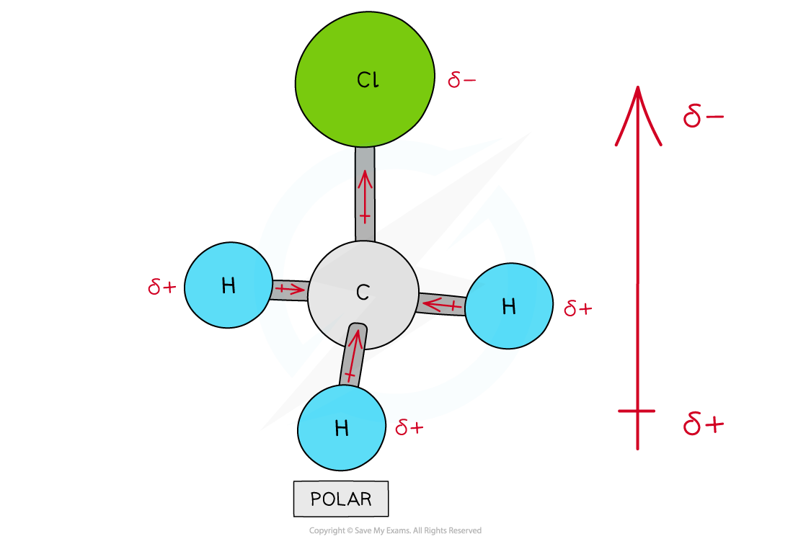
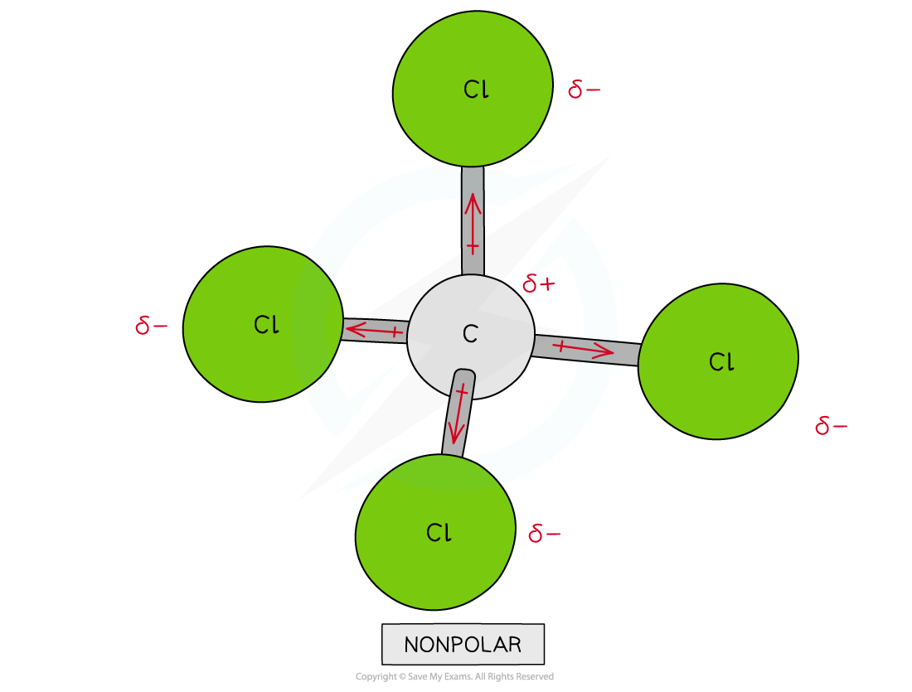

# Bond Polarity & Dipole Moments

## Bond Polarity & Dipole Moments

> **Spec point** — `spcpt_kXRXDrTrjgyqkQnj`

## Bond Polarity & Dipole Moments

- **Electronegativity **is the ability of an atom to draw a pair of electrons towards itself in a covalent bond
- Electronegativity **increases **across a Period and **decreases **going down a Group

### Polarity

- When two atoms in a covalent bond have the **same electronegativity **the covalent bond is **nonpolar**

#### Bonding electrons in a chlorine molecule

*The two chlorine atoms have similar electronegativities so the bonding electrons are shared equally between the two atoms*

- When two atoms in a covalent bond have **different electronegativities **the covalent bond is **polar **and the electrons will be drawn towards the **more electronegative **atom
- As a result of this:

  - The negative charge centre and positive charge centre do not **coincide **with each other
  - This means that the **electron distribution **is **asymmetric**
  - The **less** **electronegative** atom gets a partial charge of δ+ (**delta** **positive**)
  - The **more** **electronegative** atom gets a partial charge of δ- (**delta** **negative**)
- The greater the difference in **electronegativity** the more polar the bond becomes

#### Bonding electrons in a hydrogen chloride molecule

*Cl has a greater electronegativity than H causing the electrons to be more attracted towards the Cl atom which becomes delta negative and the H delta positive*

### Dipole moment

- The **dipole moment **is a measure of how **polar **a bond is
- The **direction** of the dipole moment is shown by the following sign in which the **arrow **points to the **partially negatively charged end **of the dipole:

#### Representing dipoles

*The sign shows the direction of the dipole moment and the arrow points to the delta negative end of the dipole*

### Assigning polarity to molecules

- To determine whether a molecule with **more than two atoms **is polar, the following things have to be taken into consideration:

  - The polarity of each bond
  - How the bonds are arranged in the molecule
- Some molecules have **polar bonds **but are overall not **polar** because the polar bonds in the molecule are arranged in such a way that the individual dipole moments **cancel each other out**

#### Polarity in chloromethane

*There are four polar covalent bonds in CH3Cl which do not cancel each other out causing CH3Cl to be a polar molecule; the overall dipole is towards the electronegative chlorine atom*

#### Polarity in tetrachloromethane

*Though CCl4 has four polar covalent bonds, the individual dipole moments cancel each other out causing CCl4 to be a nonpolar molecule*
