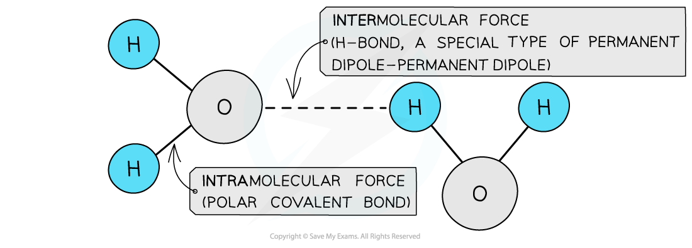
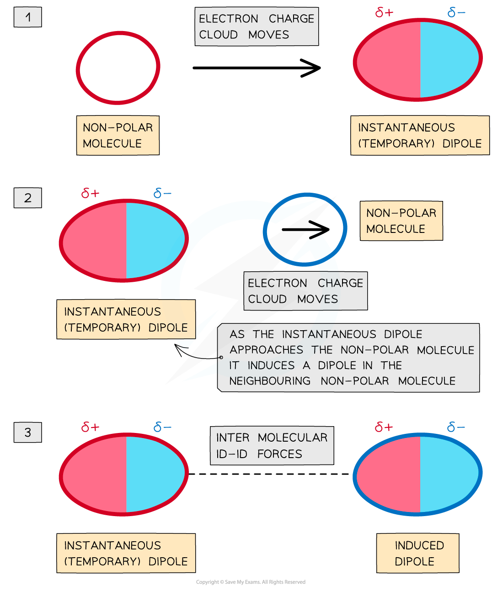
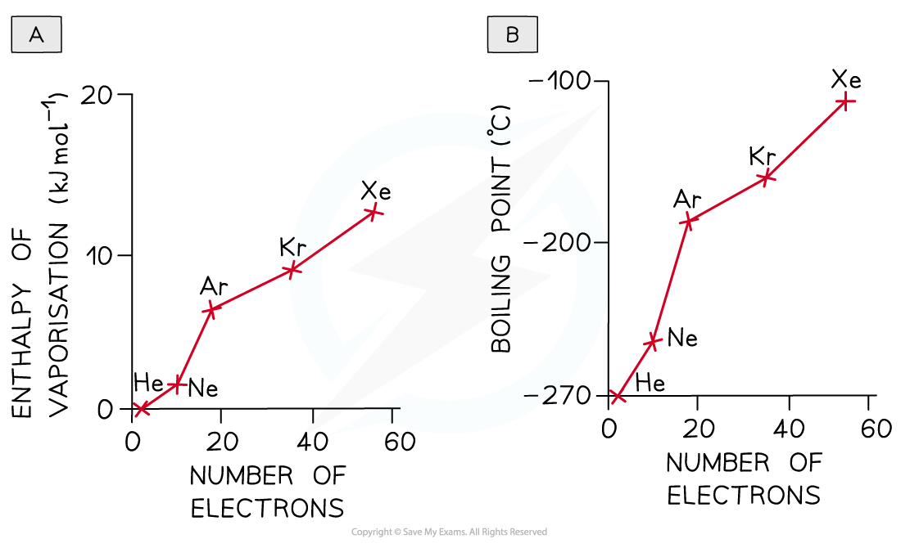
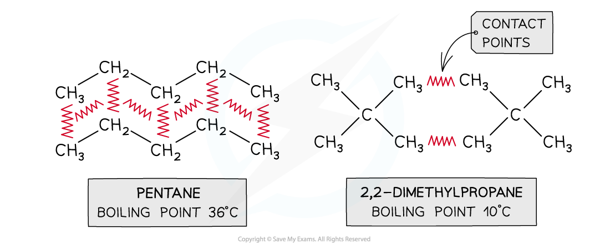
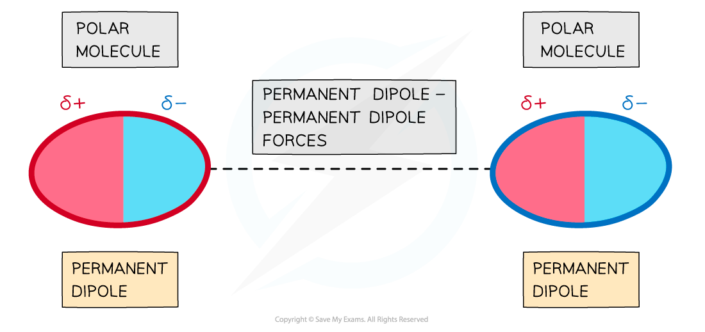
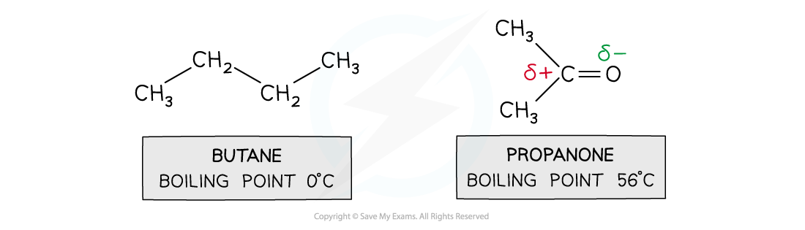
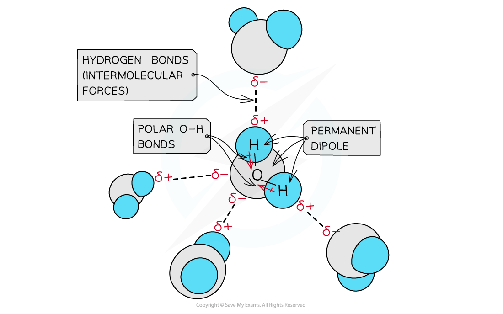

# Van der Waals' Forces

## Van der Waals' Forces & Dipoles

> **Spec point** — `spcpt_cfW8F5MnhRBc3BcZ`

## Van der Waals' Forces & Dipoles

- Covalent bonds are strong **intramolecular forces**
- Molecules also contain weaker **intermolecular forces **which are forces **between **molecules
- These intermolecular forces are called **van der Waals’ forces**
- There are two types of van der Waals’ forces:

  - **Instantaneous **(temporary) **dipole – induced dipole forces** also called **London dispersion forces**
  - **Permanent dipole – permanent dipole forces**

#### Intermolecular and intramolecular forces in water

*The polar covalent bonds between O and H atoms are intramolecular forces and the permanent dipole – permanent dipole forces between the molecules are intermolecular forces as they are a type of van der Waals’ force*

### Instantaneous dipole - induced dipole (id - id)

- **Instantaneous dipole - induced dipole forces **or **London dispersion forces **exist between all atoms or molecules
- The **electron charge cloud** in non-polar molecules or atoms are constantly moving
- During this movement, the electron charge cloud can be more on one side of the atom or molecule than the other
- This causes a **temporary dipole **to arise
- This **temporary dipole **can **induce **a dipole on neighbouring molecules
- When this happens, the **δ+ end of the dipole** in one molecule and the **δ- end of the dipole** in a neighbouring molecule are **attracted **towards each other
- Because the electron clouds are moving constantly, the dipoles are only **temporary**

#### Instantaneous dipoles

*Id-id (London dispersion) forces between two non-polar molecules*

- Id - id forces increase with:

  - Increasing number of electrons (and **atomic number**) in the molecule
  - Increasing the places where the molecules come close together

*Going down the Group, the id-id forces increase due to the increased number of electrons in the atoms*

*The increased number of contact points in pentane means that it has more id-id forces and therefore a higher boiling point*

### Permanent dipole - permanent dipole (pd - pd)

- **Polar molecules **have **permanent dipoles**
- The molecule will always have a **negatively **and **positively charged end**
- Forces between two molecules that have permanent dipoles are called **permanent dipole - permanent dipole forces**
- The **δ+ end of the dipole** in one molecule and the **δ- end of the dipole** in a neighbouring molecule are **attracted **towards each other

*The delta negative end of one polar molecule will be attracted onwards the delta positive end of a neighbouring polar molecule*

- For small molecules with **the same number of electrons, **pd - pd forces are **stronger **than id - id

  - Butane and propanone have the same number of electrons
  - Butane is a nonpolar molecule and will have id - id forces
  - Propanone is a polar molecule and will have pd - pd forces
  - Therefore, more energy is required to break the intermolecular forces between propanone molecules than between butane molecules
  - So, propanone has a higher boiling point than butane

*Pd-pd forces are stronger than id-id forces in smaller molecules with an equal number of electrons*

> **Exam Hint**
> Remember this difference: intramolecular forces are forces **within **a molecule, whereas intermolecular forces are forces **between **a molecule.

## Hydrogen Bonding as a Permanent Dipole

> **Spec point** — `spcpt_txt4gPnzhw6M2BTz`

## Hydrogen Bonding as a Permanent Dipole

- **Hydrogen bonding **is an **intermolecular force **between molecules with an -OH/-NH group and molecules with an N/O atom
- Hydrogen bonding is a special case of a **permanent dipole - dipole force **between molecules

  - Hydrogen bonds are **stronger **forces than pd - pd forces
- The hydrogen is bonded to an O/N atom which is so **electronegative**, that almost all the electron density from the covalent bond is drawn towards the O/N atom
- This leaves the H with a **large** **delta positive** and the O/N with a **large delta negative charging **resulting in the formation of a **permanent dipole **in the molecule
- A **delta positive H **in one molecule is **electrostatically attracted **to the **delta negative** **O/N** in a neighbouring molecule

#### Hydrogen bonds in water molecules

*Hydrogen bonding in water occurs between the oxygen lone pair of one water molecule and the δ+ hydrogen atoms of another water molecule*
