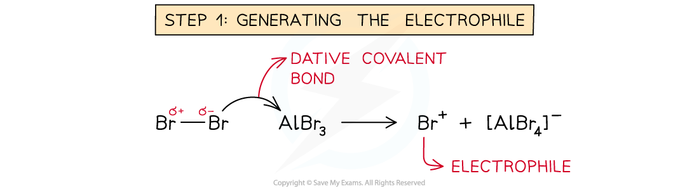

# Electrophilic Substitution of Arenes

## Electrophilic Substitution of Arenes

> **Spec point** — `spcpt_T47tXfbF7rvThY8r`

## Electrophilic Substitution of Arenes

- The **electrophilic substitution **reaction in arenes consists of **three steps**:

  1. Generation of an **electrophile**
  2. **Electrophilic attack**
  3. Regenerating **aromaticity**

### Generation of an electrophile

- The **delocalised π system** is extremely stable and is a region of **high electron density**
- Consequently, the first step of an electrophilic substitution reaction involves the generation of an electrophile

  - The electrophile can be a positive ion or the positive end of a polar molecule
- There are numerous electrophiles which can react with benzene:

#### Table of electrophiles commonly used with benzene

| **Reaction type** | **Electrophile*** |
|---|---|
| halogenation | X+, e.g. Cl+ |
| nitration | NO2+ |
| Friedel-Craft's alkylation | R+ |
| Friedel-Craft's acylation | R-C=O+ |

- Typically electrophiles cannot simply be added to the reaction mixture

  - The electrophile is produced **in situ**, by adding appropriate reagents* to the reaction mixture

### Electrophilic attack

- A pair of electrons from the benzene ring is donated to the electrophile to form a **covalent bond**
- This disrupts the aromaticity in the ring as there are now only four π electrons and there is a **positive charge** spread over the five carbon atoms

### Regenerating aromaticity

- In the **final step **of electrophilic substitution, the aromaticity of the benzene ring system is restored
- This happens by **heterolytic cleavage** of the C-H bond

  - This means that the electrons in this bond go into the benzene π bonding system

### Electrophilic substitution mechanism

- The **halogenation **and **nitration **of arenes are both examples of **electrophilic substitution reactions**

  - A hydrogen atom is replaced by a halogen atom or a nitro (-NO2) group

#### Bromination and nitration of benzene

***During bromination, a hydrogen atom is substituted by a bromine atom and during nitration, a hydrogen atom is substituted by a nitro group***

#### Step 1: Generating the Br+ and NO2+ electrophiles

- For the **halogenation** reaction:

  - This is achieved by reacting the halogen with a **halogen carrier**
  - The halogen molecules form a **dative bond** with the halogen carrier by donating a lone pair of electrons from one of its halogen atoms into an empty 3p orbital of the halogen carrier

**Step 1 of the halogenation of arenes**

***During bromination, an AlBr******3****** halogen carrier catalyst is used and during chlorination an AlCl******3****** halogen carrier catalyst is used***

- For the **nitration **reaction:

  - The electrophile **NO****2****+**** ion** is generated by reacting it with concentrated **nitric acid** (HNO3) and **concentrated sulfuric acid** (H2SO4)

**Step 1 of the nitration of arenes**

***During nitration, concentrated nitric acid and concentrated sulfuric acid react to form the NO******2******+****** electrophile  ***

#### Step 2: Electrophilic attack by the Br+ and NO2+ electrophiles

- Once the electrophile has been generated, it will carry out an **electrophilic attack **on the benzene ring

  - The nitrating mixture of HNO3 and H2SO4 is **refluxed **with the arene at 25 - 60 **o**C
- A pair of electrons from the benzene ring is donated to the electrophile to form a **covalent bond**

  - This disrupts the aromaticity in the ring as there are now only four π electrons and there is a **positive charge **spread over the five carbon atoms

**Step 2 of the halogenation of arenes**

***A pair of electrons from the benzene ring is donated to the Br******+****** electrophile to form a covalent bond causing a loss in aromaticity***

**Step 2 of the nitration of arenes**

***A pair of electrons from the benzene ring is donated to the NO******2******+****** electrophile to form a covalent bond causing a loss in aromaticity***

#### Step 3: Regenerating / restoring aromaticity

- In the **final step **of the reaction, this aromaticity is restored by **heterolytic cleavage** of the C-H bond

  - This means that the bonding pair of electrons goes into the benzene π bonding system

**Step 3 of the halogenation of arenes**

**Step 3 of the nitration of arenes**

***In both reactions, the C–H bond of the substituted carbon atom breaks and the electrons go back into the benzene π bonding system, restoring aromaticity***

### Addition reactions of arenes

- The **delocalisation of electrons **(also called **aromatic stabilisation) **in arenes is the main reason why arenes predominantly undergo **substitution **reactions over **addition **reactions
- In substitution reactions, the **aromaticity **is restored by **heterolytic cleavage **of the C-H bond
- In addition reactions, on the other hand, the aromaticity is **not restored** and is in some cases **completely lost**

  - The **hydrogenation** of arenes is an example of an addition reaction during which the aromatic stabilisation of the arene is completely lost
  - The cyclohexane formed is **energetically less stable **than the benzene
