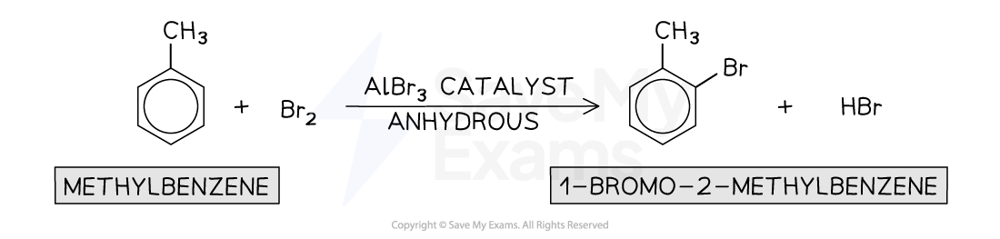
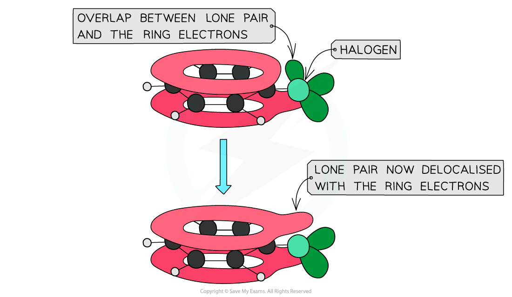
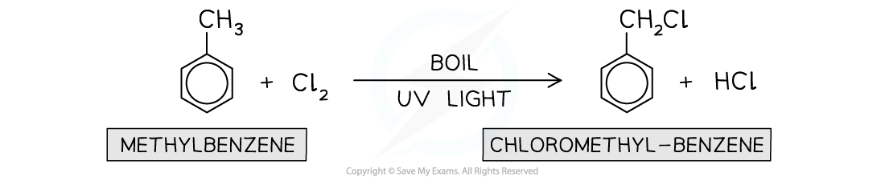
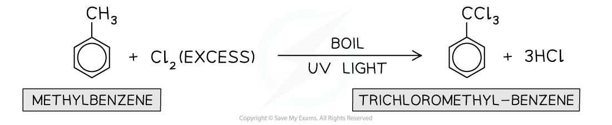

# Location of Halogenation on Arenes

## Halogenation in Arenes

> **Spec point** — `spcpt_PdCjhrpSzKtztrWh`

## Halogenation in Arenes

- Arenes will undergo s**ubstitution reactions** with halogens to form aryl halides

  - This reaction is also called a **halogenation **reaction
- Depending on the reaction conditions, halogenation can occur:

  - In the aromatic ring
  - In the side chain

### Halogenation in the aromatic ring

- Halogenation of alkylarenes **in the aromatic ring** will occur when a halogen and anhydrous halogen carrier catalyst (such as AlBr3 or AlCl3) is used

#### Halogenation of alkylarenes in the aromatic ring

***A halogen carrier catalyst is used to generate the electrophile for the halogenation of alkylarenes***** **

- Aryl halides are **less reactive **than **halogenoalkanes **as the **carbon-halogen **bond in aryl halides is **stronger**
- This is due to the partial overlap of the lone pairs on the halogen atom with the π system in the benzene ring
- The carbon-halogen bond, therefore, has a **partial double bond character**

#### The lack of reactivity in alkylarenes / aryl halides

***Aryl halides are unreactive due to the partial double bond character of the carbon-halogen bond***

### Halogenation in the side chain

- Halogenation of alkylarenes **in the side chain **will occur when the halogen is passed into **boiling alkylarene i**n the presence of** ultraviolet **(UV) **light**

  - This is a **free-radical substitution **reaction

#### Halogenation of an alkylarene side chain

***Halogenation of alkylarenes in the side chain is an example of a free-radical substitution reaction***

- If **excess** halogen is used, all hydrogen atoms on the alkyl side-chain will be substituted by the halogen atoms

#### Halogenation of an alkylarene side chain using excess halogen

***In excess halogen, all hydrogen atoms on the alkyl side-chain will be replaced***

- **Note** that no substitution into the benzene ring occurs under these conditions
