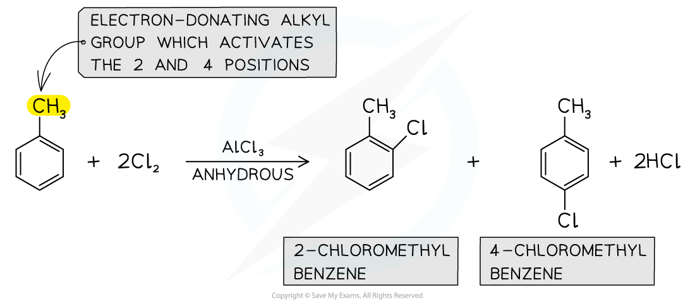
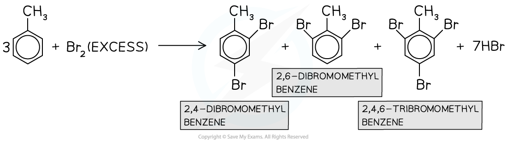
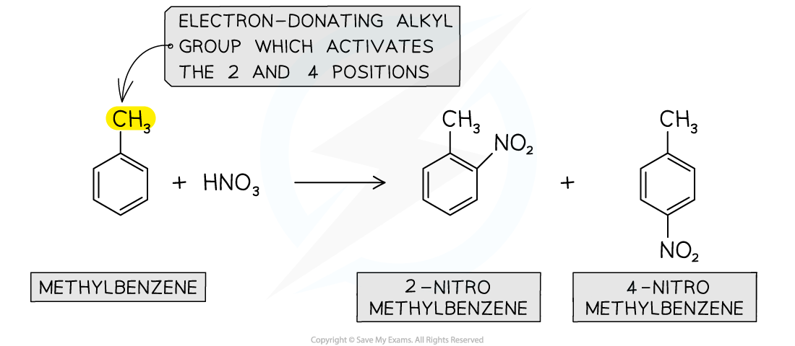
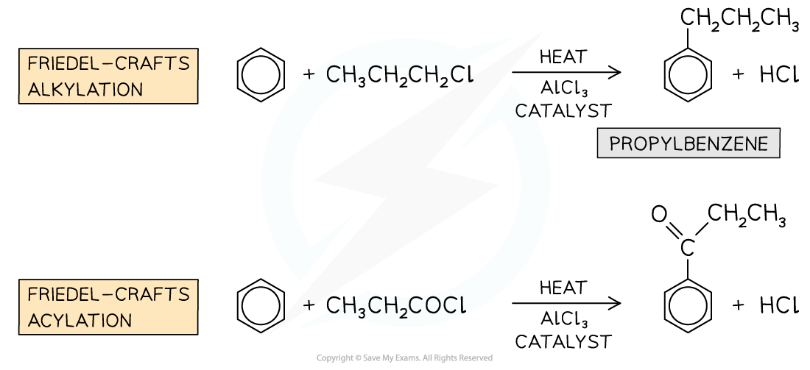
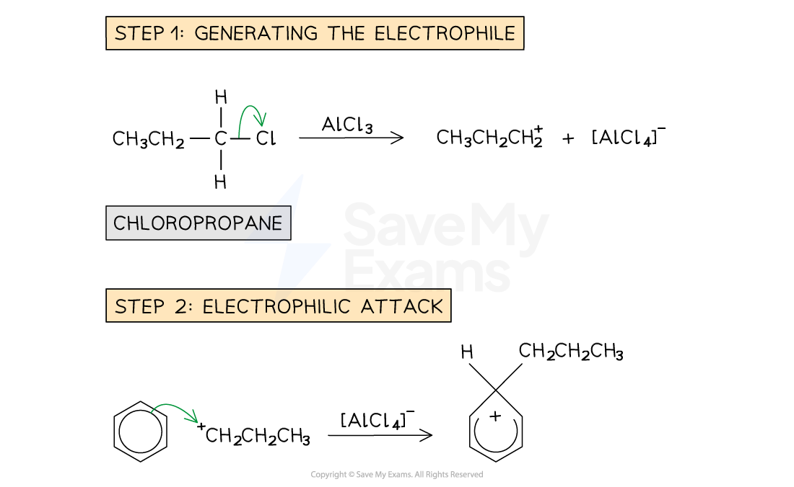
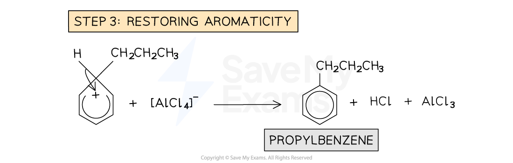
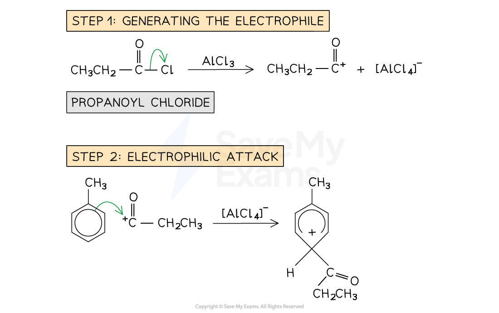
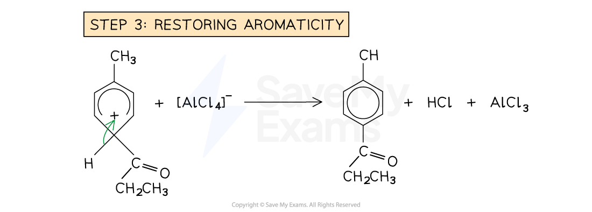

# Reactions of Arenes

## Reactions of Arenes

> **Spec point** — `spcpt_wp48D3jJvQ3Kdv9z`

## Reactions of Arenes

- Arenes are very stable compounds due to the **delocalisation of π electrons** in the ring

  - This is because the negative charge is spread out over the molecule instead of being confined to a small area
- During chemical reactions such as **substitution reactions**, this delocalised ring is maintained

  - **Addition reactions** however, **disrupt **the **aromatic stabilisation**
- Benzene undergoes a wide range of reactions including combustion - (complete and incomplete) and the following reactions:

  - Halogenation
  - Nitration
  - Friedel-Craft's alkylation
  - Friedel-Craft's acylation
  - Complete Oxidation
  - Hydrogenation

### Halogenation

- **Halogenation **reactions are examples of **electrophilic substitution** reactions
- Arenes undergo **substitution **reactions with chlorine (Cl2) and bromine (Br2) in the presence of anhydrous AlCl3 or AlBr3 **catalyst **respectively to form **halogenoarenes **(**aryl halides**)

  - The chlorine or bromine acts as an **electrophile** and replaces a hydrogen atom on the benzene ring
  - The catalyst is required for the reaction to take place, due to the stability of the benzene structure

#### Halogenation of benzene

***Arenes undergo substitution reactions with halogens to form aryl halides***

- **Alkylarenes **such as methylbenzene undergo halogenation on the 2 or 4 positions
- This is due to the **electron-donating **alkyl groups which activate these positions

  - Phenol (C6H5OH) and phenylamine (C6H5NH2) are also activated in the 2 and 4 positions
- The halogenation of alkylarenes, therefore, results in the formation of **two products**

#### Halogenation of alkylarenes

***Alkylarenes are substituted on the 2 or 4 position***

- **Multiple substitutions **occur when **excess **halogen is used

#### Halogenation of alkylarenes using an excess of halogen

***In the presence of excess halogen, multiple substitutions occur***

### Nitration

- Another example of a substitution reaction is the **nitration **of arenes
- In these reactions, a nitro (-NO2) group replaces a hydrogen atom on the arene
- The benzene is reacted with a mixture of concentrated nitric acid (HNO3) and concentrated sulfuric acid (H2SO4) at a temperature between 25 and 60 oC

#### Nitration of benzene

***During nitration, a hydrogen atom is replaced by an NO******2****** group***

- Again, due to the **electron-donating** alkyl groups in alkylarenes, nitration of methylbenzene will occur on the 2 and 4 position

#### Nitration of alkylarenes

***Alkylarenes are nitrated on the 2 or 4 position***

### Friedel-Crafts reactions

- Friedel-Crafts reactions are also **electrophilic substitution **reactions
- Due to the aromatic stabilisation in arenes, they are often **unreactive**
- To use arenes as **starting materials **for the synthesis of other organic compounds, their structure, therefore, needs to be changed to turn them into more reactive compounds
- Friedel-Crafts reactions can be used to substitute a hydrogen atom in the benzene ring for an **alkyl group **(Friedel-Crafts alkylation) or an **acyl group **(Friedel-Crafts acylation)
- Like any other electrophilic substitution reaction, the Friedel-Crafts reactions consist of three steps:

  1. Generating the electrophile
  2. Electrophilic attack on the benzene ring
  3. Regenerating aromaticity of the benzene ring

#### Examples of Friedel-Crafts alkylation and acylation reactions

***During alkylation, an alkyl / R group is substituted on the benzene ring and during acylation, an acyl / RCO group is substituted on the benzene ring***

### Friedel-Crafts alkylation

- In this type of Friedel-Crafts reaction, an **alkyl chain **is substituted into the benzene ring
- The benzene ring is reacted with a chloroalkane in the presence of an AlCl3 catalyst
- An example of an alkylation reaction is the reaction of benzene with chloropropane (CH3CH2CH2Cl) to form propylbenzene

#### Example of a Friedel-Crafts alkylation reaction

***Alkylation reactions of benzene follow the 3 steps of electrophile generation, electrophilic attack and regeneration of aromaticity***

### Friedel-Crafts acylation

- In the Friedel-Crafts acylation reaction, an **acyl group **is substituted into the benzene ring

  - An acyl group is an alkyl group containing a carbonyl, C=O group
- The benzene ring is reacted with an acyl chloride in the presence of an AlCl3 catalyst
- An example of an acylation reaction is the reaction of methylbenzene with propanoyl chloride to form an acyl benzene

  - Note that the acyl group substitutes on the 4 position due to the -CH3 group on the benzene

#### Example of a Friedel-Crafts acylation reaction

***Acylation reactions of benzene follow the same 3 steps of electrophile generation, electrophilic attack and regeneration of aromaticity***

### Complete oxidation

- Normally, alkanes are not **oxidised **by **oxidising agents** such as potassium manganate(VII) (KMnO4)
- However, the presence of the benzene ring in **alkyl arenes **affects the properties of the alkyl side-chain
- The alkyl side-chains in alkyl arenes are **oxidised **to **carboxylic acids **when **refluxed **with **alkaline potassium manganate(VII)** and then **acidified **with **dilute sulfuric acid **(H2SO4)

  - For example, the complete oxidation of **ethylbenzene **forms **benzoic acid**

#### Oxidation of alkylarenes

***The complete oxidation of alkyl side chains in arenes gives a carboxylic acid***

### Hydrogenation

- The hydrogenation of benzene is an **addition reaction**
- Benzene is **heated **with **hydrogen gas **and a **nickel **or **platinum catalyst** to form **cyclohexane**

#### Hydrogenation of benzene

***Hydrogenation of benzene results in a loss of aromaticity***

- The same reaction occurs when **ethylbenzene **undergoes hydrogenation to form **cycloethylbenzene**

#### Hydrogenation of methylbenzene

***Hydrogenation of alkylarenes also results in a loss of aromaticity***

#### Summary of Reactions of Arenes Table

| **Reaction** | **Conditions** | **Products** |
|---|---|---|
| **Halogenation** | Cl2 with an AlCl3 catalyst Br2 with an AlBr3 catalyst | Aryl halide |
| **Nitration** | A mixture of concentrated H2SO4 and concentrated HNO3  Temperature between 25 oC and 60 oC | Nitroarene |
| **Friedel-Crafts alkylation** | Halogenoalkane and anhydrous AlCl3 catalyst | Alkylbenzene |
| **Freidel-Crafts acylation** | Acyl chloride and anhydrous AlCl3 catalyst | Acylbenzene |
| **Complete oxidation** | Hot, alkaline KMnO4 and then dilute acid | Benzoic acid |
| **Hydrogenation** | Heating with hydrogen and Pt / Ni catalyst | Cyclohexane |
