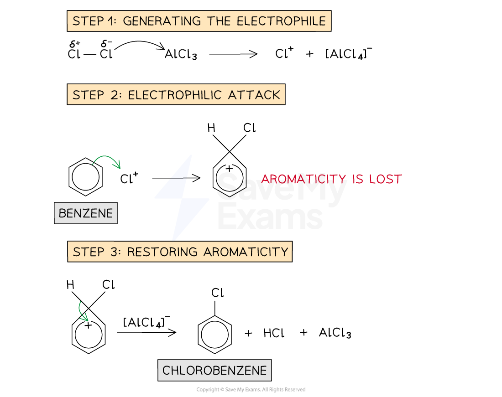
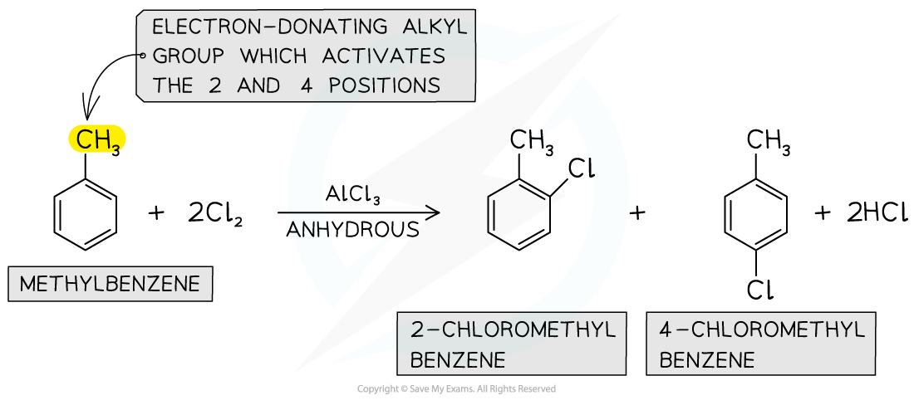

# Producing Halogenoarenes

## Production of Halogenoarenes

> **Spec point** — `spcpt_FRWWV78WKDwVvHRD`

## Production of Halogenoarenes

- **Halogenoarenes **are arenes which are bonded to **halogen **atoms
- They can be prepared from **substitution reactions** of arenes with chlorine or bromine in the presence of an anhydrous catalyst

### Substitution of benzene to form halogenoarenes

- Chlorine gas is bubbled into benzene at room temperature and in the presence of an anhydrous AlCl3 catalyst to form **chlorobenzene**
- The AlCl3 catalyst is also called a **halogen carrier **and is required to generate the **electrophile **(Cl+)
- This electrophile **attacks **the electron-rich benzene ring in the **first stage **of the reaction which **disrupts **the delocalised π system in the ring
- To restore the **aromatic stabilization, **a hydrogen atom is removed in the **second stage** of the electrophilic substitution reaction to form chlorobenzene
- When this happens, the delocalised π system of the ring is **restored**
- The same reaction occurs with benzene and bromine in the presence of an AlBr3 catalyst to form **bromobenzene**

#### Formation of chlorobenzene

***Halogenoarenes can be formed from the electrophilic substitution reaction of arenes with halogens***

### Substitution of methylbenzene to form halogenoarenes

- The **electrophilic substitution **of **methylbenzene **with halogens results in the formation of multiple halogenoarenes as products
- This is because the methyl group (which is an **alkyl **group) in methylbenzene is **electron-donating** and pushes **electron density **into the benzene ring
- This makes the benzene ring **more** **reactive **towards electrophilic substitution reactions
- The methyl group is said to be 2,4-directing and as a result, the **2 **and **4** **positions **are **activated**
- Electrophilic substitution of methylbenzene with chlorine and anhydrous AlCl3 catalyst, therefore, gives **2-chloromethylbenzene **and **4-chloromethylbenzene**
- The reaction mechanism is **the same **as the substitution mechanism of benzene

#### Chlorination of methylbenzene

***The methyl group on methylbenzene directs the incoming halogen on the 2 and 4 position***

***  ***

- In the presence of **excess **chlorine, substitution on the **6 position **will also occur
