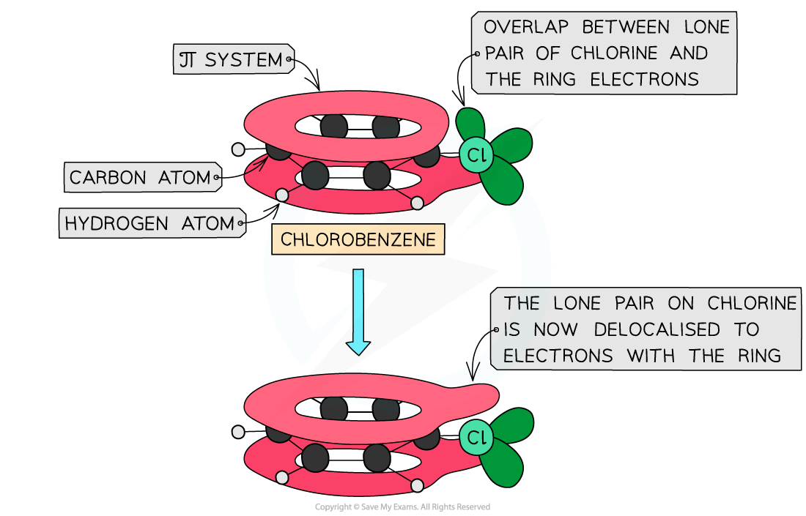

# Reactivity of Halogenoarenes

## Difference in Reactivity of Halogenoalkanes & Halogenoarenes

> **Spec point** — `spcpt_8XsxkP29yk9mkKxS`

## Difference in Reactivity of Halogenoalkanes & Halogenoarenes

- **Halogenoarenes **are very **unreactive **compared to **halogenoalkanes**
- The difference in reactivity between the two compounds is because of the carbon-halogen bond strengths

### Halogenoalkanes

- The halogenoalkane **chloroethane **can take part in **nucleophilic substitution** reactions
- A **nucleophile**, such as a hydroxide (OH-) ion, will attack the **slightly positive carbon** atom
- A covalent bond is formed between that carbon atom and the nucleophile which causes the carbon-halogen bond to break
- Overall, the halogen is replaced by the nucleophile

#### Nucleophilic substitution of halogenoalkanes

***Halogenoalkanes readily undergo nucleophilic substitution reactions due to the difference in electronegativity between the carbon and halogen***

### Halogenoarenes

- Halogenoarenes, such as chlorobenzene, **do not **readily undergo **nucleophilic substitution** reactions

  - Only under extremely **harsh** conditions, such as temperatures of 200 oC and a pressure of 200 atmospheres, will the chlorine in chlorobenzene get replaced by a nucleophile such as a hydroxide (OH-) ion
- This is because the carbon-chlorine bond is **very strong **and cannot be easily broken

  - One of the lone pairs of electrons on the chlorine will **interact **with the π system of the ring
  - This causes the carbon-chlorine bond to have a **partial double-bond character, **which **strengthens **the bond

#### How the carbon-chlorine bond affects the π system

***The carbon-chlorine bond is very strong, as it has partial double-bond character***

- Therefore, the **unreactivity **of halogenoarenes can be explained by the **delocalisation** of a lone pair on the halogen over the benzene
- This causes additional **stabilisation **of the system and **strengthens **the carbon-halogen bond, which affects the reactions that halogenoarenes will undergo
- It gets **harder **to break the carbon-halogen bond in halogenoarenes, which decreases reactivity
