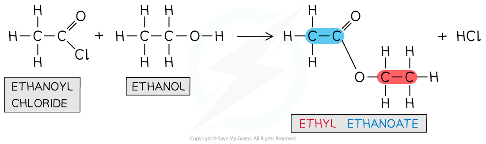
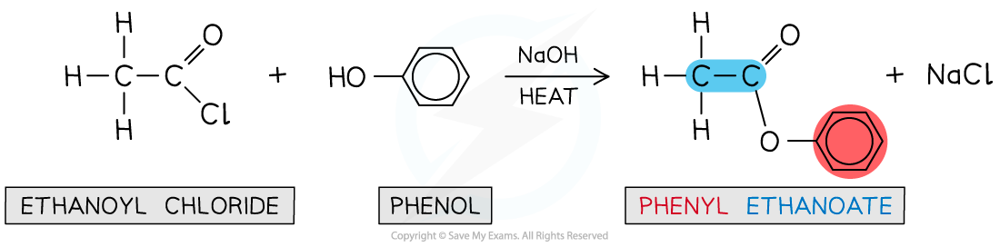

# Alcohols & Acyl Chlorides

## Reaction of Alcohols With Acyl Chlorides

> **Spec point** — `spcpt_Mwdm52Dj75yJ22tw`

## Reaction of Alcohols With Acyl Chlorides

- **Acyl chlorides **are **reactive** organic compounds with a **-COCl **functional group
- The carbonyl carbon is **electron-deficient **and has a **partial positive charge**
- It is therefore susceptible to **nucleophilic attack**
- The carbon-chlorine bond breaks and **white fumes** of **hydrogen chloride**, HCl, are formed

### Reaction with alcohols and phenols

- Acyl chlorides react with alcohols and phenols to form esters via an **addition–elimination** mechanism
- The -OH group acts as a **nucleophile **and attacks the carbonyl carbon to **substitute **the chlorine atom
- Forming esters from acyl chlorides rather than carboxylic acids is **more effective **because:

  - Acyl chlorides are more **reactive** (so they produce the ester faster)
  - Acyl chloride reactions go to **completion** (so more of the ester is produced)

### Reaction with alcohols

- The reaction of acyl chlorides with alcohols is **vigorous **and white fumes of HCl gas are formed

#### Esterification of an aliphatic alcohol using an acyl chloride

***Acyl chlorides react vigorously with alcohols to form esters***

### Reaction with phenols

- For the reaction of acyl chlorides with phenols to occur, **heat **and a **base** are required

  - The base is needed to deprotonate the phenol and form a **phenoxide ion**
  - The phenoxide ion is a better nucleophile than the original phenol molecule and will be able to attack the carbonyl carbon

#### Esterification of phenol using an acyl chloride

***Acyl chlorides react with phenols when heated and in the presence of a base to form esters***

***A base is needed to form a phenoxide ion which is a better nucleophile than phenol; now, nucleophilic attack on the carbonyl carbon can more readily occur***
