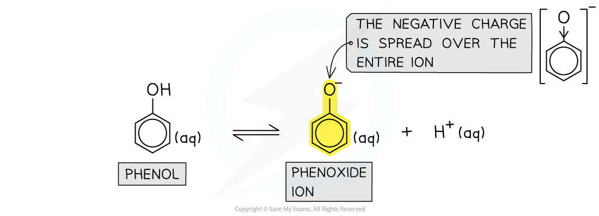
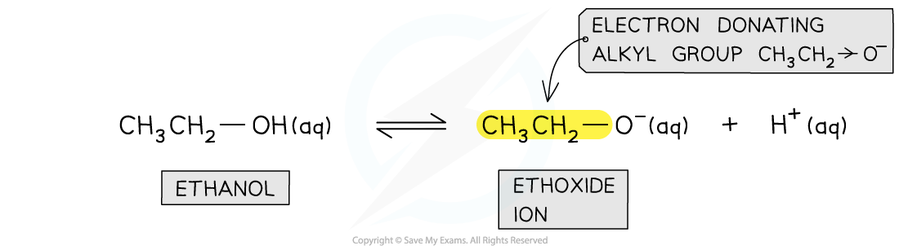
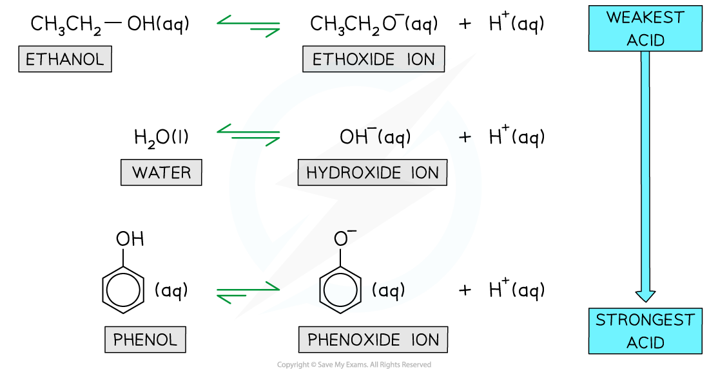

# Acidity of Phenols

## Acidity of Phenols

> **Spec point** — `spcpt_BsxZ3K63vTYS5gtF`

## Acidity of Phenols

- Although phenol compounds contain an **alcohol **(-OH) group, they are **weakly acidic**
- This is due to the **delocalisation** of one of the lone pairs from the oxygen atom into the aromatic ring
- This increases the electron density of the ring and increases the acidic behaviour

### Delocalisation of charge density

- The **conjugate base **of phenol is the **phenoxide ion**
- In the phenoxide ion, the **negative charge **on the oxygen is spread out over the entire ion
- This is possible as **one of the lone pairs **on the oxygen atom **overlaps **with the delocalised π system of the ring
- Because of this delocalisation, there is less **charge density **on the oxygen atom
- The H+ ions are therefore not strongly **attracted **to the phenoxide ion and are less likely to **reform **the **phenol **molecule
- This means that phenol is more likely to **lose **a proton (and act as an **acid**) rather than to **gain **a proton (and act as a **base** )

#### The equilibrium between phenol and the phenoxide ion

***The negative charge is spread over the ion, causing the electrons to become less available for bonding with an incoming proton***

### Stability of the conjugate base

- Phenol **ionises **to form a **more stable **negative **phenoxide **ion with its negative charge **spread out**
- This means that phenol is **more likely **to undergo **ionisation**
- The equilibrium position, therefore, lies further to the **right **and a higher proportion of phenol molecules **donate **a **proton **compared to for example water and ethanol
- The phenol compound is, therefore, more likely to act as an **acid **rather than a base

- Therefore, the position of equilibrium lies:

  - Further to the **right-hand side** favouring the **dissociated phenoxide ions**
  - Further to the **left-hand side **favouring the **undissociated ethoxide and hydroxide ions**

#### The equilibrium position of phenol and the phenoxide ion

***Since the phenoxide ion formed from the ionisation of phenol is more stable than phenol itself, the equilibrium position lies further to the right-hand-side and phenol is more likely to act as an acid rather than a base***

## Relative Acidities of Water, Phenol & Ethanol

> **Spec point** — `spcpt_hrJk3TjQMjXQsZsM`

## Relative Acidities of Water, Phenol & Ethanol

- The p*K**a* is a measure of the acidity of a substance
- The values of water, phenol, and ethanol show that phenol is a **stronger **acid than ethanol and water

#### Relative acidity of ethanol, water & phenol table

| **Acid** | **Dissociation** | **p*****K*****a**** at 25 ****o****C** |
|---|---|---|
| **Ethanol** | C2H5OH (aq) $\rightleftharpoons$ C2H5O– (aq) + H+ (aq) | 16 |
| **Water** | H2O (l) $\rightleftharpoons$ OH– (aq) + H+ (aq) | 14 |
| **Phenol** | C6H5OH (aq) $\rightleftharpoons$ C6H5O– (aq) + H+ (aq) | 10 |

- The order of acidity can be explained by looking at their **conjugate** **bases** which are formed from the dissociation of the compounds

### Delocalisation of charge density

- In the **phenoxide ion** (which is the conjugate base of phenol) the charge density on the oxygen atom is **spread out **over the entire ion
- As a result, the electrons on the oxygen atom are **less available **for bond formation with a proton (H+ ion)
- The **conjugate base **of ethanol is the **ethoxide ion**
- The **ethyl **group in the ion is an **electron-donating **group that donates electron density to the oxygen atom
- As a result, the electron density on the oxygen atom is **more readily available **for bond formation with a H+ ion

#### The equilibrium between ethanol and the ethanoate ion

***The electron-donating alkyl group in the ethoxide ion concentrates charge density on the oxygen atom which can more easily bond an H******+****** ion***

- The **conjugate base **of water is the **hydroxide ion**
- Since the charge density of the oxygen atom cannot become delocalised over a ring, the hydroxide ion more readily accepts an H+ ion compared to the phenoxide ion

  - Water is, therefore, a **stronger base **compared to phenol
- However, as there are no **electron-donating **alkyl groups, less negative charge is concentrated on the oxygen atom which therefore less readily accepts an H+ ion compared to the ethoxide ion

  - Water is, therefore, a **weaker base **compared to ethanol

#### The equilibrium between water and the hydroxide ion

***The hydroxide ion lacks an aromatic ring and electron-donating alkyl groups so water is a stronger base than phenol but a weaker base than ethanol***

- Therefore, the position of equilibrium lies:

  - Further to the **right-hand side** favouring the **dissociated phenoxide ions**
  - Further to the **left-hand side **favouring the **undissociated ethoxide and hydroxide ions**

#### Relative equilibrium positions for the dissociation of ethanol, water and phenol

***The relative equilibria for the dissociation of ethanol, water and phenol mean that ethanol is the weakest acid, while phenol is the strongest acid ***
