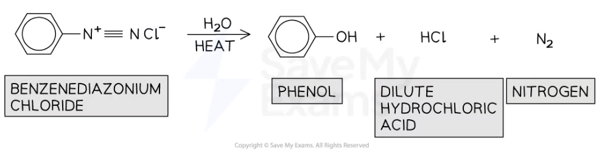

# Producing Phenol

## Production of Phenol

> **Spec point** — `spcpt_5yyk3bwv9tDG8JBq`

## Production of Phenol

- **Phenols **are organic compounds characterised by the presence of an -OH group which is attached to a benzene ring
- Phenols can be produced by the reaction of **phenylamine **with **nitrous acid **(HNO2)

### Production of phenol

- Phenols can be prepared from phenylamines under the following reaction conditions:

  - NaNO2 with dilute acid (to form HNO2)
  - Ice to keep the temperature below 10 oC (step 1)
  - Heat (step 3)
- This reaction involves three steps:

  - **Step 1** - The HNO2 is so unstable that it needs to be prepared in a test-tube by reacting sodium nitrite (NaNO2) and dilute hydrochloric acid (HCl) while keeping the temperature below 10 oC using **ice**

#### Forming nitrous acid, HNO2

***Nitrous acid can be prepared in a test-tube by reacting sodium nitrate with dilute hydrochloric acid***

- **Step 2 - **Phenyl amine is then reacted with the HNO2 to form an **unstable diazonium salt**

#### Forming benzenediazonium chloride

***Benzenediazonium chloride is an unstable diazonium salt***

- **Step 3 - **The diazonium salt is so unstable that it will **thermally decompose **when** heated **to form a **phenol**

#### Forming phenol

***Phenol is formed by the thermal decomposition of the unstable diazonium salt, benzenediazonium chloride***
