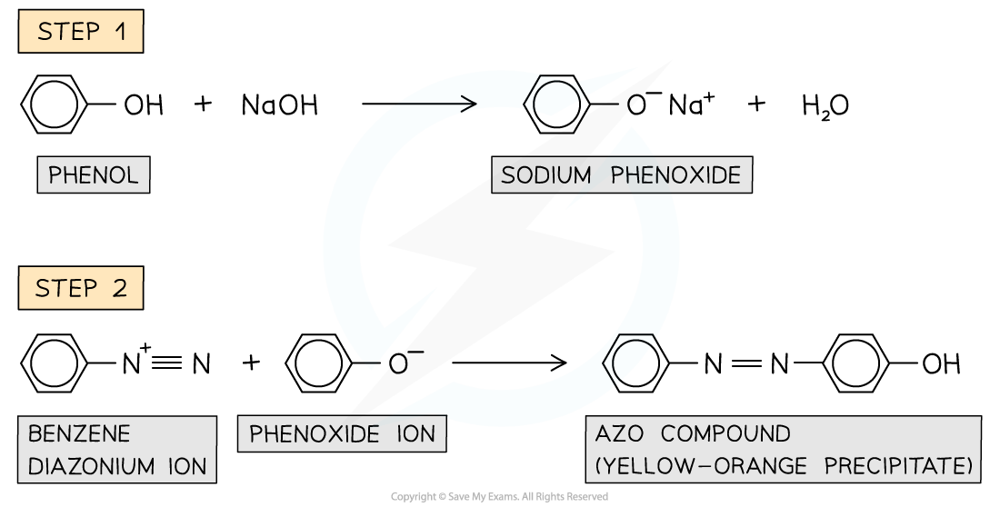

# Reactions of Phenol

## Reactions of Phenol

> **Spec point** — `spcpt_fDXjHS6ydfpRRmQ8`

## Reactions of Phenol

- Phenols can undergo many types of reactions as both the **electron-rich benzene ring **and the **polar -OH **group can participate in chemical reactions
- Some of the reactions of phenols include:

  - With bases
  - With reactive metals
  - With diazonium salts
  - Nitration
  - Bromination

### Reactions of the -OH group in phenols

- The -OH group in phenols has a **slightly acidic character**
- It can therefore act as an **acid** and take part in **acid-base reactions**

### Reaction with bases

- Phenols are **only slightly soluble **in water due to the large non-polar benzene ring
- However, they do dissolve in alkaline solutions and undergo **acid-base **reactions with **bases** to form a **soluble salt **and **water**

#### Phenol in acid-base reactions

***Phenols are weak acids and undergo acid-base reactions in alkaline solutions***

### Reaction with reactive metals

- **Molten phenols **react **vigorously **with reactive metals such as **sodium **(Na)
- This is also an **acid-base **reaction
- Now, a soluble salt is formed and **hydrogen gas **is given off

#### Phenol with metals reaction

***Molten phenols react vigorously with reactive metals to form a soluble salt and hydrogen gas***

### Reaction with diazonium ions

- **Diazonium ions **are very reactive compounds containing an -N2+ group
- When phenols are **dissolved **in sodium hydroxide (NaOH), a solution of **sodium phenoxide **is obtained
- This solution is cooled in **ice **and **cold diazonium ion **is added to the sodium phenoxide
- After the reaction has occurred, a **yellow-orange **solution or precipitate of an **azo compound **is formed
- These are compounds in which **two benzene **rings are linked by a **nitrogen bridge**

#### Phenol in diazonium ion reactions

***Azo compounds are formed from the reaction of phenols with diazonium ions***

### Reactions of the aromatic ring in phenols

- Phenols react more **readily **with **electrophiles** compared to benzene
- This is because one of the lone pairs of electrons on the oxygen atom in -OH overlaps with the π bonding system
- This increases the **electron density **of the benzene ring making it more **susceptible **to **electrophilic attack**
- The -OH group in phenols is **activating **and **directs **incoming electrophiles to the **2, 4, and 6 positions**

### Nitration

- Phenols can undergo **electrophilic substitution** reactions when reacted with **dilute nitric acid **(HNO3) at **room temperature **to give a mixture of **2-nitrophenol **and **4-nitrophenol**

  - When **concentrated HNO****3**** **is used, the product will be 2,4,6-trinitrophenol instead
- A hydrogen atom in the benzene ring is **substituted **by a nitro (-NO2) group
- This is also known as the **nitration **of phenol

#### Phenol in nitration reactions

***Phenols undergo nitration when reacted with dilute HNO******3****** at room temperature***

### Bromination

- Phenols also undergo **electrophilic substitution **reactions when reacted with **bromine water **at **room temperature**
- Phenol **decolourises **the **orange **bromine solution to form a **white precipitate **of 2,4,6-tribromophenol
- This is also known as the **bromination **of phenol

#### Phenol in bromination reactions

***Phenols undergo bromination when reacted with bromine water at room temperature***
