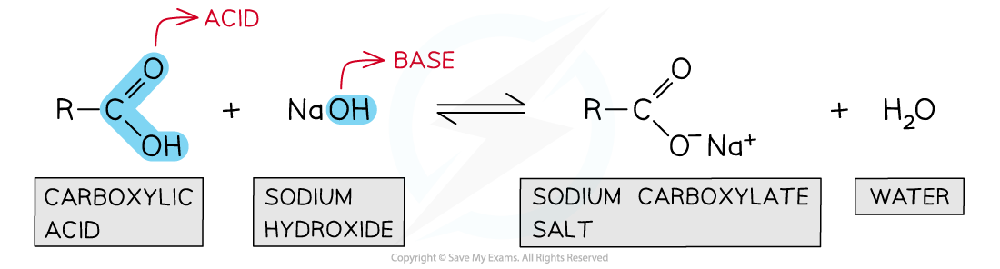
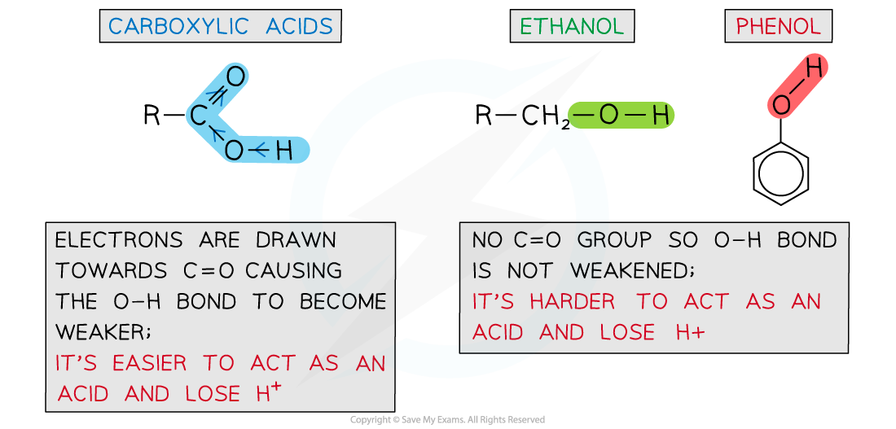
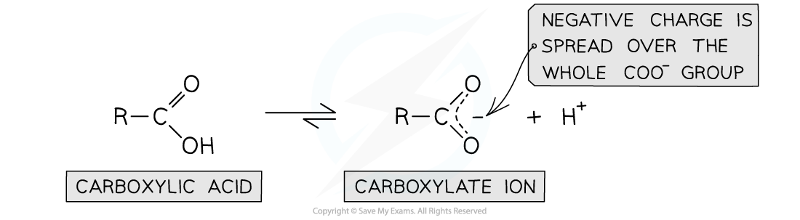
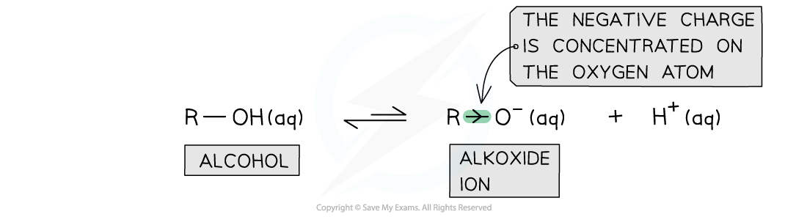
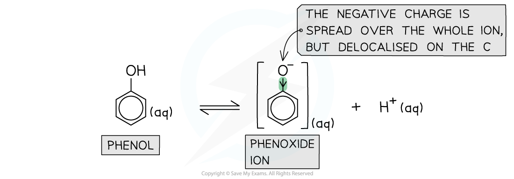

# Relative Acidities of Carboxylic Acids, Phenols & Alcohols

## Relative Acidities of Carboxylic Acids, Phenols & Alcohols

> **Spec point** — `spcpt_5PdXcRhBrPyPBYDs`

## Relative Acidities of Carboxylic Acids, Phenols & Alcohols

- **Carboxylic acids **are compounds with a -COOH functional group
- They can act as **acids** and lose a proton (H+ ion) in an aqueous solution to form **carboxylate salts **and **water**

#### Carboxylic acids forming carboxylate salts

***Carboxylic acids dissociate in aqueous solutions to form carboxylate salts and water***

- However, carboxylic acids are only **weak acids **as the **position of equilibrium **lies well over to the **left-hand side**
- The p*K**a* values of carboxylic acids, phenols, and alcohols suggest that carboxylic acids are **stronger acids **than alcohols and phenols

  - The p*K**a* is a measure of the relative strength of a species as an acid
  - The smaller the p*K**a* value, the stronger the acid

#### Relative acidity of ethanol, phenol & carboxylic acids table

| **Acid** | **Dissociation** | **p*****K*****a**** at 25 ****o****C** |
|---|---|---|
| **Ethanol** | C2H5OH (aq) $\rightleftharpoons$ C2H5O– (aq) + H+ (aq) | 16 |
| **Phenol** | C6H5OH (aq) $\rightleftharpoons$ C6H5O– (aq) + H+ (aq) | 10 |
| **Ethanoic acid** | CH3COOH (aq) $\rightleftharpoons$ CH3COO– (aq) + H+ (aq) | 4.8 |
| **Benzoic acid** | C6H5COOH (aq) $\rightleftharpoons$ C6H5COO– (aq) + H+ (aq) | 4.2 |

- This order of relative acidities can be explained by looking at the **strength **of the O-H bond and the stability of the **conjugate bases** of the acids

### Strength of O-H bond

- In carboxylic acids, the electrons in the O-H bond are drawn towards the C-O bond
- The electrons in the C-O bond are drawn towards the C=O bond
- Overall, the O-H bond is **weakened **due to the **carbonyl **(C=O) group removing electron density from it and drawing it towards itself
- Carboxylic acids can therefore more easily **lose **a proton compared to phenols and alcohols which **lack **this electron-withdrawing carbonyl group

#### Comparing OH bond strength of carboxylic acids, ethanol and phenol

***The carbonyl group in carboxylic acids draws the electrons away from the O-H bond causing it to become weaker compared to the O-H bond in phenols and alcohols***

### Stability of carboxylate ions

- The **conjugate base **of carboxylic acids is the **carboxylate ion**
- The **charge density **on the oxygen atom is **spread out **over the carboxylate ion
- This is because the charge is **delocalised** on an **electronegative carbonyl oxygen atom**
- As a result, the electrons on the oxygen atom are **less available **for bond formation with an H+ ion to reform the **undissociated **acid molecule with -COOH group
- The position of the dissociation equilibrium lies more to the right compared to alcohols and phenols

#### The equilibrium position of a carboxylic acid and its carboxylate ion

***The carboxylate ion is stable due to the delocalisation of the charge density on the electronegative oxygen***

### Stability of alkoxide ions

- The **conjugate base **of alcohols is the **alkoxide ion**
- The **alkyl **group in the ion is an **electron-donating **group that donates electron density to the oxygen atom
- As a result, the electron density on the oxygen atom is **more readily available **for bond formation with an H+ ion
- Alkoxide ions also **lack** the ability to delocalise the charge density on the entire ion
- The conjugate bases of alcohols are therefore less stable than the alcohols themselves and are more likely to reform the alcohol
- This means that alcohols are **weaker acids **compared to carboxylic acids and phenols
- The position of the dissociation equilibrium lies more to the left

#### The equilibrium position of an alcohol and its alkoxide ion

***The electron-donating alkyl groups in alkoxide ions increase the electron density on the oxygen atom which is, therefore, more likely to bond with a H******+****** ion and reform the alcohol***

### Stability of phenoxide ions

- In the **phenoxide ion** (which is the conjugate base of phenol) the charge density on the oxygen atom is **spread out **over the entire ion

  - This delocalisation of electrons **stabilises **the phenoxide ion
- As a result, the electrons on the oxygen atom are **less available **for bond formation with a proton (H+ ion)
- The **conjugate base **of phenols is therefore **more stable **than phenol
- However, since the delocalisation of charge density is on carbon atoms and not on electronegative oxygen atoms like in the carboxylate ion, phenoxide ions are **less stable **than carboxylate ions
- Therefore, phenols are **weaker acids **relative to carboxylic acids
- The position of the dissociation equilibrium lies more to the right compared to alcohols and more to the left compared to carboxylic acids

#### The equilibrium position of phenol and the phenoxide ion

***The charge density is delocalised on the entire benzene ring in the phenoxide ions***
