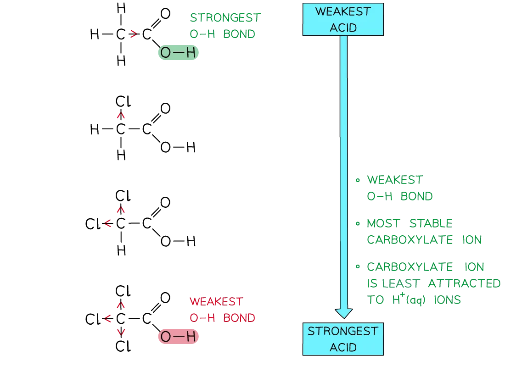
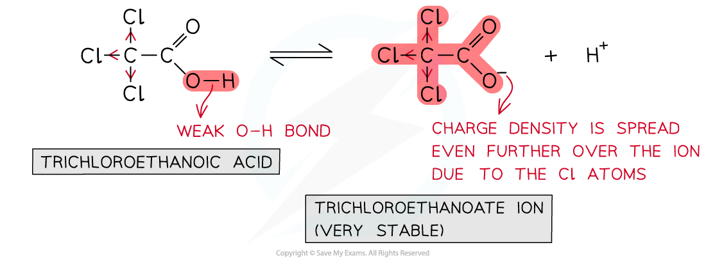
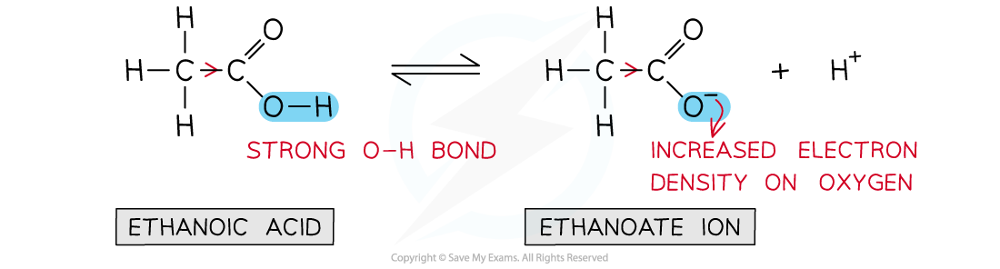

# Relative Acidities of Chlorine-substituted Carboxylic Acids

## Relative Acidities of Chlorine-substituted Carboxylic Acids

> **Spec point** — `spcpt_xwkbCcqCWkWyNYtc`

## Relative Acidities of Chlorine-Substituted Carboxylic Acids

- **Electron-withdrawing **groups bonded to the carbon attached to the -COOH group make the carboxylic acids **stronger acids**
- This is because the O-H bond in the **undissociated acid molecule **is even further weakened as the electron-withdrawing group draws even more electron density away from this bond
- Furthermore, the electron-withdrawing groups extend the **delocalisation **of the negative charge on the -COO- group of the carboxylate ion
- The -COO- group is now even more stabilised and is less likely to bond with an H+ ion
- **Chlorine-substituted carboxylic acids **are examples of carboxylic acids with electron-withdrawing groups

#### pKa values of ethanoic acid and chlorine-substituted derivatives table

| **Acid** | **p*****K*****a**** at 25 ****o****C** |
|---|---|
| Ethanoic acid, CH3COOH | 4.8 |
| Chloroethanoic acid, CH2ClCOOH | 2.9 |
| Dichloroethanoic acid, CHCl2COOH | 1.3 |
| Trichloroethanoic acid, CCl3COOH | 0.6 |

- The p*K**a* values of ethanoic acid and **chloro-substituted derivatives **show that the **more** electron-withdrawing groups there are on the carbon attached to the -COOH group, the **stronger **the acid

#### Comparing the relative acidities of chlorine substituted derivatives of ethanoic acid

***The more chlorine atoms there are in the carboxylic acids, the stronger the acid is***

- Trichloroethanoic acid is the **strongest acid** as:

  - The O-H bond in CCl3COOH is the **weakest** since there are **three **very strong electronegative Cl atoms withdrawing electron density from the -COOH group
  - When the O-H is broken to form the carboxylate (-COO-) ion, the charge density is further spread out by the three electron-withdrawing Cl atoms
  - The carboxylate ion is so **stabilised **that it is less attracted to H+ ions

#### The equilibrium of trichloroethanoic acid and the trichloroethanoate ion

***Relative acidity of trichloroethanoic acid***

- Ethanoic acid is the **weakest acid **as:

  - It contains an **electron-donating **methyl group which **strengthens **the O-H bond
  - The methyl group **donates** negative charge towards the -COO- group which becomes more likely to accept an H+ ion

#### The equilibrium of ethanoic acid and the ethanoate ion

***Relative acidity of ethanoic acid***
