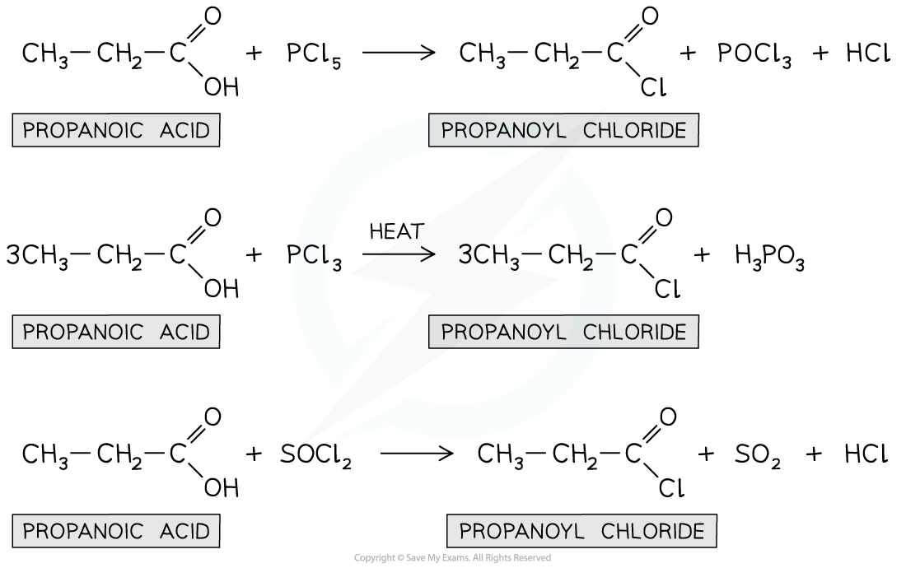
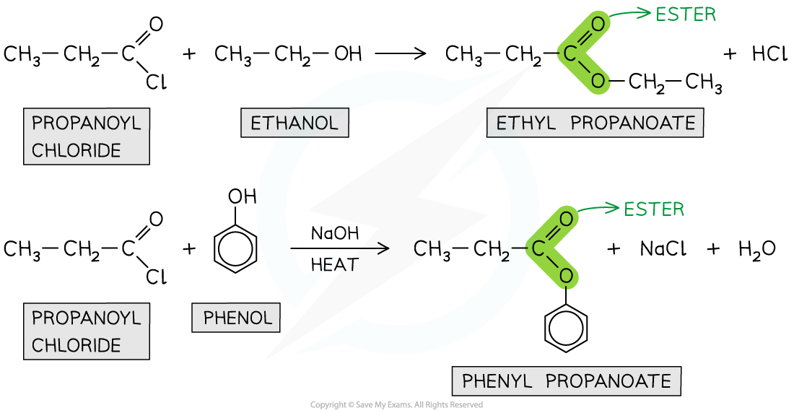

# Acyl Chlorides

## Production of Acyl Chlorides

> **Spec point** — `spcpt_kmmQMJ52BJxbDd6g`

## Production of Acyl Chlorides

- Due to the increased reactivity of acyl chlorides compared to carboxylic acids, they are often used as **starting compounds **in organic reactions
- Acyl chlorides are compounds that contain an -COCl functional group and can be prepared from the reaction of carboxylic acids with:

  - **Solid **phosphorus(V) chloride (PCl5)
  - **Liquid **phosphorus(III) chloride (PCl3) and heat
  - **Liquid **sulfur dichloride oxide (SOCl2)
- Propanoyl chloride can this way be prepared from propanoic acid using the reactions above

#### Using propanoic acid to form propanoyl chloride

***Propanoic acid can be used to produce propanoyl chloride with different by-products depending on the reagent used***

## Reactions of Acyl Chlorides

> **Spec point** — `spcpt_fCjpP6j9jx8qt8CG`

## Reactions of Acyl Chlorides

- **Acyl chlorides **are **reactive **organic compounds that undergo many reactions such as **addition-elimination reactions**
- In addition-elimination reactions, the **addition** of a small molecule across the C=O bond takes place followed by **elimination** of a small molecule
- Examples of these addition-elimination reactions include:

  - **Hydrolysis**
  - Reaction with alcohols and phenols to form **esters**
  - Reaction with ammonia and amines to form **amides**

### Hydrolysis

- The **hydrolysis **of acyl chlorides results in the formation of a **carboxylic acid **and **HCl **molecule
- This is an **addition-elimination **reaction

  - A **water molecule **adds across the C=O bond
  - A hydrochloric acid (HCl) molecule is **eliminated**
- An example is the hydrolysis of propanoyl chloride to form propanoic acid and HCl

#### Hydrolysis of acyl chlorides

***Acyl chlorides are hydrolysed to carboxylic acids***

### Formation of esters

- Acyl chlorides can react with **alcohols **and **phenols **to form esters

  - The reaction with phenols requires **heat** and a **base**
- Esters can also be formed from the reaction of **carboxylic acids **with phenol and alcohols however, this is a **slower **reaction as carboxylic acids are less reactive and the reaction does **not go to completion **(so less product is formed)
- Acyl chlorides are therefore more useful in the synthesis of esters
- The esterification of acyl chlorides is also an **addition-elimination **reaction

  - The alcohol or phenol adds across the C=O bond
  - A HCl molecule is eliminated

#### Esterification reactions using acyl chlorides

***Acyl chlorides undergo esterification with alcohols and phenols to form esters***

### Formation of amides

- Acyl chlorides react with **ammonia** or **primary amines** to form **amides** in a **condensation reaction**.
- A **lone pair** on the nitrogen atom attacks the **carbonyl carbon** in the acyl chloride.
- The reaction proceeds via a nucleophilic **addition–elimination mechanism**:

  - The nucleophile adds to the C=O bond
  - A chloride ion (Cl⁻) is eliminated
  - **Hydrogen chloride (HCl)** is formed

#### What happens to the HCl?

- The **HCl formed** does not remain unreacted.
- It is **immediately neutralised** by a **second molecule** of ammonia or amine present in excess.
- This forms an **ammonium salt** (e.g. NH₄Cl, CH₃NH₃Cl).

#### Why 2 molecules are needed

- The **1st molecule** of ammonia/amine forms the **amide**
- The **2nd molecule** of ammonia/amine neutralises the **HCl** and forms **ammonium salt**

#### Examples

- **Reaction with ammonia**
- **Product:** Primary amide (propanamide) and ammonium chloride

CH3CH2COCl + 2NH3 → CH3CH2CONH2 + NH4Cl

- **Reaction with methylamine**
- **Product:** Secondary (substituted) amide and methylammonium chloride

CH3COCl + 2CH3NH2 → CH3CONHCH3 + CH3NH3Cl

- **Reaction with ethylamine**
- **Product:** Secondary (substituted) amide and ethylammonium chloride

CH3COCl + 2CH3CH2NH2 → CH3CONHCH2CH3 + CH3CH2NH3Cl

#### Summary for formation of amides

- All reactions form **HCl**, which is **not observed** as a separate product
- The **HCl is neutralised** by excess ammonia or amine
- The final products are an **amide** and an **ammonium salt**
