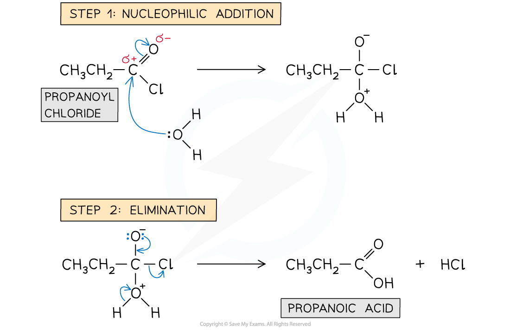
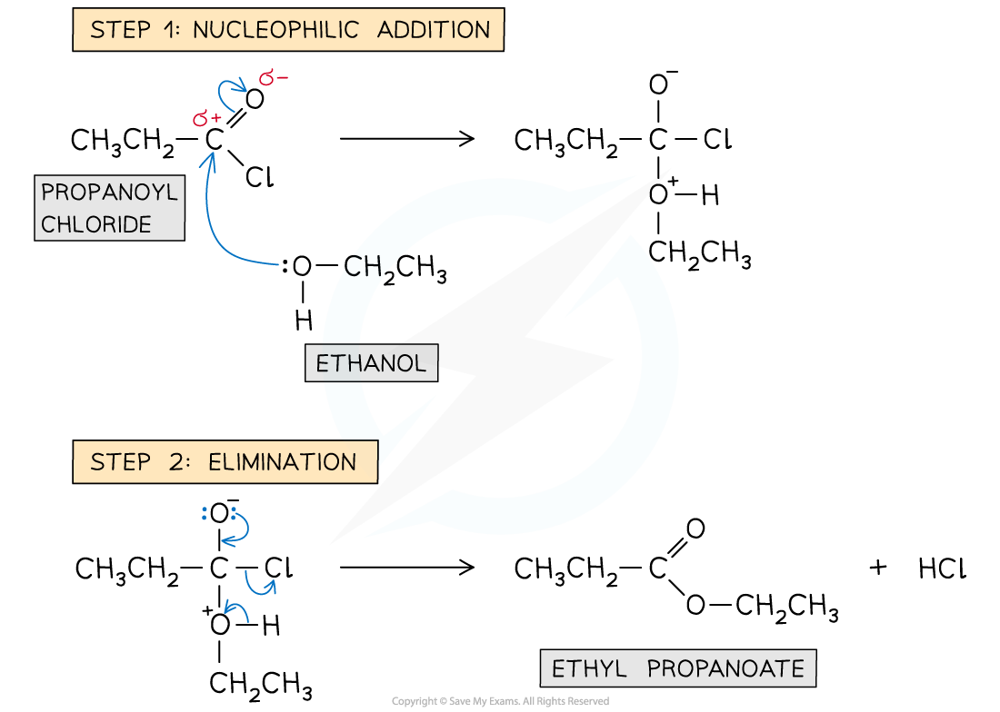
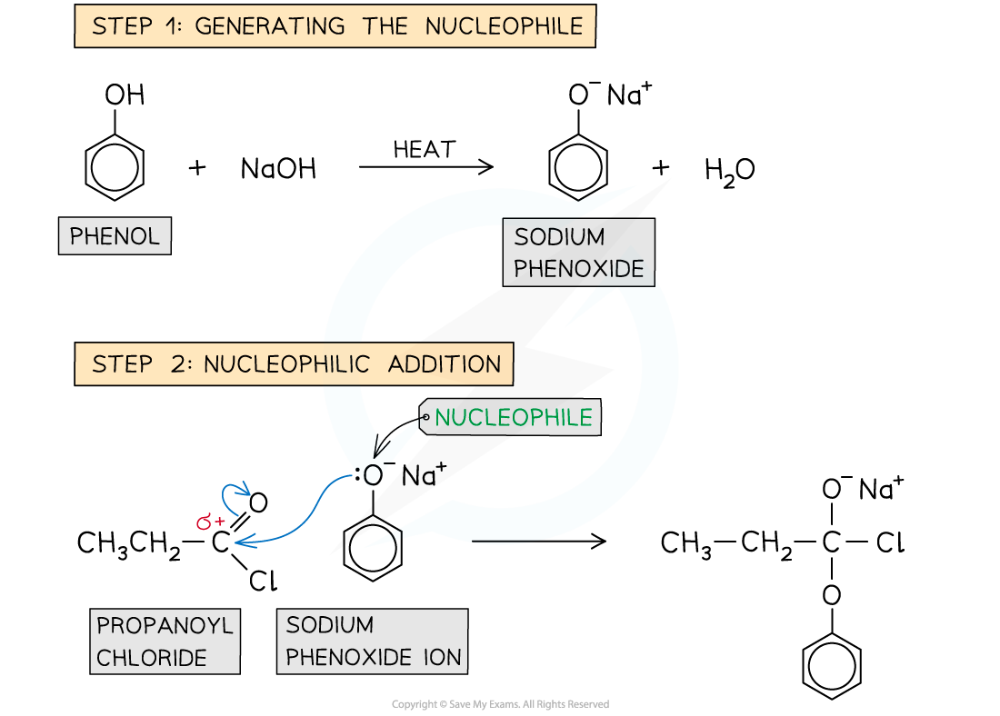
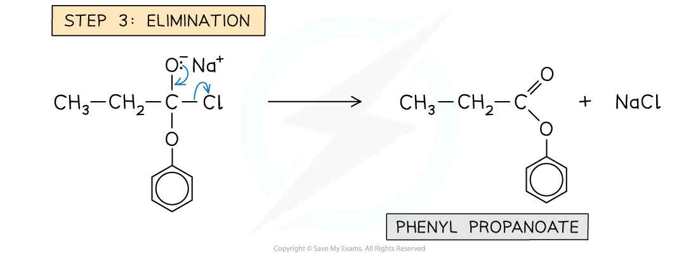
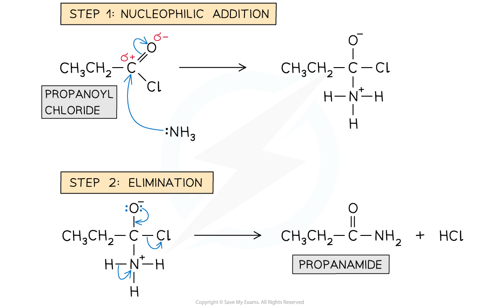
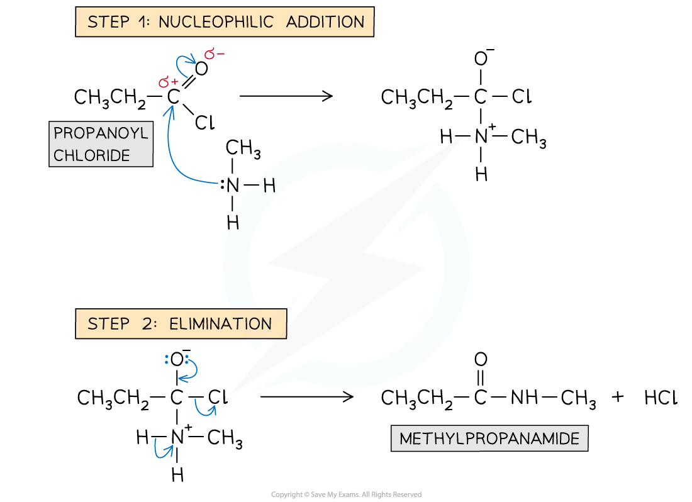
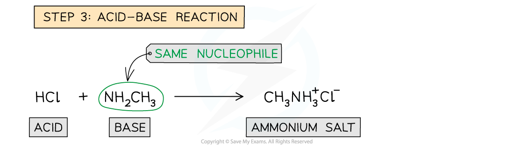
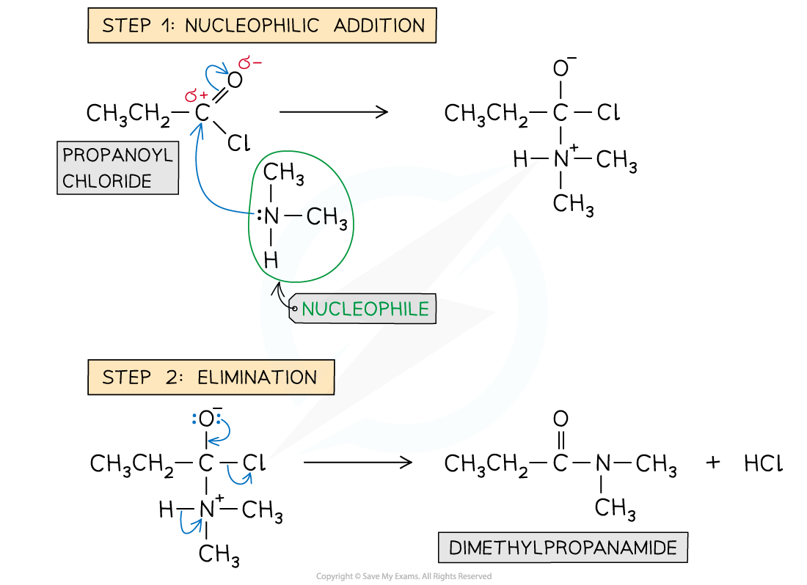
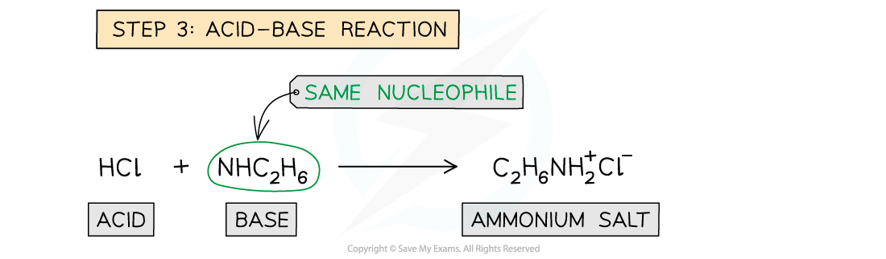

# Addition-Elimination Reactions of Acyl Chlorides

## Mechanism of Addition - Elimination in Acyl Chloride Reactions

> **Spec point** — `spcpt_gTszGR44g8Y97r7z`

## Mechanism of Addition - Elimination in Acyl Chloride Reactions

- Acyl chlorides undergo **addition-elimination **reactions such as **hydrolysis, esterification **reactions to form esters, and **condensation **reactions to form **amides**
- The general mechanism of these addition-elimination reactions involves two steps:

  - **Step 1 - **Addition of a **nucleophile** across the C=O bond
  - **Step 2 - **Elimination of a **small molecule **such as HCl or H2O

### Mechanism of hydrolysis of acyl chlorides

- In the **hydrolysis** of acyl chlorides, the water molecule acts as a **nucleophile**

  - The lone pair of the oxygen atom from water carries out an **initial attack **on the carbonyl carbon
  - This is followed by the elimination of a hydrochloric acid (HCl) molecule

#### Reaction mechanism of the hydrolysis of acyl chlorides

***The two-step addition-elimination reaction mechanism of propanoyl chloride to form propanoic acid***

### Formation of esters: reaction mechanism

- In the **esterification **reaction of acyl chlorides, the alcohols or phenols act as a **nucleophile**

  - The lone pair of the alcohol / phenol oxygen atom carries out an **initial **attack on the carbonyl carbon
  - This is again followed by the elimination of an HCl molecule
- With phenols, the reaction requires **heat **to proceed and needs to be carried out in the presence of a **base**
- The base **deprotonates **the phenol to form a **phenoxide **ion which is a **better nucleophile **than the phenol molecule

  - The **phenoxide ion** carries out an **initial attack **on the carbonyl carbon
  - A small molecule of NaCl is eliminated

#### Reaction mechanism of the esterification of acyl chlorides with alcohols

***The two-step addition-elimination reaction mechanism of propanoyl chloride and ethanol to form ethyl propanoate and water***

#### Reaction mechanism of the esterification of acyl chlorides with phenols

***The three-step addition-elimination reaction mechanism of propanoyl chloride with phenol to form phenyl propanoate***

#### Formation of amides: reaction mechanism

- The nitrogen atom in **ammonia **and **primary/secondary amines** act as a **nucleophile**

  - The lone pair of the nitrogen atom carries out an **initial **attack on the carbonyl carbon
  - This is followed by the elimination of an HCl molecule
- Both reactions of acyl chlorides with ammonia and amines are **vigorous **however there are also differences

  - With **ammonia** - The product is a **non-substituted amide **and **white fumes **of HCl are formed
  - With **amines - **The product is a **substituted amide **and the HCl formed reacts with the **unreacted amine **to form a **white organic ammonium salt**

#### Reaction mechanism of the formation of amides from acyl chlorides with ammonia

***The two-step addition-elimination reaction mechanism of propanoyl chloride and ammonia to form propanamide***

#### Reaction mechanism of the formation of amides from acyl chlorides with primary amines

***The addition-elimination reaction mechanism of propanoyl chloride and methylamine to form methylpropanamide***

#### Reaction mechanism of the formation of amides from acyl chlorides with secondary amines

***The addition-elimination reaction mechanism of propanoyl chloride and dimethylamine to form dimethylpropanamide***
