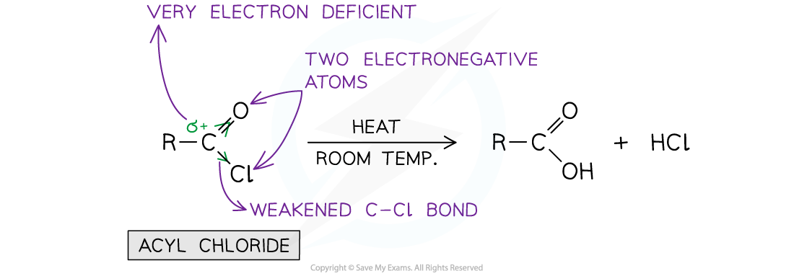

# Relative Ease of Hydrolysis

## Hydrolysis of Acyl Chlorides, Alkyl Chlorides & Halogenoarenes

> **Spec point** — `spcpt_phjwdc3vP6s54mMt`

## Hydrolysis of Acyl Chlorides, Alkyl Chlorides & Halogenoarenes

- **Hydrolysis **is the breakdown of a compound using **water**
- The ease of hydrolysis for different organic compounds may differ
- For example, the ease of hydrolysis, starting with the compounds most readily broken down, is: acyl chloride > alkyl chloride > aryl chloride
- This trend can be explained by looking at the **strength **of the C-Cl

### Strength of C-Cl bond in acyl chlorides

- Acyl chlorides are hydrolysed most readily at **room temperature**
- This is because the carbon bonded to the chlorine atom is also attached to an oxygen atom
- There are two **strong electronegative **atoms pulling electrons away from the carbonyl carbon, leaving it very **δ****+**
- The C-Cl bond is therefore **weakened** and **nucleophilic attack **of the carbonyl carbon is much more **rapid**

#### Hydrolysis of acyl chlorides

***The hydrolysis of acyl chlorides occurs most readily***

### Strength of C-Cl bond in alkyl chlorides

- The carbonyl carbon in alkyl chlorides is only attached to **one electronegative **atom which pulls electrons away from it
- This carbon atom is therefore not very **δ****+**** **and the C-Cl bond is stronger than the C-Cl bond in acyl chlorides
- The hydrolysis of alkyl chlorides, therefore, requires a **strong alkali** (such as OH-) to be **refluxed **with it
- An OH- ion will hydrolyse the alkyl chloride as it is a **stronger nucleophile **than H2O

#### Hydrolysis of alkyl chlorides

***The hydrolysis of alkyl chlorides requires a strong nucleophile***

### Strength of C-Cl bond in aryl chlorides

- In aryl chlorides, the carbon atom bonded to the chlorine atom is part of the **delocalised π bonding system **of the benzene ring
- One of the lone pairs of electrons of the Cl atom **overlaps **with this **delocalised **system
- The C-Cl bond, therefore, has some **double-bond character** causing it to become **stronger**
- As a result, the C-Cl bond is difficult to break and **hydrolysis **will **not occur**

#### Hydrolysis of aryl chlorides

***Due to the strong C-Cl bond in aryl chlorides, these compounds will not undergo hydrolysis***
