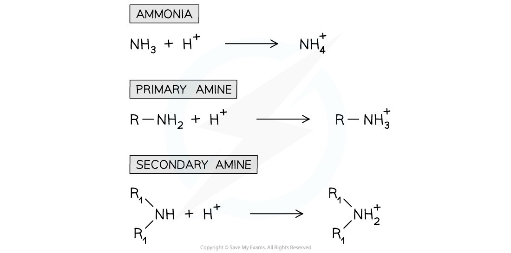

# Basicity of Amines

## Basicity of Aqueous Solutions of Amines

> **Spec point** — `spcpt_KR2xn6FYs3kB52pj`

## Basicity of Aqueous Solutions of Amines

- The nitrogen atom in ammonia and amine molecules can **accept **a **proton **(H+ ion)
- They can therefore act as **bases** in aqueous solutions by **donating **their lone pair of electrons to a proton and forming a **dative bond**

  - For example, ammonia undergoes an **acid-base **reaction with dilute hydrochloric acid (HCl) to form a salt

**NH****3**** + HCl → NH****4****+****Cl****–**

#### Ammonia and amines acting as a base

***The nitrogen atom in ammonia and amines can donate its lone pair of electrons to form a bond with a proton and therefore act as a base***

### Strength of ammonia and amines as bases

- The **strength** of amines depends on the **availability **of the lone pair of electrons on the nitrogen atom to form a dative covalent bond with a proton
- The **more readily** this lone pair of electrons is available, the **stronger the base** is
- Factors that may affect the **basicity **of amines include:

  - **Positive inductive effect** - Some groups such as **alkyl groups **donate electron density to the nitrogen atom causing the lone pair of electrons to become more available and therefore **increasing **the amine’s **basicity**
  - **Delocalisation** - The presence of aromatic rings such as the **benzene ring** causes the lone pair of electrons on the nitrogen atom to be **delocalised **into the benzene ring
  - The lone pair becomes **less available **to form a dative covalent bond with ammonia and hence **decreases **the amine’s **basicity**
- For example, ethylamine (which has an electron-donating ethyl group) is **more basic** than **phenylamine **(which has an electron-withdrawing benzene ring)
