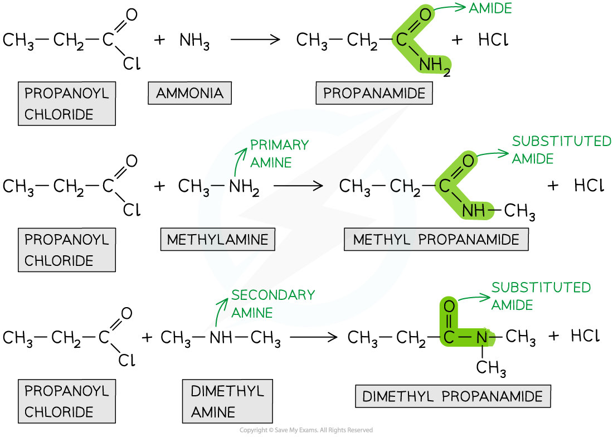

# Producing Amides

## Production of Amides 

> **Spec point** — `spcpt_mcRjWfSwJ35xZVjh`

## Production of Amides

- **Amides **are organic compounds with an -CONR2 functional group
- They can be prepared from the **condensation reaction **between an **acyl chloride **and **ammonia **or **amine**
- In a **condensation **reaction, two organic molecules **join together **and in the process **eliminate **a small molecule
- In this case, the acyl chlorides and ammonia or amine **join together **to form an **amide **and **eliminate **an HCl molecule

### Condensation reaction

- The chlorine atom in acyl chlorides is **electronegative **and draws electron density from the carbonyl carbon
- The carbonyl carbon is therefore **electron-deficient **and can be attacked by **nucleophiles**
- The nitrogen atom in ammonia and amines has a lone pair of electrons which can act as a **nucleophile **and attack the carbonyl carbon
- As a result, the C-Cl bond is **broken **and an **amide **is formed
- Whether the product is a **substituted **amide or not, depends on the nature of the **nucleophile**

  - Primary and secondary amines will give a **substituted amide**
  - The reaction of acyl chlorides with ammonia will produce a **non-substituted amide**
- **Note **that amides can also be formed from the condensation reaction between **carboxylic acids **and ammonia or amines
- However, this reaction is **slower **as carboxylic acids are **less reactive **than **acyl chlorides **and the reaction doesn’t go to completion

#### Condensation reactions of propanoyl chloride to form different substituted amides

***Acyl chlorides undergo condensation reactions with ammonia to form amides and with amines to form substituted amides***
