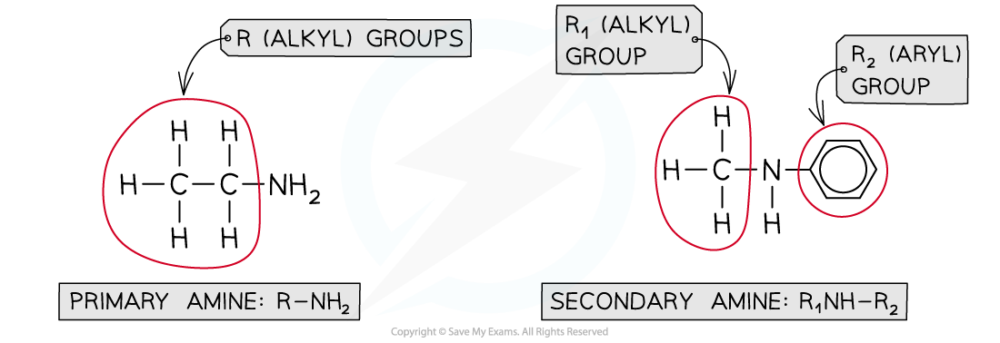
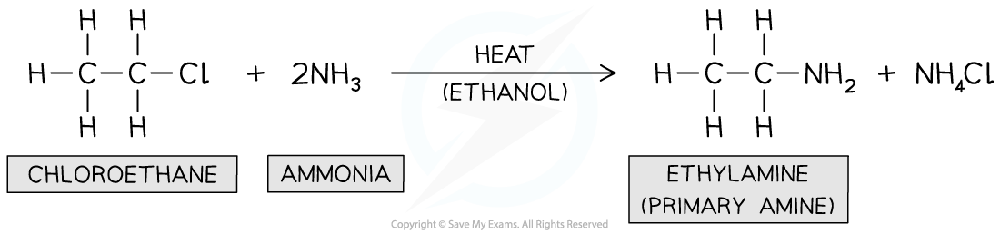
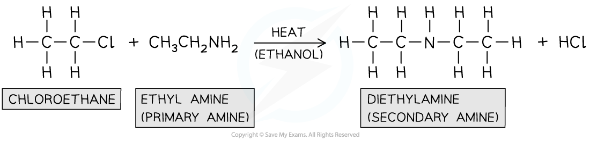
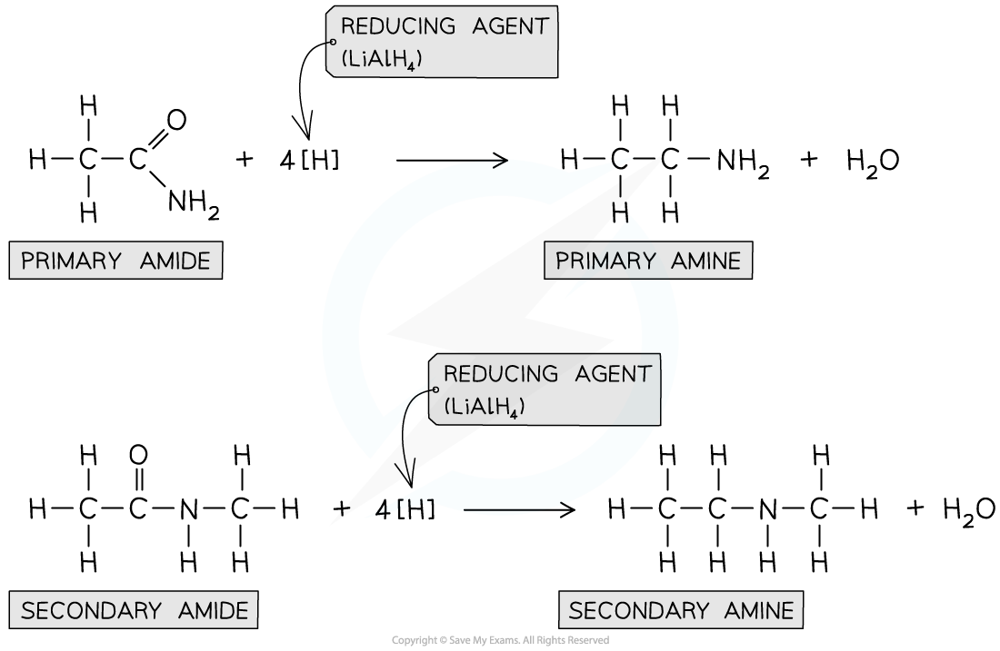
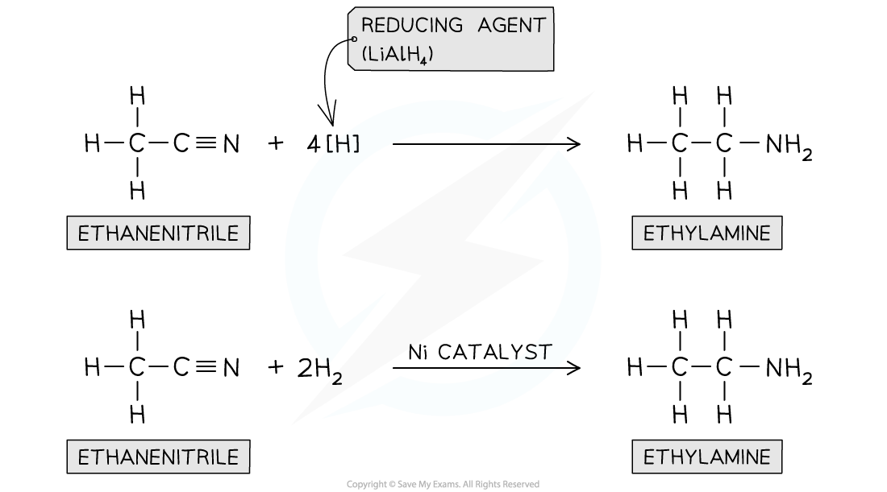

# Producing Amines

## Production of Primary & Secondary Amines

> **Spec point** — `spcpt_kYVJBY575W892XsF`

## Production of Primary & Secondary Amines

- **Primary amines **are organic compounds that have an -NH2 functional group attached to an alkyl or aryl group
- **Secondary amines **have two alkyl or aryl groups attached to an -NH group

#### Structures of primary and secondary amines

***A primary amine has one R-group attached to the nitrogen atom, while a secondary amine has two R-groups attached to the nitrogen atom***

- Primary and secondary amines can be prepared from different reactions including:

  - The reaction of halogenoalkanes with ammonia
  - The reaction of halogenoalkanes with primary amines
  - The **reduction** of amides
  - The reduction of nitriles

### Reaction of halogenoalkanes with ammonia

- This is a **nucleophilic substitution **reaction in which the nitrogen lone pair in ammonia acts as a **nucleophile **and **replaces **the halogen in the halogenoalkane
- When a halogenoalkane is reacted with **excess, hot ethanolic ammonia under pressure **a **primary amine **is formed

#### Formation of primary amine

***Primary amines can be produced by a nucleophilic substitution of a halogenoalkane with an excess of ammonia***

### Reaction of halogenoalkanes with primary amine

- This is also a **nucleophilic substitution **reaction in which the nitrogen in the primary amine acts as a **nucleophile **and **replaces **the halogen in the halogenoalkane
- When a halogenoalkane is reacted with a **primary amine** in **ethanol** and **heated in a sealed tube, under pressure **a **secondary amine **is formed

#### Formation of secondary amine

***Secondary amines can be produced by a nucleophilic substitution of a halogenoalkane with a primary amine***

### Reduction of amides

- Amines can also be formed from the **reduction **of **amides **by LiAlH4 in **dry ether**
- Whether a primary or secondary amine is formed depends on the nature of the amide

#### Formation of amines from amides

***Amides can be reduced by LiAlH******4****** to form amines***

### Reduction of nitriles

- Nitriles contain a -CN functional group which can be **reduced** to an -NH2 group
- The nitrile vapour and **hydrogen gas **are passed over a **nickel catalyst **or **LiAlH****4**** **in **dry ether** to form a **primary amine**

#### Formation of amines from nitriles

***Nitriles can be reduced with LiAlH******4****** or H******2****** and Ni catalyst***
