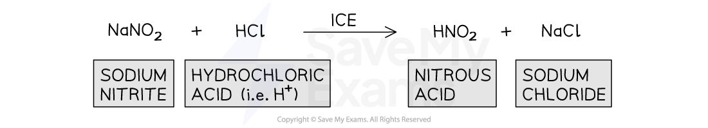
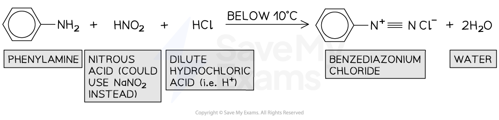
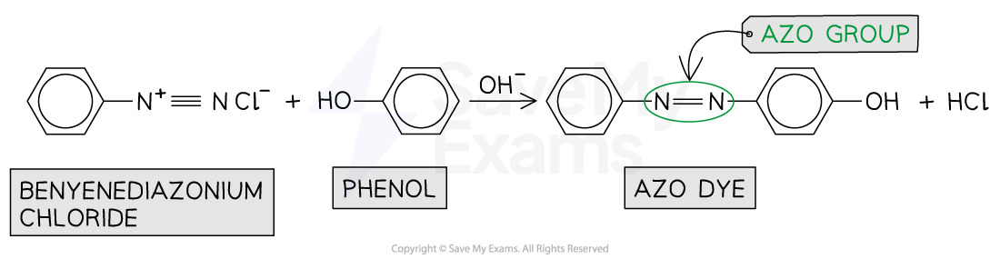
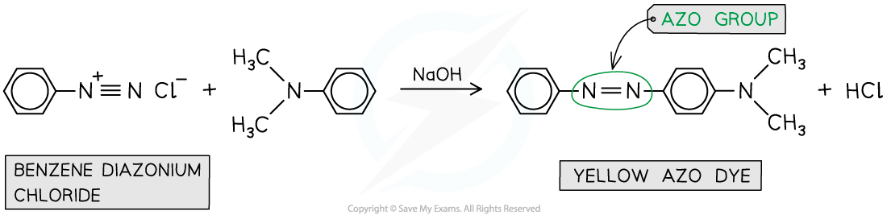

# Azo Compounds

## Azo Compounds

> **Spec point** — `spcpt_zSNqTgXKwfMvmXnW`

## Azo Compounds

- **Azo **(or **diazonium**) **compounds **are organic compounds that have an R1-N=N-R2 group
- They are often used as **dyes** and are formed in a **coupling reaction **between the **diazonium ion **and an **alkaline solution **of** phenol**

#### Example compound containing an azo group

***Azo compounds are characterized by the presence of an *****R****1*****-*****N=N-R****2***** group***

### Coupling of benzenediazonium chloride with phenol in NaOH

- Azo compounds can be formed from the coupling reaction of a **benzenediazonium chloride salt **with **alkaline phenol**
- Making an azo dye is a **multi-step process**:

  - **Step 1 - Formation of nitrous acid**
  
    - The nitrous acid, HNO2, is so unstable that it needs to be prepared in a test-tube by reacting sodium nitrite (NaNO2) and dilute hydrochloric acid (HCl) while keeping the temperature below 10 oC using **ice**

#### Forming nitrous acid, HNO2

***Nitrous acid can be prepared in a test-tube by reacting sodium nitrate with dilute hydrochloric acid***

- **Step 2 - Diazotisation**

  - This is the reaction between nitrous acid and phenylamine to form a diazonium ion
  - Dilute acid is used for this step, e.g. HCl
  - The reaction mixture must be kept < 10 °C using ice to prevent the diazonium ion from **thermally decomposing** to phenol, nitrogen and hydrochloric acid

#### Forming benzenediazonium chloride

***Benzenediazonium chloride is an unstable diazonium salt***

- **Step 3 - Coupling reaction**

  - The diazonium ion acts as an **electrophile **and substitutes into the benzene ring of the **phenol**, at the 4th position
  - Alkaline conditions are required to deprotonate the organic product and form the **azo compound**

#### Forming the azo compound

***The azo compound is formed by the electrophilic substitution reaction of benzenediazonium chloride and phenol***

- The **delocalised** electrons in the π bonding systems of the two benzene rings are **extended **through the -N=N- which acts as a **bridge **between the two rings
- As a result of the delocalisation of electrons throughout the compound, azo compounds are **very stable**

### Making other azo dyes

- Other dyes can be formed via a **similar route **as described above
- For example, the **yellow** **dye** can be formed from the **coupling reaction **between **benzenediazonium chloride **and **C****6****H****5****N(CH****3****)****2**** **instead of phenol (C6H5OH)

#### Making yellow azo dye

***The yellow azo dye is formed via a coupling reaction between benzenediazonium chloride and C******6******H******5******N(CH******3******)******2***
