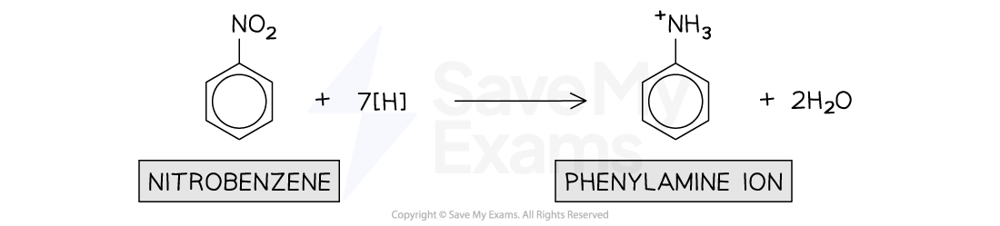
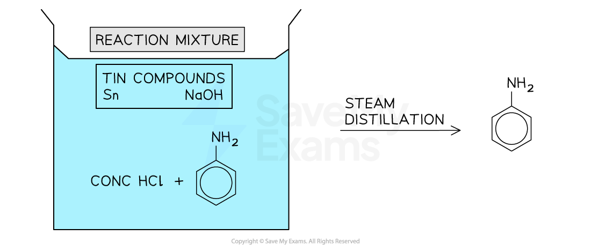
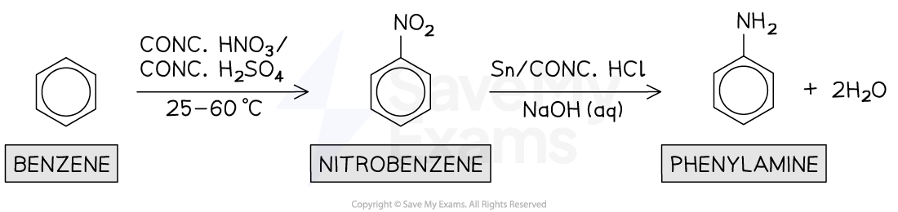
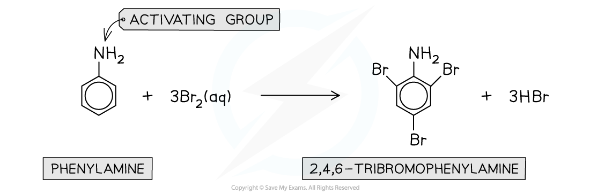
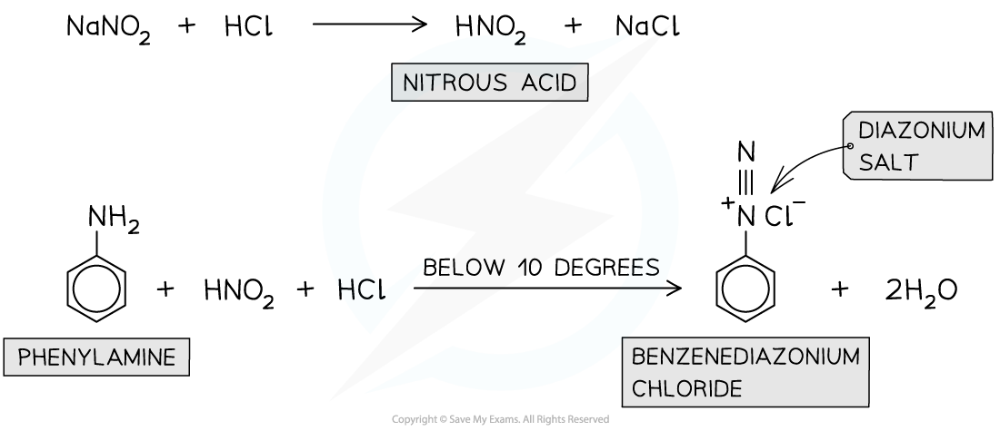

# Production & Reactions of Phenylamine

## Preparation of Phenylamine

> **Spec point** — `spcpt_ZrYv26MGZKXyPXbQ`

## Preparation of Phenylamine

- **Phenylamine **is an organic compound consisting of a benzene ring and an **amine** (NH2) functional group
- It can be produced in a **three-step synthesis **reaction followed by the separation of phenylamine from the reaction mixture

  - **Step 1 - Nitration**
  
    - Benzene undergoes **nitration **with concentrated nitric acid (HNO3) and concentrated sulfuric acid (H2SO4) at 25 to 60 oC to form **nitrobenzene**

#### Nitration of benzene

***Benzene forms nitrobenzene by reacting with the NO******2******+****** electrophile formed by concentrated nitric acid and concentrated sulfuric acid***

- **Step 2 - Reduction**

  - Nitrobenzene is **reduced** with **hot tin **(Sn) and **concentrated hydrochloric acid **(HCl)** under reflux **to form an acidic mixture that contains the organic product C6H5N+H3

#### Reduction of nitrobenzene

***Refluxing nitrobenzene with hot tin and concentrated hydrochloric acid forms the phenylamine ion***

- **Step 3** **- Deprotonation**

  - Sodium hydroxide (NaOH) is added to the acidic reaction mixture to **deprotonate **the phenylamine ion to **phenylamine**

#### Deprotonation of the phenylamine ion

***The hydroxide ion from sodium hydroxide deprotonates the phenylamine ion, forming the desired phenylamine ***

- **Separation / purification**

  - The phenylamine is then separated from the reaction mixture by **steam distillation**

#### Separation of phenylamine

***Steam distillation is used to separate the phenylamine from the reaction mixture***

#### The overall reaction forming phenylamine from benzene

***The first reaction step is nitration and the second reaction step is reduction followed by deprotonation***

## Reactions of Phenylamine

> **Spec point** — `spcpt_9Dxx4xs6KDbb85cJ`

## Reactions of Phenylamine

- Both the benzene ring as well as the -NH2 group in **phenylamine** can take part in chemical reactions
- These reactions include

  - The **bromination** of phenylamine
  - Formation of a **diazonium** **salt**

### Bromination of phenylamine

- Phenylamines react in **electrophilic substitution** reactions in a similar way as **phenols**
- The lone pair of electrons on the nitrogen atom in phenylamines donate electron density into the benzene ring

  - In phenols, the oxygen atom donates its lone pair of electrons instead
- The **delocalisation** of the electrons causes an **increased electron density **in the benzene ring
- The benzene ring, therefore, becomes **activated **and becomes more readily attacked by **electrophiles**
- The incoming electrophiles are directed to the 2,4 and 6 positions
- Phenylamines, therefore, react under milder conditions with **aqueous bromine **at **room temperature **to form 2,4,6-tribromophenylamine

#### Bromination of phenylamine

***The bromination of phenylamine produces 2,4,6-tribromophenylamine***

### Formation of diazonium salt

- **Diazonium** compounds are very reactive compounds containing an -N2+ group
- The amine (-NH2) group of phenylamines will react with **nitrous acid **(HNO2) at a temperature below 10 °C to form **diazonium salts**

  - Since nitric(III) acid is unstable, it has to be made in the **test-tube **by reacting sodium nitrite (NaNO2) and **dilute acid **(such as HCl)
- These **diazonium salts **are so unstable that they will, upon further warming with water, form **phenol**

#### Reacting nitrous acid with phenylamine to form a diazonium salt

***The diazonium salt formed from phenylamine is unstable and decomposes upon warming to form phenol.***
