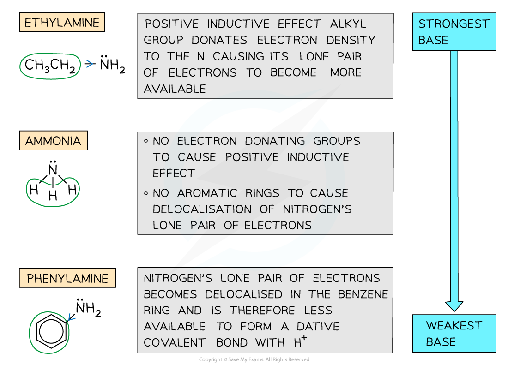

# Relative Basicity of Ammonia, Ethylamine & Phenylamine

## Relative Basicity of Aqueous Ammonia, Ethylamine & Phenylamine

> **Spec point** — `spcpt_xK4XH2bxzdj2FHn4`

## Relative Basicity of Aqueous Ammonia, Ethylamine & Phenylamine

- Ammonia and amines act as **bases** as they can donate their lone pair of electrons to form a dative covalent bond with a proton
- The **basicity **of the amines depends on how readily available their lone pair of electrons is
- **Electron-donating **groups (such as alkyl groups) increase the electron density on the nitrogen atom and cause the lone pair of electrons to become **more** available for dative covalent bonding

  - The amine becomes **more** basic
- **Delocalisation** of the lone pair of electrons into an aromatic ring (such as a benzene ring) causes the lone pair of electrons to become **less **available for dative covalent bonding

  - The amine becomes **less** basic

### Comparing basicity of ammonia, ethylamine & phenylamine

- The order of basicity of ammonia, ethylamine and phenylamine is as follows:

| **Ethylamine >** | **ammonia** | **> phenylamine** |
|---|---|---|
| **STRONGEST BASE  ** |   | **WEAKEST BASE** |

- This trend can be explained by looking at the groups attached to the amine (-NH2) group
- In ethylamine, the electron-donating alkyl group donates electron density to the nitrogen atom causing its lone pair to become more available to form a dative covalent bond with a proton
- Ammonia lacks an electron-donating group

  - Hence, it is less basic than ethylamine
  - However, it is more basic than phenylamine as the lone pair on the nitrogen is **not delocalised**
- In phenylamine, the lone pair of electrons overlap with the conjugated system on the benzene ring and become delocalised

  - As a result, the lone pair of electrons become less readily available to form a bond with a proton

#### Trends in the basicity of ammonia, ethylamine, and phenylamine

***The positive inductive effect of electron donating groups increases the basicity of an amine, while the negative inductive effect of electron withdrawing groups decreases the basicity of an amine***
