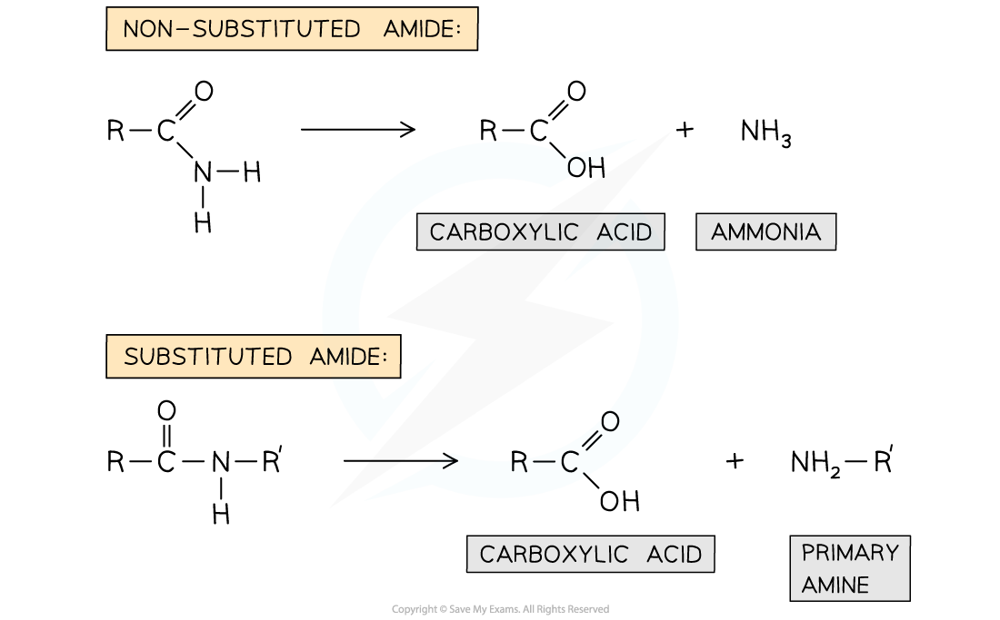
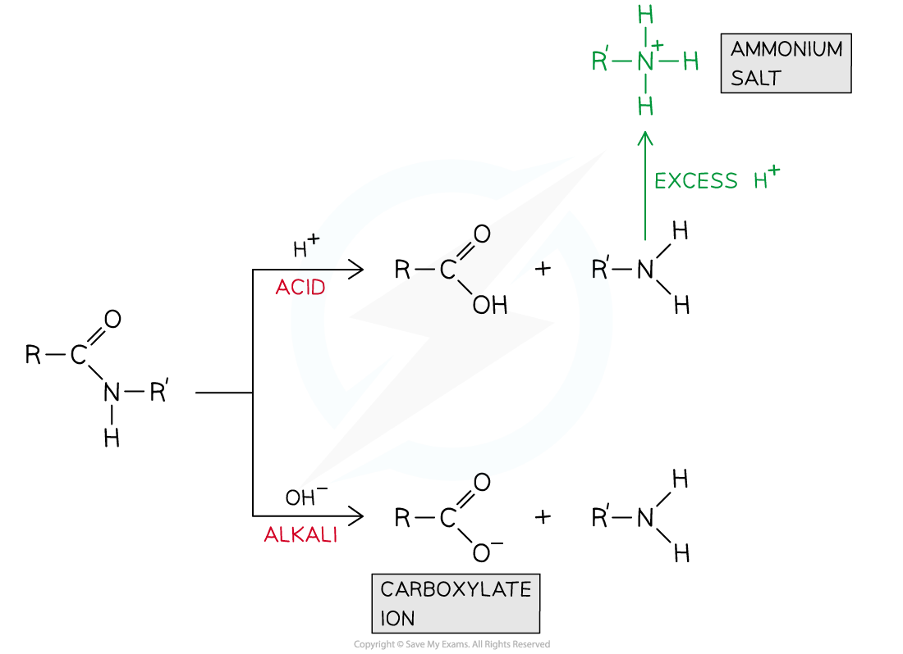

# Reactions of Amides

## Reactions of Amides

> **Spec point** — `spcpt_GbJwJMgJ2ZztVqw4`

## Reactions of Amides

- **Amides **are formed from the **condensation reaction** of **carboxylic acids or acyl chlorides **with **ammonia or amines**
- The amide group (CONR2) in these compounds can undergo reactions including

  - **Hydrolysis** with **aqueous alkali **or **aqueous acid**
  - **Reduction** with **LiAlH****4**** **

### Hydrolysis of amides

- The -CON- group in **substituted amides **links two hydrocarbon sections of their molecules together
- This amide link can be broken down by **hydrolysis **by **refluxing **it with an **acid **or **alkali**
- The products of a **non-substituted amide** are:

  - Carboxylic acid
  - Ammonia
- The products of a **substituted amide** are:

  - Carboxylic acid
  - Primary amine

#### Hydrolysis of substituted and non-substituted amides

***The hydrolysis products include a carboxylic acid along with ammonia for a non-substituted amide and an amine for a substituted amide***

- When hydrolysed by refluxing in **excess acid**, the ammonia or amine produced will form an ammonium salt
- When hydrolysed by refluxing in **excess** base, the carboxylic acid produced will be deprotonated to form a carboxylate ion

#### Comparing amide hydrolysis in acidic and alkaline conditions

***Amides are hydrolysed to carboxylic acids and ammonia or primary amines when refluxed with acid or alkali***

### Reduction of amides

- The C=O group in amides can be **reduced **by the strong reducing agent LiAlH4 to form an amine
- The products of a **non-substituted amide **are:

  - A primary amine and water
- The products of a **substituted amide **are:

  - A secondary amine and water

#### Reduction of amides

***Amides can be reduced to amines using LiAlH******4****** ***
