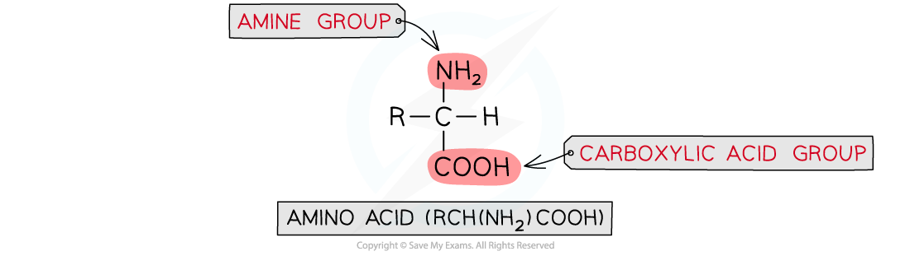
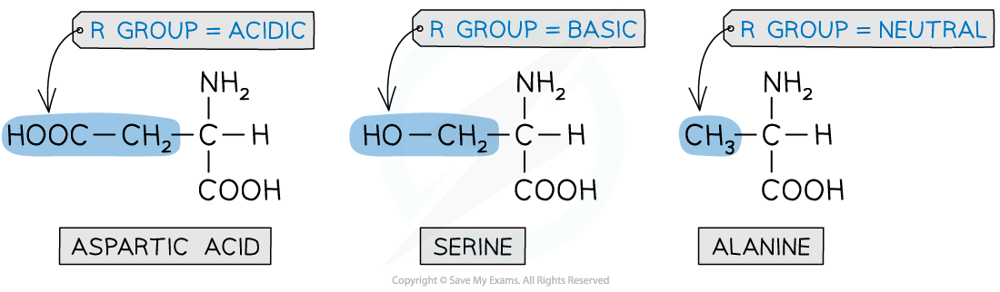
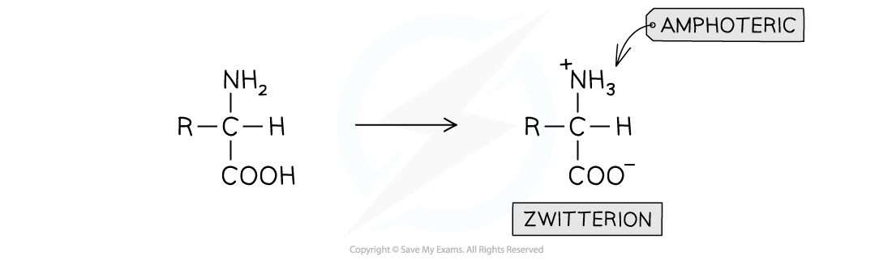
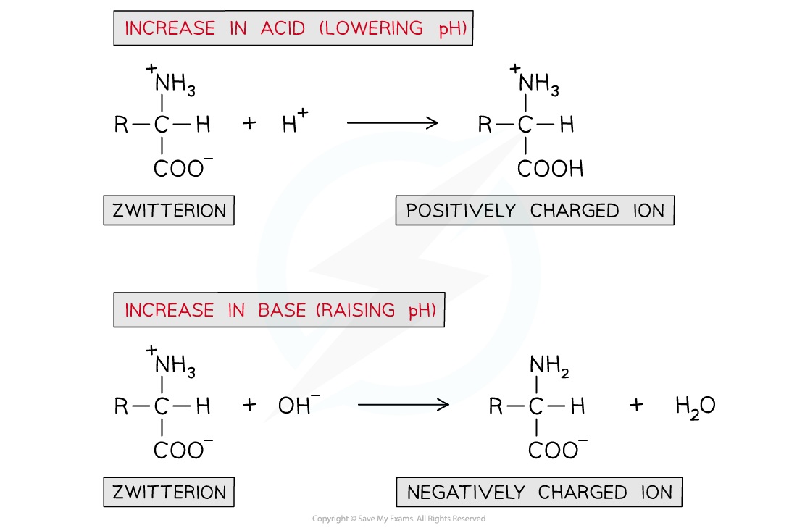
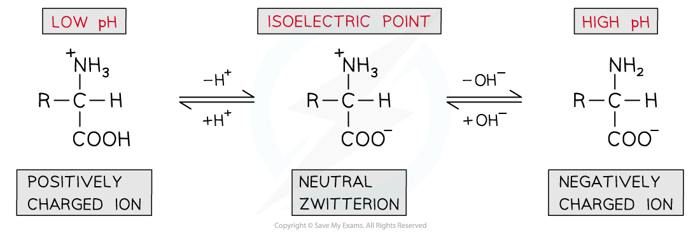

# Amino Acids

## Acid / Base Properties of Amino Acids, Zwitterions & the Isoelectric Point

> **Spec point** — `spcpt_nkkvrrBtBQrm3jc8`

## Acid / Base Properties of Amino Acids, Zwitterions & the Isoelectric Point

- **Amino acids **are **organic compounds **that contain two functional groups:

  - A basic **amino **(-NH2) group
  - An acidic **carboxylic** **acid** (-COOH) group
- Due to the presence of both a **basic **and **acidic **group in amino acids, they are said to be **amphoteric**

  - They can act as both acids and bases

### Naturally occurring amino acids

- **2-aminocarboxylic acids **are a type of amino acid where the amine (-NH2) group is bonded to the carbon atom **next **to the -COOH group
- These types of amino acid form the ‘building blocks’ that make up **proteins**
- There are **20** naturally occurring amino acids with the general structural formula of **RCH(NH****2****)COOH**

#### General structural formula of amino acids

***In most amino acids, the amine group is bonded to the carbon directly adjacent to the carboxylic acid group***

- The **R **group varies in different amino acids and can be:

  - Acidic
  - Basic
  - Neutral

#### Example amino acids with different R groups

***The R group in amino acids can be acidic (aspartic acid), basic (serine) or neutral (alanine)***

### Acid / base properties of amino acids

- Amino acids will undergo most reactions of amines and carboxylic acids including acid-base reactions of:

  - Amines with acids
  - Carboxylic acids with bases
- However, they can also interact **intramolecularly** (within themselves) to form a **zwitterion**
- A zwitterion is an ion with both a **positive **(-NH3+) and a **negative **(-COO-) charge
- Because of these charges in a zwitterion, there are **strong intermolecular forces of attraction** between amino acids

  - Amino acids are therefore **soluble crystalline solids**

#### Zwitterion formation within an amino acid

***An amino acid molecule can interact within itself to form a zwitterion***

### Isoelectric point

- A solution of amino acids in water will exist as **zwitterions **with both **acidic **and **basic **properties
- They act as **buffer solutions** as they resist any changes in pH when **small **amounts of acids or alkali are added
- If an acid is added (and thus the pH is **lowered**):

  - The -COO- part of the zwitterion will **accept** an H+ ion to reform the -COOH group
  - This causes the zwitterion to become a **positively charged ion**
- If a base is added (and thus the pH is **raised**):

  - The -NH3+ part of the zwitterion will **donate **an H+ ion to reform the -NH2 group
  - This causes the zwitterion to become a **negatively charged ion**

#### The effect of changing pH on zwitterions

***An amino acid solution can act as a buffer solution by resisting any small changes in pH***

- The pH can be slightly adjusted to reach a point at which neither the **negatively charged **or **positively charged **ions dominate and the amino acid exists as a **neutral zwitterion**

  - This is called the **isoelectric point **of the amino acid

#### The isoelectric point of an amino acid

***The isoelectric point of amino acids is the pH at which the amino acid exists as a neutral zwitterion***

- At low pH, the equilibrium is shifted by the addition or removal of H⁺ ions (from added acid)
- At high pH, it is shifted by the addition or removal of OH⁻ ions (from added base).
- Both conventions describe changes to the protonation state of the amino acid

  - They reflect the reagent used to alter the pH rather than the same underlying process written two different ways.
