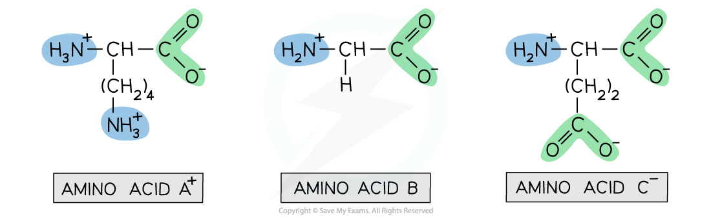
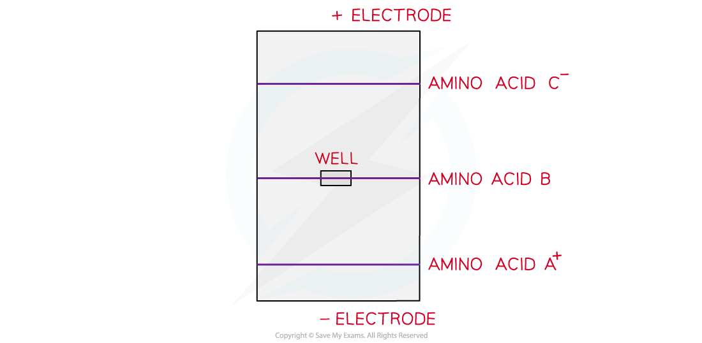

# Electrophoresis

## Electrophoresis

> **Spec point** — `spcpt_SMHHZFxTGGKYJgjw`

## Electrophoresis

- **Electrophoresis **is an **analytical technique **which separates ions by placing them in an electrical field

  - This method is often used in **biochemical analysis **to **identify **and **purify **proteins
- A sample of amino acids is placed between **two oppositely charged electrodes**

  - The positively charged ions will move towards the **negative electrode**
  - The negatively charged ions will move towards the **positive electrode**
- The **rate **(how fast) at which the ions move towards the electrodes depends on:

  - The **size** of the ions: larger ions move **more** **slowly**
  - The **charge **of the ions: highly charged ions move **more quickly**
- An **electropherogram **is the series of bands which are observed on the paper or gel after **electrophoresis **has occurred

  - Each band in the electropherogram corresponds to a particular species

### Separating mixtures of amino acids by varying the pH

- The charge on the **amino acid ions **depends on the pH of the solution
- The movement of the ions to the electrodes during electrophoresis will therefore be affected by the pH
- Consider a sample which consists of a **mixture **of three amino acids at pH 7

  - Amino acid **A**: lysine, side-chain is **positively charged**
  - Amino acid **B**: glycine, side chain is **neutral**
  - Amino acid **C**: glutamic acid, side chain is **negatively charged**

#### The different amino acids within the sample

***The sample consists of a mixture of three amino acids which are separated using electrophoresis***

- The amino acids in this mixture can be separated by electrophoresis

  - Amino acid **C **will move towards the **positive** electrode
  - Amino acid **B** will remain in the **well** where the sample is applied to the gel
  - Amino acid **A** will move towards the **negative **electrode
- Since glutamic acid is **larger **than lysine, it will travel towards the positive electrode at a **slower rate **compared to lysine

#### Separation of a mixture of amino acids by electrophoresis

***During electrophoresis, positive amino acids move to the negative electrode and negative amino acids move to the positive electrode***
