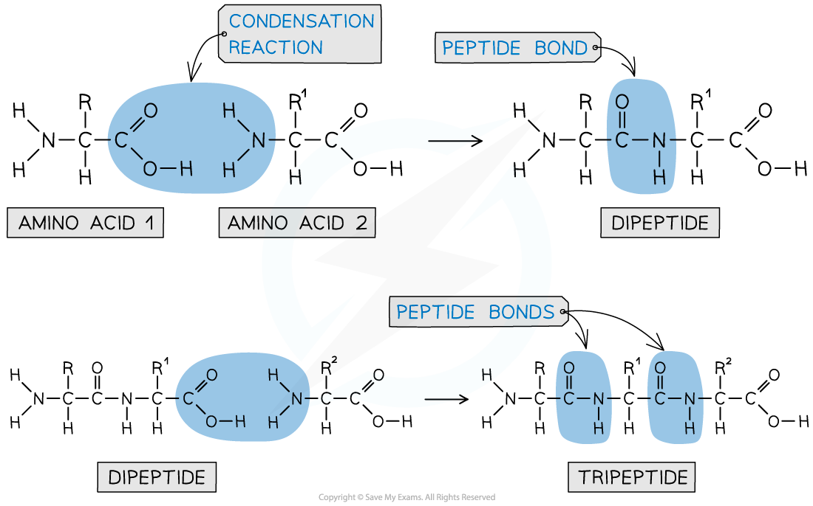

# Peptide Bonds

## Formation of Peptide Bonds

> **Spec point** — `spcpt_G2nMVpt96f6Jvkms`

## Formation of Peptide Bonds

- Each amino acid contains an amine (-NH2) and carboxylic acid (-COOH) group
- The -NH2 group of **one amino acid **can react with the -COOH group of **another amino acid **in a **condensation reaction** to form a **dipeptide**

  - The new **amide bond **between two amino acids is also called a **peptide link **or **peptide bond**
- Since this is a condensation reaction, a small molecule (in this case H2O) is **eliminated**
- The **dipeptide **still contains an -NH2 and -COOH group at each end of the molecule which can again participate in a condensation reaction to form a **tripeptide**

#### Peptide bonds

***A peptide bond is an amide bond between two amino acids***

- A **polypeptide **is formed when **many **amino acids join together to form a long chain of molecules

#### Showing polypeptides

***A polypeptide is a long chain of amino acid molecules joined together***
