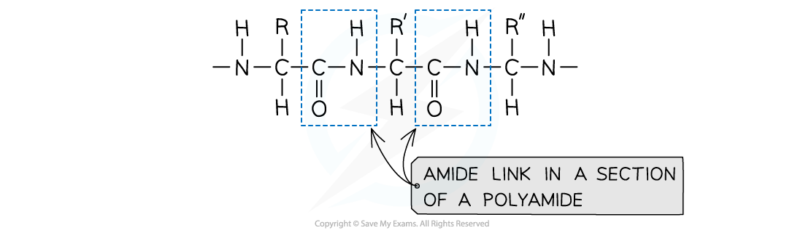
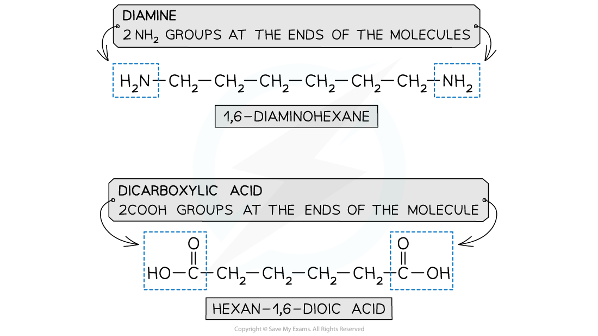
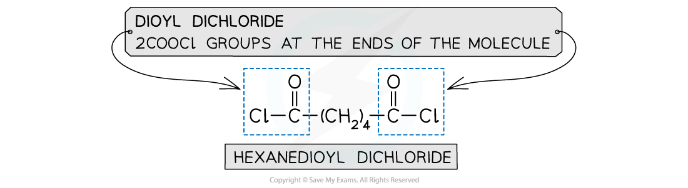
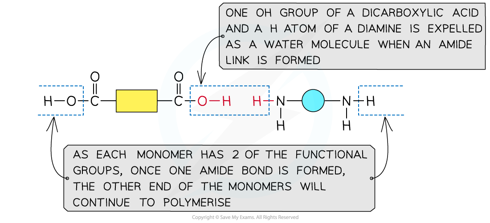
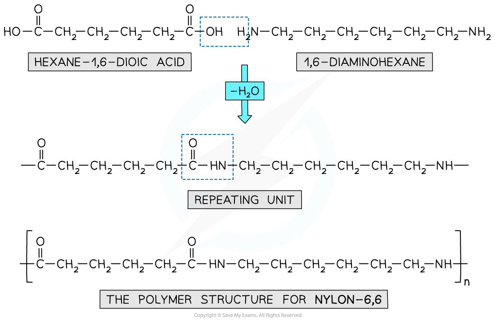
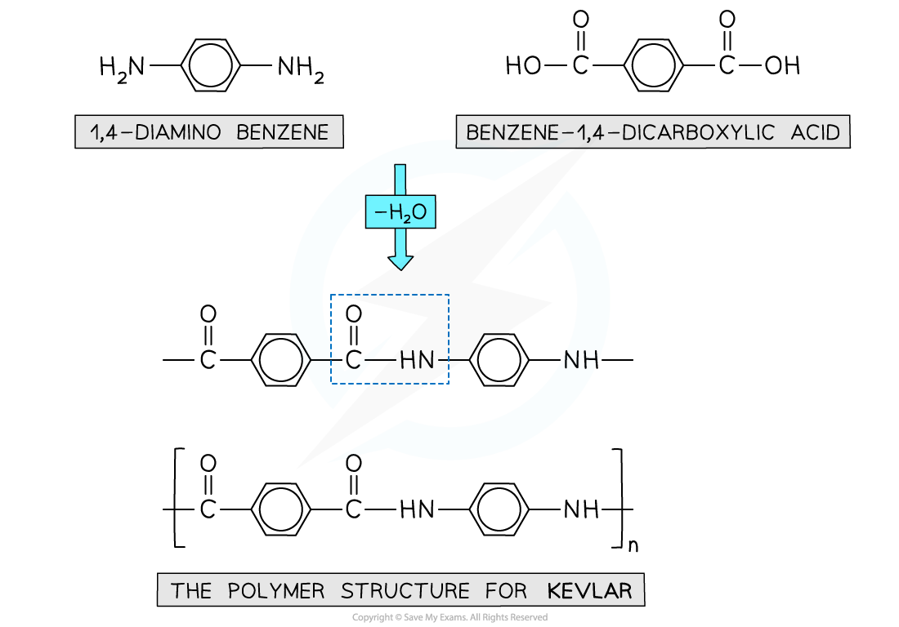
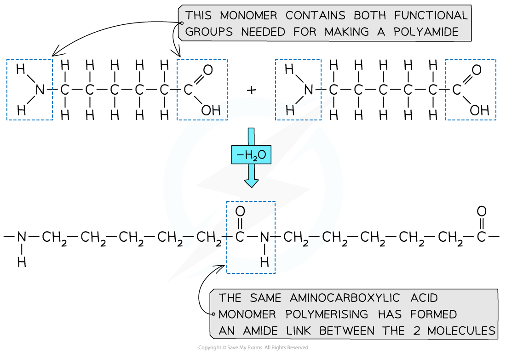
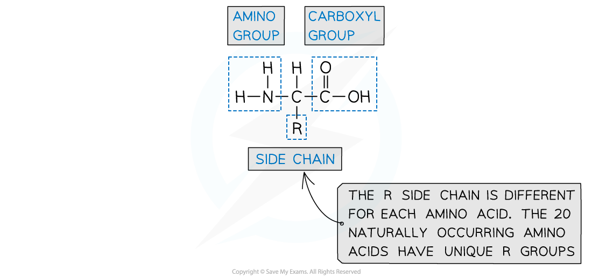
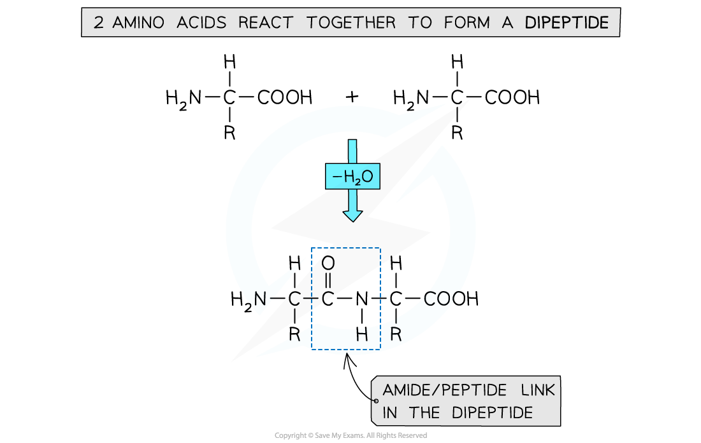
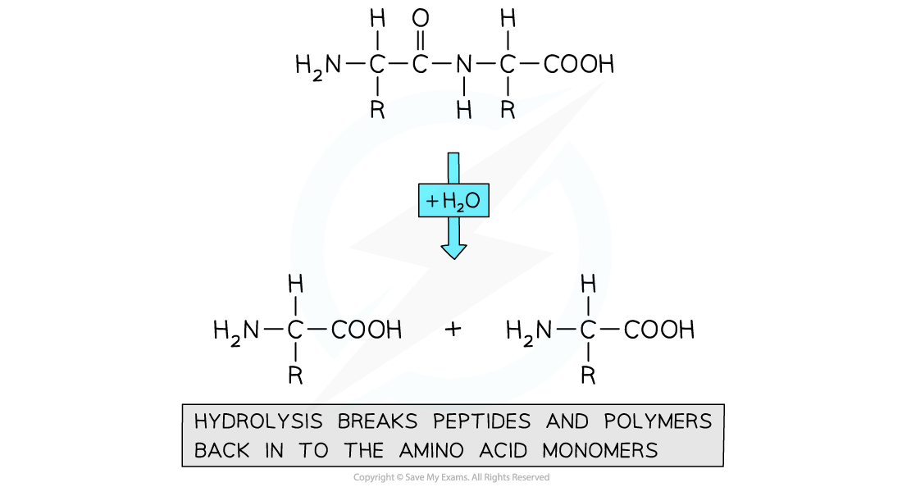

# Formation of Polyamides

## Formation of Polyamides

> **Spec point** — `spcpt_N36WqvGVj2WYtrf8`

## Formation of Polyamides

### Amide link

- Polyamides are also formed using condensation polymerisation

#### Section of a polyamide highlighting the amide links

***An amide link - also known as a peptide link - is the key functional group in a polyamide***

### Monomers

- A diamine and a dicarboxylic acid are required to form a polyamide

  - A diamine contains 2 -NH2 groups
  - A dicarboxylic acid contains 2 -COOH groups
- Dioyl dichlorides can also used to react with the diamine instead of the acid

  - A dioyl chloride contains 2 -COCl groups
- This is a more reactive monomer than dicarboxylic acid. However, a more expensive alternative

#### Examples of the monomers required to form polyamides

***The position of the functional groups on these molecules allows condensation polymerisation to take place effectively***

### Formation of polyamides

#### Forming an amide link

***This shows the expulsion of a small molecule as the amide link forms***

- Nylon 6,6 is a synthetic polyamide
- Its monomers are 1,6-diaminohexane and hexane-1,6-dioic acid

  - The ‘6,6’ part of its name arises from the 6 carbon atoms in each of Nylon 6,6 monomers

#### Forming nylon 6,6

***Nylon 6,6 is a synthetic polyamide made using specific diamine and dicarboxylic acid monomers***

### Kevlar

- Kevlar is another example of a polymer formed through condensation polymerisation
- The polymer chains are neatly arranged with many hydrogen bonds between them
- This results in a strong and flexible polymer material with fire resistant properties
- These properties also lend Kevlar to a vital application in bullet-proof vests
- The monomers used to make Kevlar

  - 1,4-diaminobenzene
  - Benzene-1,4-dicarboxylic acid
- As seen with Nylon, a dioyl chloride can be used instead of the acid as well (benzene-1,4-dioyl chloride)

#### Forming Kevlar

***Kevlar is made using specific diamine and dicarboxylic acid monomers***

### Aminocarboxylic acids

- So far, condensation polymerisation has covered the use of monomers that contain 2 of the same functional group (eg. diamine, Diol etc.)
- It is possible to carry out a condensation polymerisation where one monomer provides both of the function groups necessary for an amide/peptide link
- For example, 6-aminohexanoic acid has an amino group and a carboxylic acid group on the same molecule
- Molecules like this are called amino carboxylic acids
- They are able to polymerise to form a structure similar to Nylon 6,6

#### Forming nylon 6,6 using a single monomer

***6-aminohexanoic acid polymerises to make the synthetic polymer nylon 6,6***

### Making Proteins

- Proteins are vital biological molecules with varying functions within the body
- They are essentially polymers made up of amino acid monomers
- Amino acids have an aminocarboxylic acid structure
- Their properties are governed by a branching side group - the R group

#### The functionality of an amino acid

***Amino acids contain an amine group, an acid group and a unique R group***

- Different amino acids are identified by their unique R group
- The name of each amino acid is given using 3 letters

  - For example, Glutamine is known as ‘Gln’
- Dipeptides can be produced by polymerising 2 amino acids together

  - The amine group (-NH2) and acid group (-COOH) of each amino acid are used to polymerise with another amino acid
- Polypeptides are made by polymerising more than 2 amino acids together

#### Forming dipeptides and polypeptides

***Dipeptides and polypeptides are formed by polymerising amino acid molecules together***

### Protein hydrolysis

- Proteins (polypeptides) can be broken down into its constituent amino acids
- This process occurs through a hydrolysis reaction

#### Hydrolysing proteins

***Hydrolysis of proteins produces the component amino acids***

> **Exam Hint**
> - Become familiar with the structures of the different monomers that can be used to make condensation polymers.
> - Also, remember that exam questions will require you to identify the key functional groups and also draw small sections of polymers.
