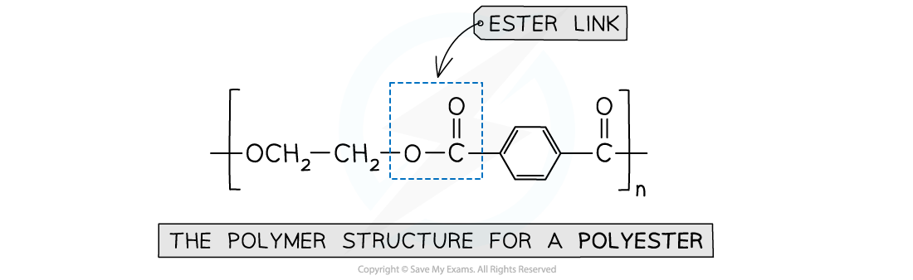
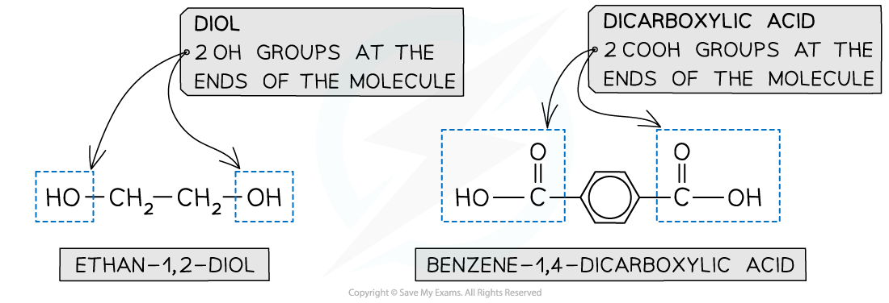
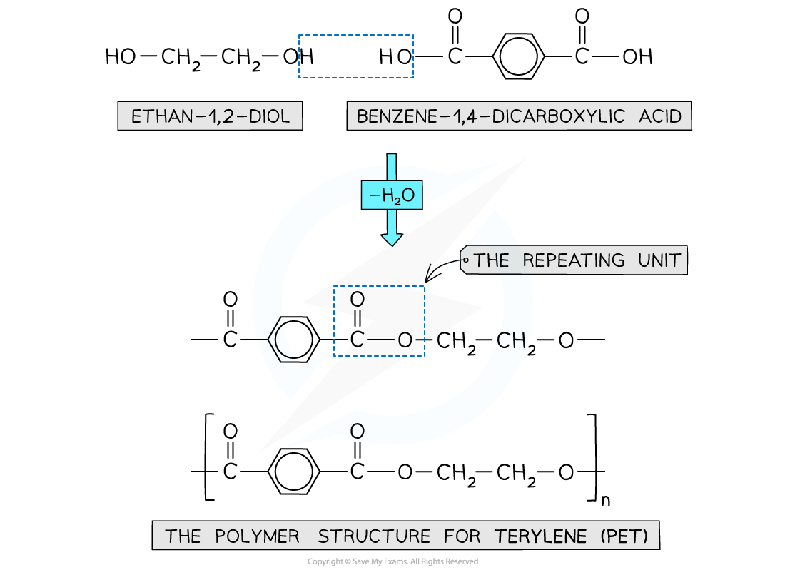
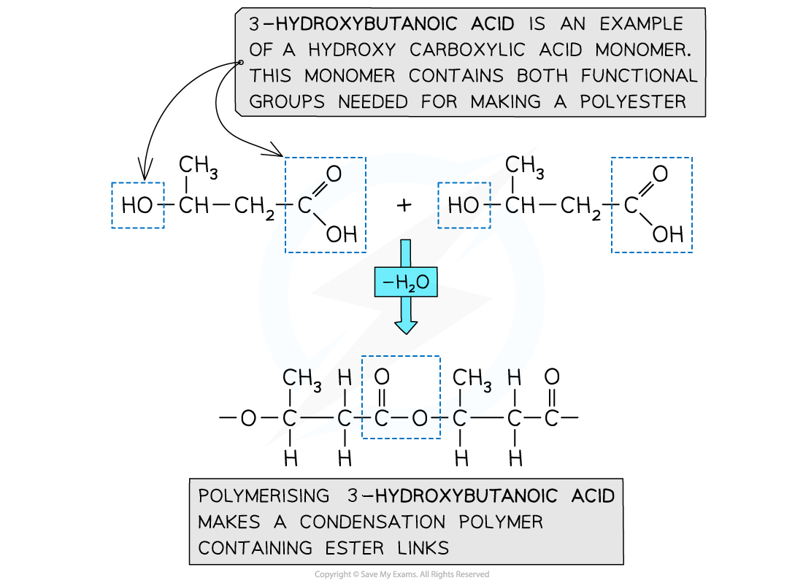

# Formation of Polyesters

## Formation of Polyesters

> **Spec point** — `spcpt_vbGjQ8vGtVPVDVyC`

## Formation of Polyesters

- [Addition polymerisation](https://www.savemyexams.com/a-level/chemistry/cie/25/revision-notes/20-polymerisation/20-1-addition-polymerisation/addition-polymerisation/) has been covered in reactions of alkenes

  - They are made using monomers that have C–C double bonds joined together to form polymers such as (poly)ethene
- Condensation polymerisation is another type of reaction and is used in the making of polyesters

  - A small molecule (e.g. a water molecule) is lost when the monomers join together to form a polyester
  - Polyesters contain ester linkages

#### Example of a polyester

***This polymer structure shows an ester functional group linking monomers together***

### Formation of polyesters

- A diol and a dicarboxylic acid are required to form a polyester

  - A diol contains 2 -OH groups
  - A dicarboxylic acid contains 2 COOH groups

#### Diol and dicarboxylic acid examples

***The position of the functional groups on both of these molecules allows condensation polymerisation to take place effectively***

- When the polyester is formed, one of the -OH groups on the dicarboxylic acid and the hydrogen atom of the diol are expelled as a water molecule (H2O)
- The resulting polymer is a polyester

#### Forming polyethylene terephthalate (PET)

***Expulsion of a water molecule in this condensation polymerisation forms the polyester called Polyethylene terephthalate also known as Terylene or PET***

### Hydroxycarboxylic acids

- So far the examples of making polyesters have focused on using 2 separate monomers for the polymerisation
- There is another route to making polyesters
- A single monomer containing both of the key functional groups can also be used
- These monomers are called hydroxycarboxylic acids

  - They contain an alcohol group (-OH) at one end of the molecule while the other end is capped by a carboxylic acid group (-COOH)

#### Using hydroxycarboxylic acids to form condensation polymers

***Both functional groups needed to make a polyester come from the same monomer***

> **Exam Hint**
> - Polyesters can be made using condensation polymerisation
> - The monomers needed are diols and dicarboxylic acids / dioyl chlorides or a single hydroxycarboxylic acid monomer
