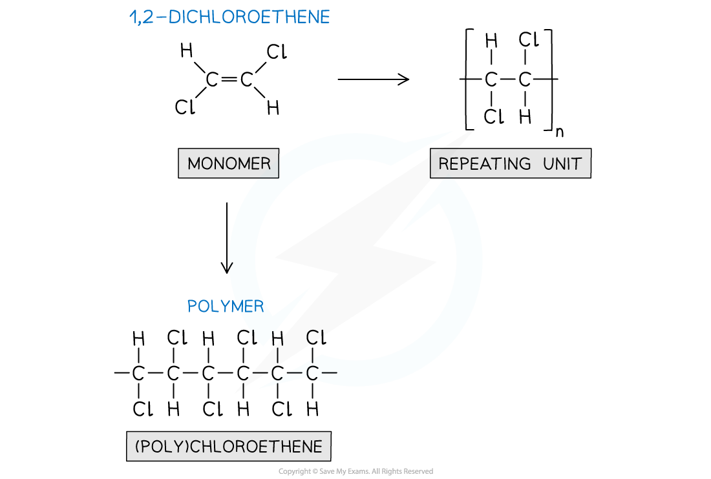
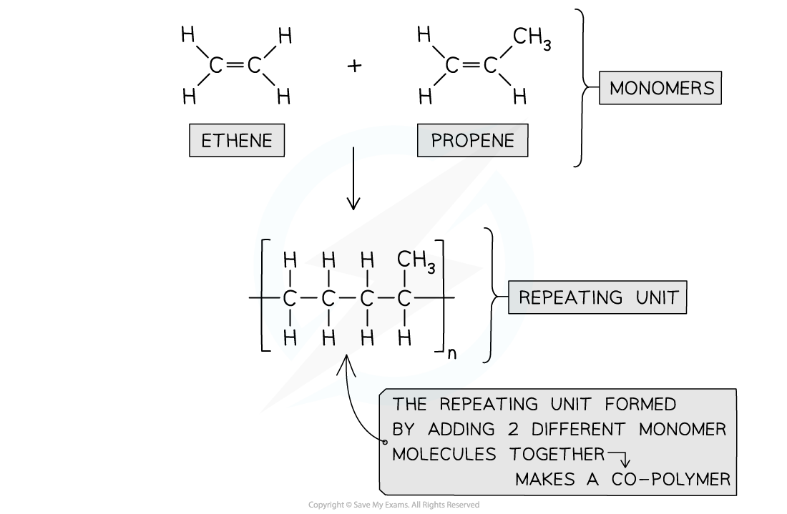
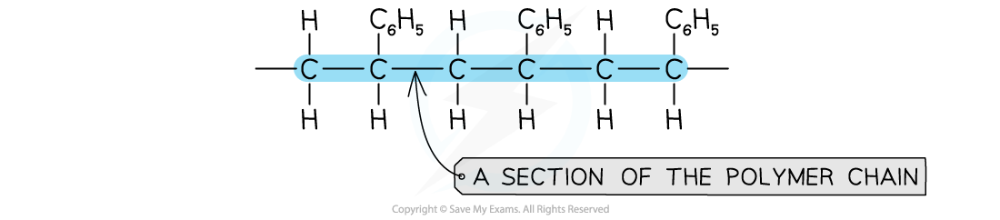
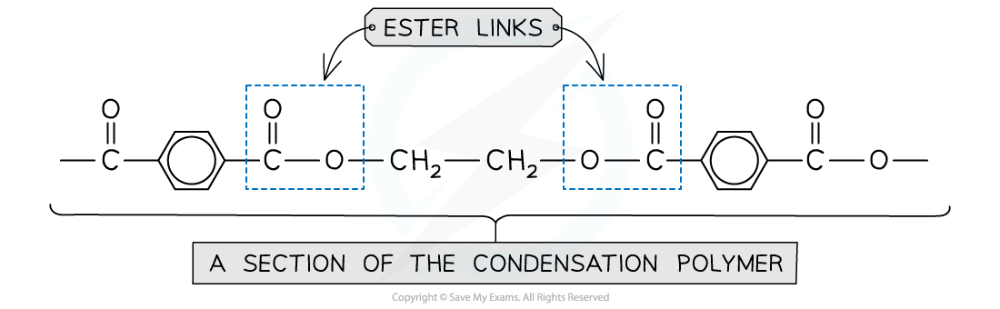

# Predicting & Deducing the Type of Polymerisation

## Predicting Type of Polymerisation

> **Spec point** — `spcpt_Zn8ynqWMthW3YHXw`

## Predicting Type of Polymerisation

- When a set of monomers is given in an exam question, the type of polymerisation can be determined
- Firstly, it’s important to identify the key functional groups in the monomers

### Addition polymerisation

- If the monomer/s contain a C=C double bond, they will polymerise through addition polymerisation
- The double bond can open up in order to add more monomers on either side of the starting monomer
- This type of polymerisation makes (poly)alkenes

#### Addition polymerisation using one monomer

***During addition polymerisation of one alkene monomer, a (poly)alkene is formed***

- (Poly)alkenes can be produced if there are 2 or more alkene monomers as well
- When more than one monomer is used for addition polymerisation, the resulting product is known as a copolymer

#### Addition polymerisation using more than one monomer

***Addition polymerization can also use two or more different alkene monomers forming a co-polymer***

### Condensation polymerisation

- Condensation polymerisation makes polyamides and polyesters
- When looking to identify this type of polymerisation, there are some key functional groups to be aware of

#### Monomers for condensation polymers table

| **Polyamide monomers** | **Polyester monomers** | **Molecule expelled as a result of condensation polymerisation** |
|---|---|---|
| Acyl chlorides (–COCl) Amines (–NH2) | Acyl chlorides (–COCl) Alcohols (–OH) | Hydrochloric acid (HCl) |
| Carboxylic acids (–COOH) Amines (–NH2) | Carboxylic acids (–COOH) Alcohols (–OH) | Water (H2O) |
| Aminocarboxylic acids (H2N–CHR–COOH) | Hydroxycarboxylic acids (HO–R–COOH) | Water (H2O) |

> **Exam Hint**
> - As well as the functional groups to be aware of, know that a small molecule is expelled when the polymer is formed
> - Identify 2 functional groups that can react together to produce either a polyamide or a polyester
> - There are instances where both of the functional groups are on the same monomer molecule
> 
>   - For example, amino acid molecules contain an amine group (-NH2) and a carboxylic acid group (-COOH) which means that they can polymerise to produce a polyamide

## Deducing Type of Polymerisation

> **Spec point** — `spcpt_t6tGYYB2sptyfJfN`

## Deducing Type of Polymerisation

- The type of polymerisation can be determined by considering the structure of the polymer backbone

### Identifying addition polymerisation

- The polymer backbone of an addition polymer does not contain functional groups
- The backbone of the polymer is generally a chain of carbon atoms
- There may be sidechains branching off from the backbone
- Some examples of side chains include:

  - Benzene rings
  - Nitrile groups (-CN)
  - Halogen atoms (-F / -Cl / -Br / -I)

#### Identifying addition polymers

***Addition polymers are identified using the plain carbon chain as the polymer backbone***

### Identifying condensation polymerisation

- A condensation polymer can be identified by functional groups on the polymer backbone
- The backbone of polyesters contains ester links (-COO-)
- The backbone of polyamides contains amide / peptide links (-CONH-)

#### Identifying condensation polymers

***Condensation polymers are identified using functional groups that form part of the polymer backbone, e.g. ester links in polyesters and amide / peptide links in polyamides***

> **Exam Hint**
> - Different sections of polymer chains may be formed using various types of polymerisation
> - In an exam, you may be given a section of a polymer and asked to determine the type of polymerisation used to form that section
> - Firstly, look at the polymer backbone
> 
>   - If there are functional groups along the backbone, that section was made using condensation polymerisation
>   - If there are no functional groups along the backbone, addition polymerisation was used
