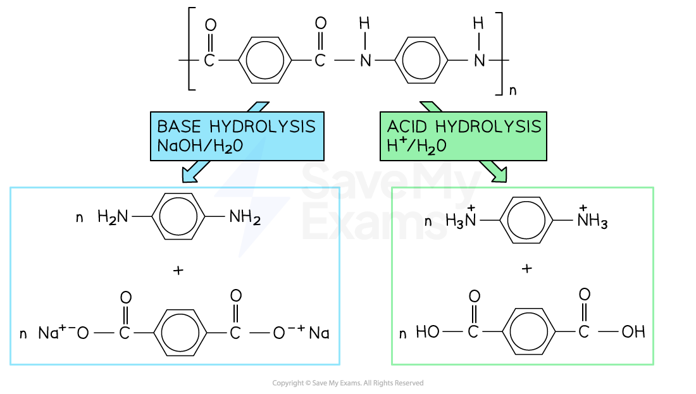
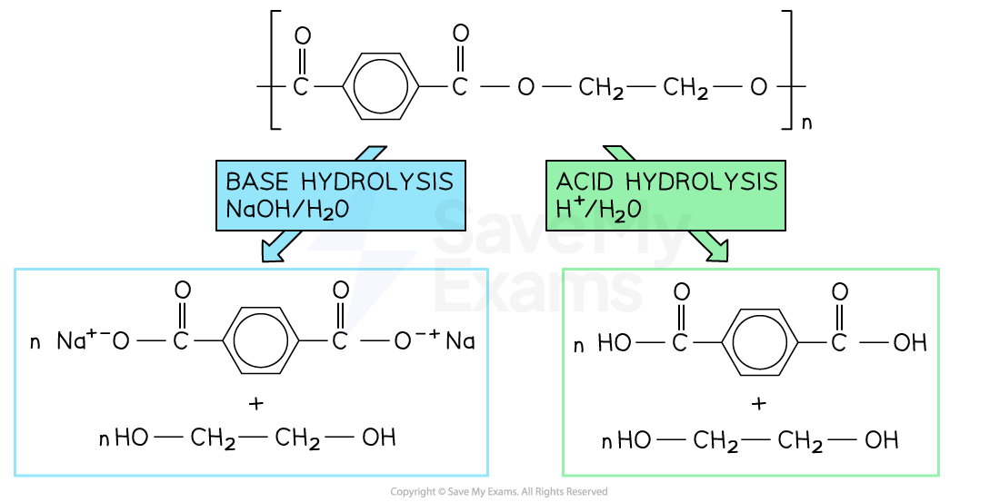

# Degradability of Polymers

## Poly(alkenes) & Biodegradability

> **Spec point** — `spcpt_bJCxxtBR93bJ7pF7`

## Poly(alkenes) & Biodegradability

- Many of the polymers in use have been produced through addition polymerisation of alkenes
- The (poly)alkene chains are non-polar and saturated

  - This makes them chemically inert and, therefore, non-biodegradable
- (Poly)alkenes can be melted and recycled for new uses

  - However, even in the new applications, the (poly)alkenes are not biodegradable
- Recycling plants can burn used plastic materials

  - The energy released from burning can be used to generate electricity
  - Burning plastics in oxygen releases carbon dioxide and water (complete combustion) which can contribute to global warming

## Photodegradation of Polymers

> **Spec point** — `spcpt_svfSPSM8VF3kbs3M`

## Photodegradation of Polymers

- Polyesters and polyamides are biodegradable polymers for a number of reasons

  - One such reason is their ability to breakdown with the use of light
- Carbonyl groups (C=O) along polymer chains are able to absorb energy from the Electromagnetic Spectrum, in particular ultraviolet (UV) light

  - Absorbing UV light weakens the carbonyl areas of polymers and breaks them down into smaller molecules

### Disadvantages of photodegradability

- Despite this ability being a great advantage of polyesters and polyamides, it may pose problems when the polymers are repurposed
- When applied to a new use, the biodegradability could give a weaker polymer
- Breaking down polymers also poses another challenge

  - Once used, polymeric materials are taken to landfill sites where many other materials are piled on top of each other
  - This could mean that photodegradable polyesters or polyamides do not have access to UV light in order to break down naturally

## Biodegrading Polyesters & Polyamides

> **Spec point** — `spcpt_Sh55qyWjdW53sTMX`

## Biodegrading Polyesters & Polyamides

### Biodegradable polymers

- Both polyesters and polyamides can be broken down using hydrolysis reactions
- This is a major advantage over the polymers produced using alkene monomers (polyalkenes)
- When polyesters and polyamides are taken to landfill sites, they can be broken down easily and their products used for other applications

### Hydrolysis of polyamides

- Hydrolysis is the breakdown of molecules using water
- In **acidic **hydrolysis, an acid (such as hydrochloric acid) acts as the catalyst

  - Polyamides such as Kevlar are heated with dilute acid
  - This reaction breaks the polyamide into a dicarboxylic acid and ammonium ions
- **Alkaline** hydrolysis

  - The polyamide is heated with a species containing hydroxide ions (eg. sodium hydroxide)
  - This breaks the polymer into the sodium salts of its monomers (dicarboxylic acid salt and diamines)

#### Hydrolysis of Kevlar, a polyamide

***Hydrolysis of Kevlar produces different products based on whether it is acid hydrolysis or base hydrolysis***

### Hydrolysis of polyesters

- Ester linkages can also be degraded through hydrolysis reactions

  - The acidic and alkaline hydrolysis of polyethylene terephthalate** **(PET) is shown

#### Hydrolysis of polyethylene terephthalate (PET), a polyester

***Hydrolysis of polyethylene terephthalate (PET) produces different products based on whether it is acid hydrolysis or base hydrolysis***

- Acid hydrolysis forms the diol and dicarboxylic acid that were used to form the polyesters
- Alkaline hydrolysis forms the diol and dicarboxylic acid salt
