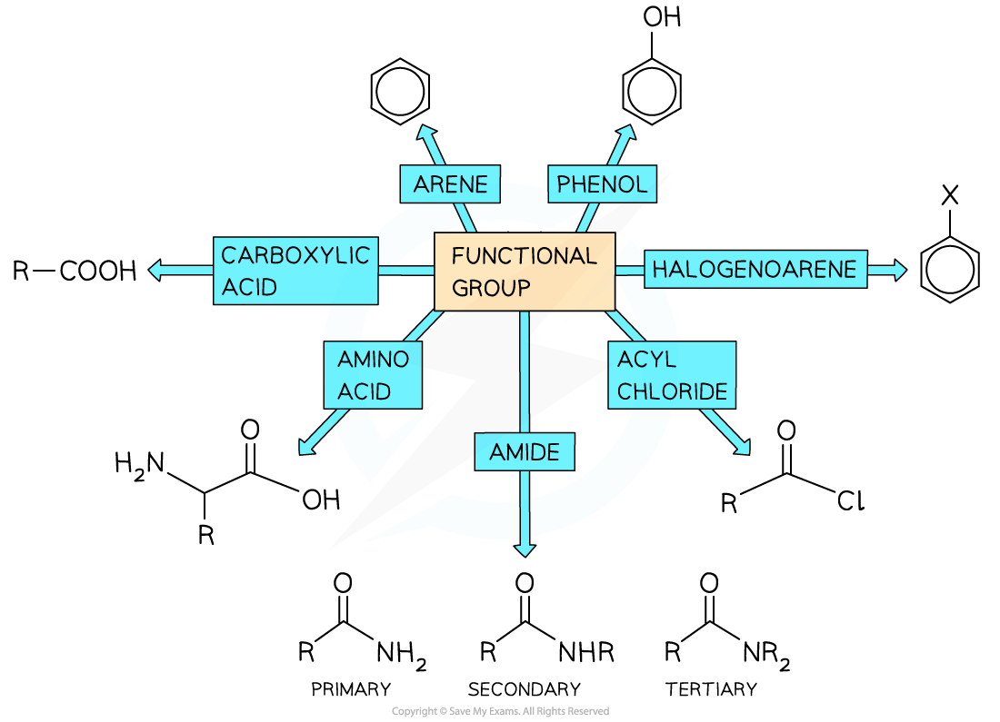
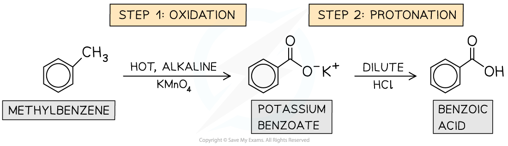
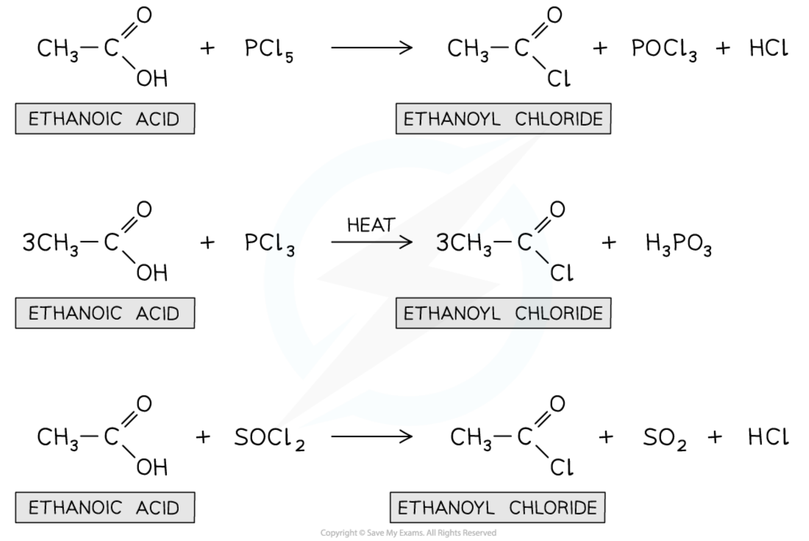
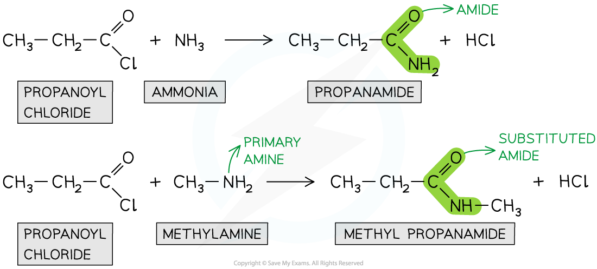
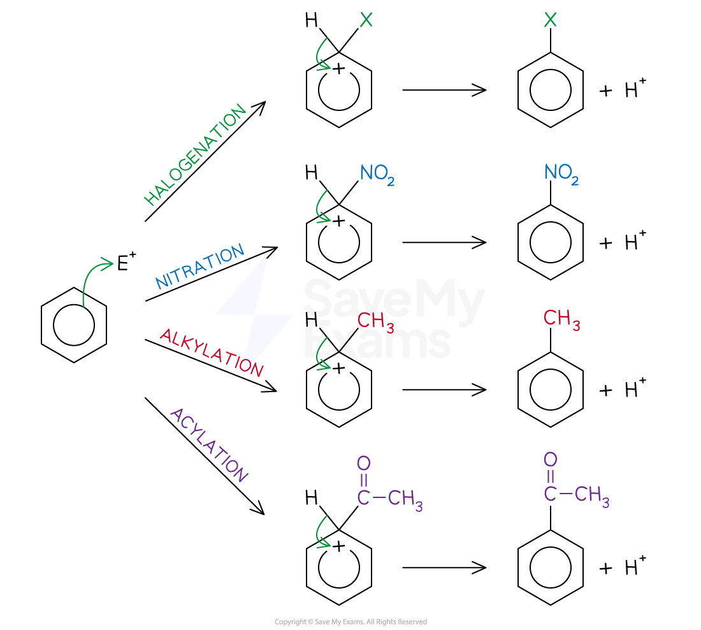
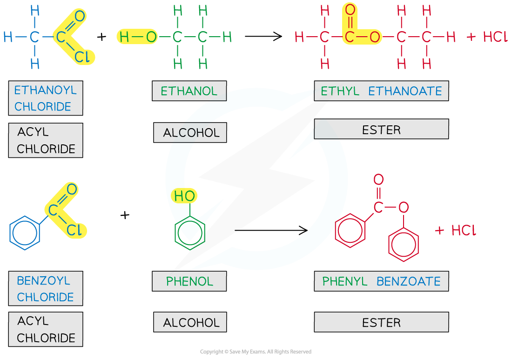
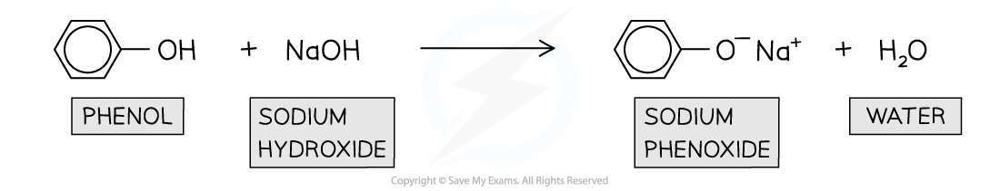
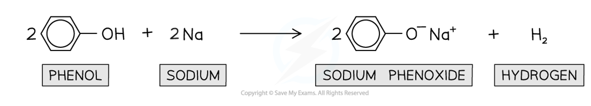
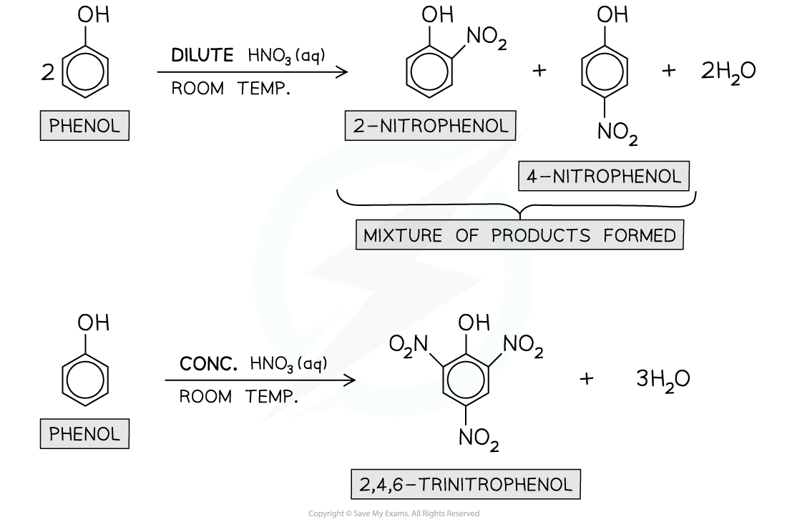
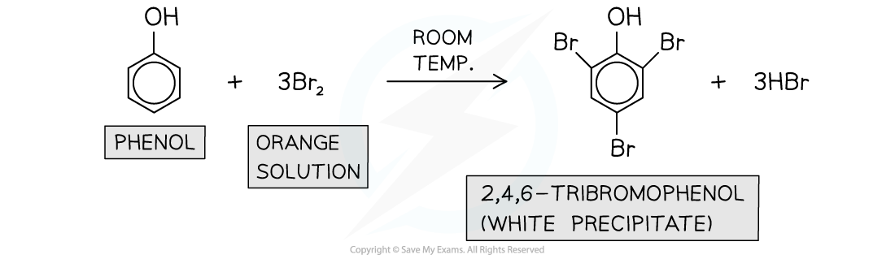

# Elucidating Organic Molecules

## Elucidating Organic Molecules

> **Spec point** — `spcpt_ThVqnpMXwdCPNtHm`

## Elucidating Organic Molecules

- Students should be able to identify organic functional groups and recall their properties and the reactions that they undergo

### Properties of functional groups

- In addition to the functional groups mentioned in the [AS course](https://www.savemyexams.com/a-level/chemistry/cie/25/revision-notes/21-organic-synthesis/21-1-organic-synthesis/organic-synthesis/), students should also be familiar with additional functional groups and their properties including:

  - Arenes
  - Halogenoarenes
  - Carboxylic acids (and derivatives)
  - Phenols
  - Amides
  - Amino acids
  - Acyl chlorides

#### Overview of additional functional groups

***These functional groups are extra to those already covered in ******[21.1 Organic Synthesis](https://www.savemyexams.com/a-level/chemistry/cie/25/revision-notes/21-organic-synthesis/21-1-organic-synthesis/organic-synthesis/)***

### Reactions of functional groups

- Students should also be able to recall:

  - The reactions by which these functional groups can be produced including:
  
    - Benzoic acid
    - Acyl chlorides
    - Amides
  - The reactions that these functional groups undergo

### Producing functional groups

#### Benzoic acid

- Benzoic acid is produced, from methylbenzene, in two steps:

  1. An oxidation reaction by refluxing with hot alkaline KMnO4 to form potassium benzoate
  2. A protonation reaction with dilute HCl

#### Production of benzoic acid

***Benzoic acid is produced from methylbenzene in 2 steps***

#### Acyl chlorides

- Acyl chlorides are formed by an electrophilic substitution reaction of the parent carboxylic acid
- There are various possible reagents:

  - Solid PCl5 - producing the acyl chloride along with POCl3 and HCl
  - Liquid PCl3 and heat - producing the acyl chloride and H3PO3
  - Liquid SOCl2 - producing the acyl chloride along with SO2 and HCl

#### Production of acyl chlorides

***Using ethanoic acid as an example, the reactions all produce acyl chlorides with different byproducts due to the different reagents***

#### Amides

- Amides are formed by a condensation reaction, at room temperature, of an acyl chloride
- The possible amides that can be produced are substituted amides and non-substituted amides

  - Non-substituted amides are produced by the reaction with ammonia
  - Substituted amides are produced by the reaction with primary amines

#### Production of substituted and non-substituted amides

***Using propanoyl chloride as an example, the reaction with ammonia produces a non-substituted amide while the reaction with primary amines produces substituted amides***

### Reacting functional groups

#### Electrophilic substitution reactions of arenes

- You should be able to provide the mechanisms for specific electrophilic substitution reactions of benzene:

  - The electrophile, E+, for a **halogenation **reaction, is a positive halogen ion, X+
  - The electrophile, E+, for a **nitration **reaction, is the nitronium ion, NO2+
  - The electrophile, E+, for an **alkylation **reaction, is a carbocation, R+
  - The electrophile, E+, for an **acylation **reaction, is an **acyl group**, RCO+
  
    - An acyl group is an alkyl group containing a carbonyl, C=O group

#### Specific electrophilic substitution reactions of arenes

***Using different electrophiles, E******+******, the mechanisms for halogenation, nitration, alkylation and acylation are shown***

Hydrogenation of arenes The hydrogenation of benzene is an **addition reaction** Benzene is **heated **with **hydrogen gas **and a **nickel **or **platinum catalyst** to form **cyclohexane** Hydrogenation of benzene

***The hydrogenation of benzene causes a complete loss of aromaticity***

#### Esterification of phenol

- The esterification reaction of carboxylic acids with phenol is slow, so acyl chlorides are used
- The reaction between ethanoyl chloride and phenol is similar to the reaction of ethanoyl chloride and ethanol, although it is not as vigorous

  - The products of this reaction are phenyl ethanoate and hydrogen chloride gas
- The reaction between benzoyl chloride and phenol is also similar to the reaction of ethanoyl chloride and ethanol

  - The products of this reaction are phenyl benzoate and hydrogen chloride gas

#### Formation of esters from the reaction of alcohols with acyl chlorides

***The first part of the ester name comes from the alcohol and the second part of the ester name comes from the acyl chloride***

- To make the reactions with acyl chlorides and aryl chlorides occur in a more timely fashion, phenol is converted into sodium phenoxide by heating with sodium hydroxide

  - This forms the phenoxide ion which is more reactive
  - The hydrogen chloride product is replaced by water and sodium chloride

#### Acid / base reactions of phenol

Phenols dissolve in alkaline solutions to undergo **acid-base **reactions with **bases** forming a **soluble salt **and **water** **Molten phenols **also react **vigorously **with reactive metals such as **sodium **(Na) in an **acid-base **reaction forming a soluble salt and **hydrogen gas ** Acid / base reactions of phenol

***Phenols behave as weak acids in alkaline conditions and molten phenols react vigorously with reactive metals to form a soluble salt and hydrogen gas***

#### Nitration of phenol

Phenols undergo **electrophilic substitution** reactions with **dilute nitric acid **(HNO3) at **room temperature **to give a mixture of **2-nitrophenol **and **4-nitrophenol** When **concentrated HNO****3**** **is used, the product will be 2,4,6-trinitrophenol instead

Nitration of phenol

***Phenols undergo nitration when reacted with dilute HNO******3****** at room temperature***

#### Bromination of phenol

Phenols undergo **electrophilic substitution **with **bromine water **at **room temperature **forming a **white precipitate **of 2,4,6-tribromophenol

Phenol in bromination reactions

***Phenols undergo bromination when reacted with bromine water at room temperature***
