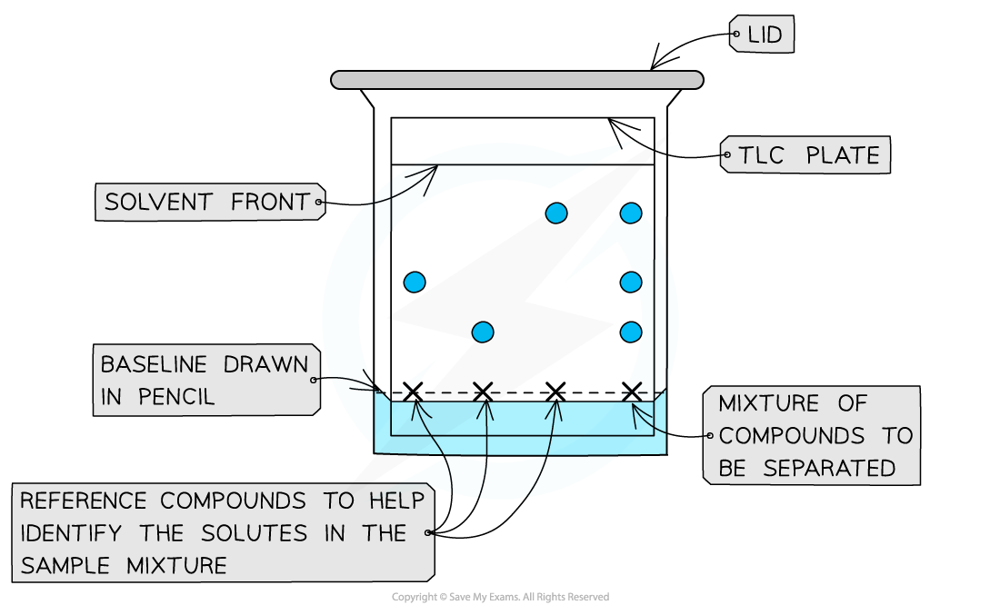
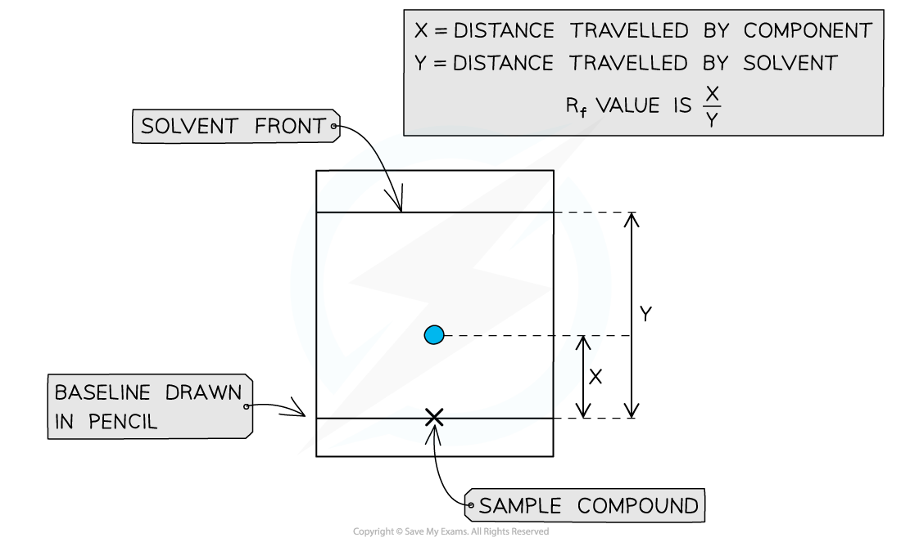

# Thin-Layer Chromatography

## Thin Layer Chromatography: Basics

> **Spec point** — `spcpt_m4QWsjGjw2rcHj2b`

## Thin Layer Chromatography: Basics

- Thin Layer Chromatography (TLC) is a technique used to analyse small samples via separation

  - For example, we could separate a dye out to determine the mixture of dyes in a forensic sample
- There are 2 phases involved in TLC:

  1. Stationary phase
  2. Mobile phase

### Stationary phase

- This phase is commonly a thin metal sheet coated in alumina (Al2O3) or silica (SiO2)
- The solute molecules **adsorb** onto the surface
- Depending on the strength of interactions with the stationary phase, the separated components will travel particular distances through the plate
- The more they interact with the stationary phase, the more they will 'stick' to it

### Mobile phase

- Flows over the stationary phase
- It is a polar or nonpolar liquid (solvent) or gas that carries components of the compound being investigated

  - Polar solvents - water or alcohol
  - Non-polar solvents - alkanes
- If the sample components are coloured, they are easily identifiable
- We can examine the plate under UV light using ninhydrin to identify uncoloured components

### Conducting a TLC analysis

- **Step 1:**

  - Prepare a beaker with a small quantity of solvent
- **Step 2:**

  - On a TLC plate, draw a horizontal line, called the **baseline**, at the bottom edge (in pencil)
- **Step 3:**

  - Place a spot of pure reference compound on the left of this line, then a spot of the sample to be analysed to the right of the baseline and allow to air dry The reference compounds will allow identification of the mixture of compounds in the sample
- **Step 4:**

  - Place the TLC plate inside the beaker with solvent - making sure that the pencil baseline is above the level of the solvent - and place a lid to cover the beaker
  - The solvent will begin to travel up the plate, dissolving the compounds as it does
- **Step 5:**

  - As the solvent reaches the top, remove the plate and draw another pencil line where the solvent has reached, indicating the **solvent front**
  - The sample’s components will have separated and travelled up towards this solvent front

#### Thin layer chromatography experimental set up

***A dot of the sample is placed on the baseline and allowed to separate as the mobile phase flows through the stationary phase; the reference compound/s will also move with the solvent***

### Rf values

- A TLC plate can be used to calculate *R*f values for compounds:

***R*****f**** = **$\frac{\mathrm{distance} \mathrm{travelled} \mathrm{by} \mathrm{component}}{\mathrm{distance} \mathrm{travelled} \mathrm{by} \mathrm{solvent}}$

- These values can be used alongside other analytical data to deduce the composition of mixtures

#### Calculating Rf values

#### Rf values can be calculated by taking 2 measurements from the TLC plate

> **Exam Hint**
> - The baseline on a TLC plate must be drawn in pencil
> - Any other medium would interact with the sample component and solvents used in the analysis process.

## Interpreting & Explaining Rf Values in TLC

> **Spec point** — `spcpt_B8TWJXzXhRwkNnVW`

## Interpreting & Explaining Rf Values in TLC

- The less polar components travel further up the TLC plate

  - Their *R*f values are higher than those closer to the baseline
  - They are more soluble in the mobile phase and get carried forward with the solvent
- More polar components do not travel far up the plate

  - They are more attracted to the polar stationary phase
- The extent to which the components within the investigated sample are separated depends on:

  - The solubility of each component in the mobile phase
  - The interaction between each component and the stationary phase
- Knowing the *R*f values, of compounds being analysed, helps to compare the polarity of various molecules
