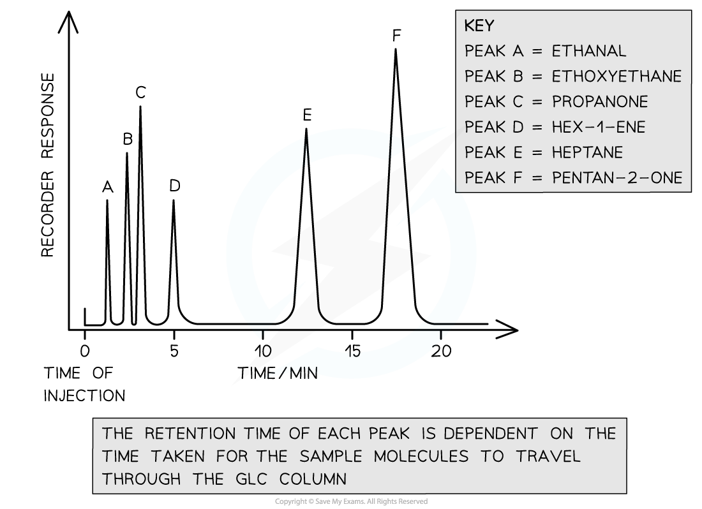

# Gas/Liquid Chromatography

## Gas/Liquid Chromatography Terminology

> **Spec point** — `spcpt_VrBCfBdBTftmDgDY`

## Gas/Liquid Chromatography Terminology

- Gas-Liquid Chromatography (GLC) is used for analysing:

  - Gases
  - Volatile liquids
  - Solids in their vapour form
- The stationary phase:

  - This method uses a column for the stationary phase
  - A non-polar, long-chain, non-volatile hydrocarbon with a high boiling point is mounted onto a solid support
  - Small silica particles can be packed into a glass column to offer a large surface area
  - Sample gas particles travel through this phase and are able to separate well due to the large surface area
- The Mobile phase

  - An **inert** carrier gas (eg. Helium, Nitrogen) moves the sample molecules through the stationary phase

### Retention times

- Once sample molecules reach the detector, their **retention times** are recorded

  - This is the time taken for a component to travel through the column
- The retention times are recorded on a chromatogram where each peak represents a volatile compound in the analysed sample
- Retention times are then compared with data book values to identify unknown molecules

#### An example gas chromatogram

***A gas chromatogram of a volatile sample compound has six peaks. Depending on each molecule’s interaction with the stationary phase, each peak has its own retention time***
