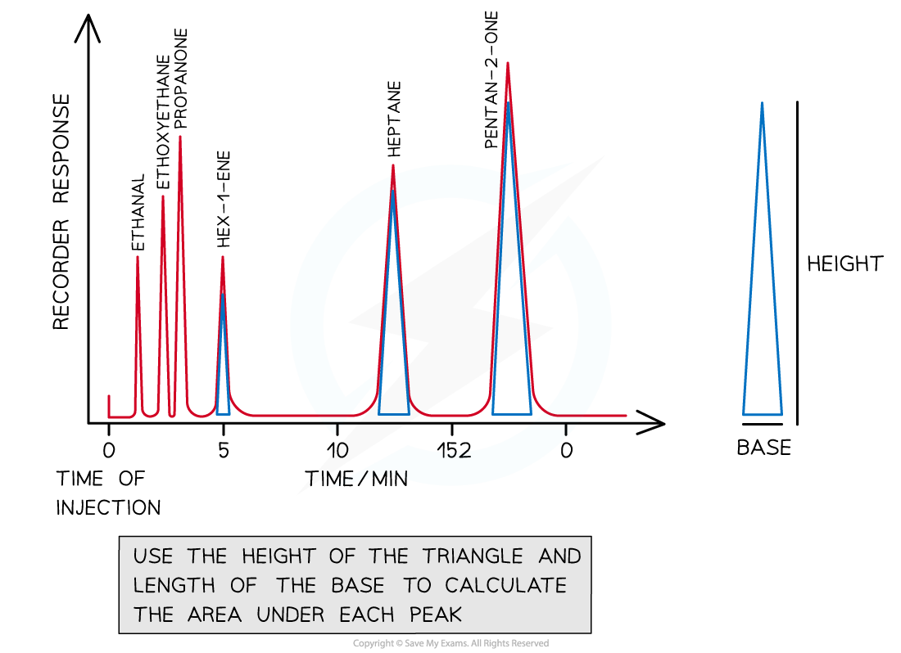

# Interpreting Rf Values in GL Chromatography

## Interpreting Rf Values in GL Chromatography

> **Spec point** — `spcpt_dc6NxTSP7ngzvzvq`

## Interpreting Rf Values in GL Chromatography

### Features of a gas-liquid chromatogram

- Peaks represent different molecules from the sample - each roughly taking the shape of a triangle
- The area under each peak is the relative concentration of each component (the peak integration value)

**Area under the peak = ½ x base x height**

- If the area under each peak is very small or too difficult to decipher, the height of the peaks are used for further analysis

#### Calculating areas under curves on a gas chromatogram

***To find the area under each peak, treat each peak as a triangle - see the examples shown using blue triangles in the diagram***

### Percentage composition of a mixture

- We can calculate the amount of a particular molecule in a sample by using an expression
- If a chromatogram shows peaks for alcohols A, B, C and D, to calculate the % composition of alcohol C, use this expression:

`equation`

## Explaining Retention Times

> **Spec point** — `spcpt_GrDHnRRH7rRvMNSr`

## Explaining Retention Times

- Retention time is the time taken for a sample molecule to travel through the column, from the time it is inserted into the machine to the time it is detected
- Molecules in the gaseous mixture travel at different rates, therefore giving rise to different retention times
- **Longer retention times** are associated with:

  - **Non-polar components** in the mixture
  - They are more attracted to the non-polar liquid in the stationary phase
  - So non-polar molecules travel slower through the column
- **Shorter retention times **are associated with:

  - **Polar components** in the mixture that prefer to interact with the carrier gas
  - They are less attracted to the non-polar liquid in the stationary phase
  - So polar molecules travel faster through the column
  - These molecules may have lower boiling points and, therefore, are vapourised more readily
