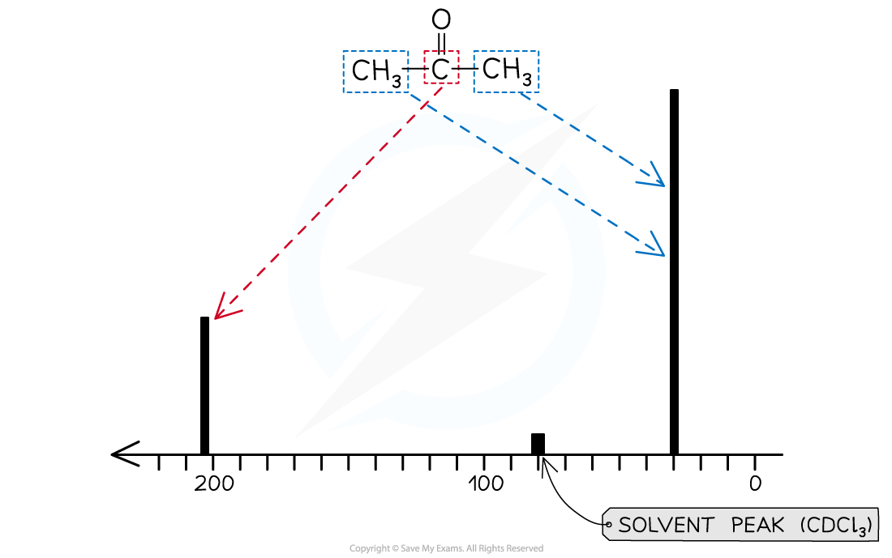

# Interpreting & Explaining Carbon-13 NMR Spectroscopy

## Interpreting & Explaining Carbon-13 NMR Spectra

> **Spec point** — `spcpt_3gMJXKdXVpBfkmWS`

## Interpreting & Explaining Carbon-13 NMR Spectra

- Nuclear Magnetic Resonance (NMR) spectroscopy is used for analysing organic compounds
- Atoms with odd mass numbers usually show signals on NMR

  - For example isotopes of atoms
  - Many of the carbon atoms on organic molecules are carbon-12
  - A small quantity of organic molecules will contain the isotope carbon-13 atoms
  - These will show signals on a 13C NMR
- In 13C NMR, the magnetic field strengths of carbon-13 atoms in organic compounds are measured and recorded on a spectrum
- Just as in 1H NMR, all samples are measured against a reference compound – Tetramethylsilane (TMS)
- On a 13C NMR spectrum, non-equivalent carbon atoms appear as peaks with different chemical shifts

#### Chemical shift values (relative to TMS) for 13C NMR analysis table

| **Hybridisation of carbon atom** | **Environment of carbon atom** | **Example** | **Range of chemical shift (ppm)** |
|---|---|---|---|
| sp3 | alkyl | **C**H3–, **C**H2–, **C**H–, –**C**– | 0 - 50 |
| sp3 | next to alkene / arene | –**C**–C=C, –**C**–Ar* | 25 - 50 |
| sp3 | next to carbonyl / carboxyl | **C**–COR, **C**–CO2R | 30 - 65 |
| sp3 | next to halogen | **C**–X | 30 - 60 |
| sp3 | next to oxygen | **C**–O | 50 - 70 |
| sp2 | alkene / arene | –**C**=C–, –**Ar***– | 110 - 160 |
| sp2 | carboxyl | R–**C**OOH, R–**C**OOR | 160 - 185 |
| sp2 | carbonyl | R–**C**HO, R–**C**O–R | 190 - 220 |
| sp | nitrile | R–**C**$\equiv$N– | 100 - 125 |

* represents a benzene ring

### Features of a 13C NMR spectrum

- 13C NMR spectra display sharp single signals

  - There aren’t any complicated spitting patterns as seen with 1H NMR spectra
- The height of each signal is **not **proportional to the number of carbon atoms present in a single molecular environment
- CDCl3 is used as a solvent to dissolve samples for 13C NMR

  - On spectra, a single solvent peak appears at 80 ppm caused by 13C atoms in the CDCl3
  - This can be ignored when interpreting 13C spectra

### Explaining 13C molecular environments

- On an organic molecule, the carbon-13 environments can be identified in a similar way to the proton environments in 1H NMR
- For example, propanone

#### Identifying molecular environments in propanone

***There are 2 molecular environments in propanone***

- There are 2 molecular environments

  - Therefore, 2 signals will be present on its 13C NMR spectrum
- The carbonyl carbon will produce a 13C peak in the range of 190 - 220 ppm
- The 2 methyl groups will produce a 13C peak in the range of 30 - 65 ppm

#### Carbon-13 NMR spectrum for propanone

***The ******13******C NMR of propanone shows 2 signals for the 2 molecular environments***
