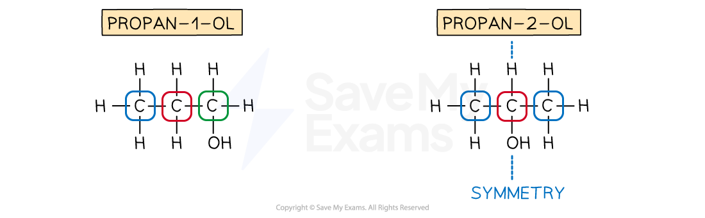
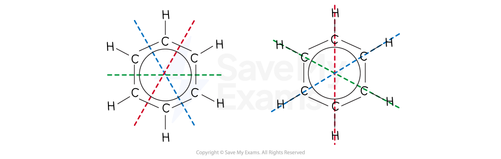

# Predicting Carbon-13 NMR Spectra

## Predicting Carbon-13 NMR Spectra

> **Spec point** — `spcpt_4GFJYWgB7fCm97pj`

## Predicting Carbon-13 NMR Spectra

### Predicting 13C molecular environments

- The key to carbon-13 NMR spectroscopy is identifying different carbon environments

  - It can help to look for symmetry in the molecules
- For example, propanol

  - There are 2 isomers of propanol: propan-1-ol and propan-2-ol
  - Since both isomers contain 3 carbons, the maximum possible number of 13C NMR peaks is 3
  - Propan-1-ol
  
    - There is no symmetry or equivalent carbons in a molecule of propan-1-ol
    - Therefore, there will be 3 peaks in the 13C NMR spectrum of propan-1-ol
  - Propan-2-ol
  
    - There is a line of symmetry through the second carbon with the hydroxyl / OH group attached
    - This means that the CH3 groups on either side are equivalent
    - Therefore, there will be 2 peaks in the 13C NMR spectrum of propan-2-ol

#### Identifying molecular environments in propanol

***Propan-1-ol has no symmetry / equivalent carbons in its structure, while propan-2-ol has symmetry and, therefore, 2 equivalent carbons***

- For example, pentane-1,4-diol

  - Since pentane-1,4-diol contains 5 carbons, the maximum possible number of 13C NMR peaks is 5
  - There are 2 carbons with hydroxyl / OH groups attached but these are not equivalent
  
    - Carbon-1 is CH2OH  with a neighbouring CH2
    - Carbon-4 is CHOH with a neighbouring CH2 and a neighbouring CH3
    - This means that there is no symmetry within the molecule and, therefore, no equivalent carbons
    - So, there will be 5 peaks in the 13C NMR spectrum of pentane-1,4-diol

#### Identifying molecular environments in pentane-1,4-diol

***Pentane-1,4-diol has no symmetry / equivalent carbons in its structure***

- The same principle of carbon environments also applies to aromatic compounds
- For example, benzene

  - Since benzene contains 6 carbons, the maximum possible number of 13C NMR peaks is 6
  - The benzene molecule has several lines of symmetry leading to the fact that all of the carbons are equivalent
  - So, there will be 1 peak in the 13C NMR spectrum of benzene

#### Identifying molecular environments in benzene

***Benzene has symmetry / equivalent carbons in its structure***

> **Exam Hint**
> - Counting the number of 13C resonances should be the first step in analysing a spectrum
> - For example, it is possible to differentiate the three isomers of dihydroxybenzene quickly be considering the symmetry of the molecules and therefore the number of resonances expected in their spectra.

> **Worked Example**
> Predict the number of peaks / resonances in the 13C  spectrum of 1,3-dihydroxybenzene.
> 
> **Answer:**
> 
> - There are 4 chemical environments
> - Therefore, there will be four peaks / resonances in the 13C  spectrum
> 
> 
