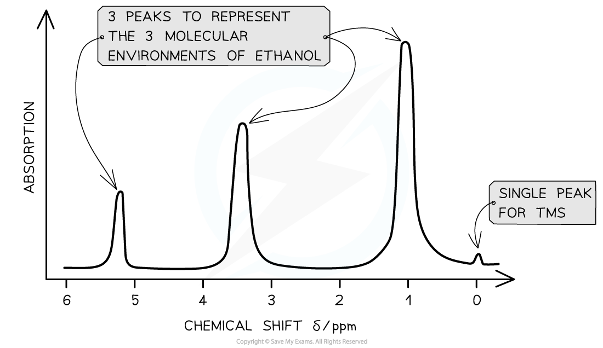
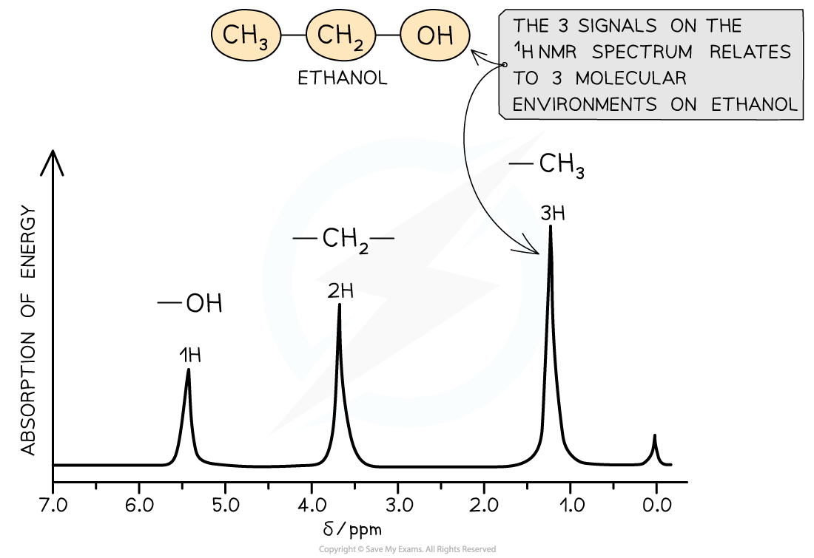
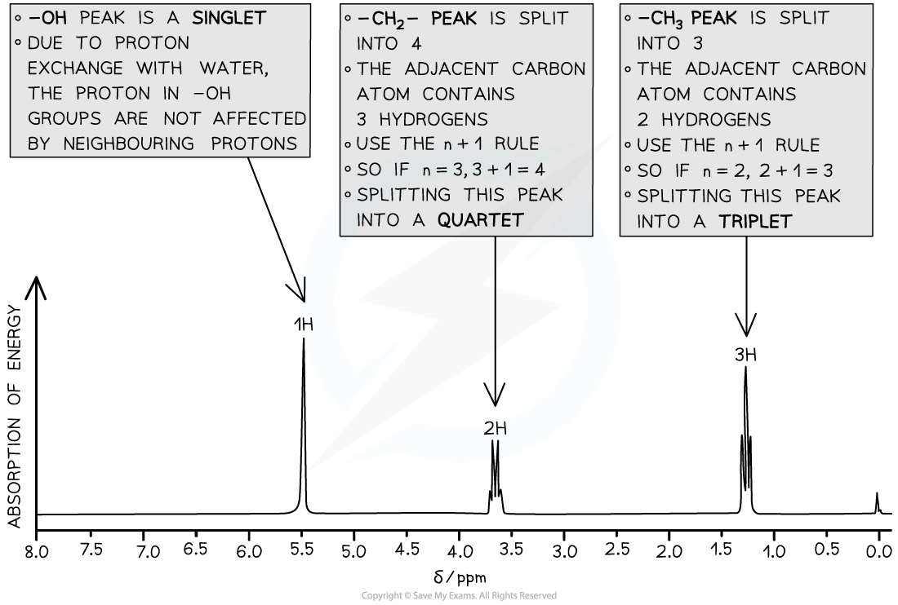
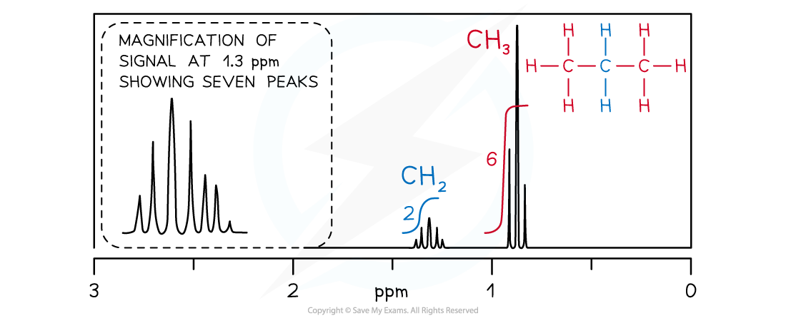

# Proton (1H) NMR Spectroscopy

## Interpreting & Explaining Proton (1H) NMR Spectra 

> **Spec point** — `spcpt_7NgTR976NR3q2HXs`

## Interpreting & Explaining Proton (1H) NMR Spectra

- **Nuclear Magnetic Resonance (NMR)** spectroscopy is used for analysing organic compounds
- Atoms with odd mass numbers usually show signals on NMR
- In 1H NMR, the magnetic field strengths of protons in organic compounds are measured and recorded on a spectrum
- Protons on different parts of a molecule (in different molecular environments) emit different frequencies when an external magnetic field is applied
- All samples are measured against a reference compound – **Tetramethylsilane (TMS)**

  - TMS shows a single sharp peak on NMR spectra, at a value of zero
  - Sample peaks are then plotted as a ‘shift’ away from this reference peak
  - This gives rise to ‘chemical shift’ values for protons on the sample compound
  - Chemical shifts are measured in parts per million (ppm)

### Features of an NMR spectrum

- NMR spectra show the intensity of each peak against its chemical shift
- The area under each peak gives information about the number of protons in a particular environment
- The height of each peak shows the intensity/absorption from protons
- A single sharp peak is seen to the far right of the spectrum

  - This is the reference peak from TMS
  - Usually at chemical shift 0 ppm

#### Low resolution 1H NMR for ethanol

***The key features of this spectrum are the number and position of the peaks***

### Molecular environments

- Hydrogen atoms of an organic compound are said to reside in different molecular environments

  - E.g. Methanol has the molecular formula CH3OH
  - There are 2 molecular environments: -CH3 and -OH
- The hydrogen atoms in these environments will appear at 2 different chemical shifts
- Different types of protons are given their own range of chemical shifts

> **Worked Example**
> How many different 1H chemical environments occur in 2-methylpropane?
> 
> **Answer:**
> 
> - Two different 1H chemical environments occur in 2-methylpropane
> - The three methyl groups are in the same 1H environment
> 
>   - The lone hydrogen is in its own 1H environment
> 
> 

#### Chemical shift values for 1H molecular environments table

| **Environment of proton** | **Example** | **Chemical shift range, δ / ppm** |
|---|---|---|
| alkane | –C**H**3, –C**H**2–, >C**H**– | 0.9 - 1.7 |
| alkyl next to C=O | C**H**3–C=O, –C**H**2–C=O, >C**H**–C=O | 2.2 - 3.0 |
| alkyl next to aromatic ring | C**H**3–Ar, –C**H**2–Ar, >C**H**2–Ar | 2.3 - 3.0 |
| alkyl next to electronegative atom | C**H**3–O, C**H**2–O, C**H**2–Cl | 3.2 - 4.0 |
| attached to alkene | =C**H**R | 4.5 - 6.0 |
| attached to aromatic ring | **H**–Ar | 6.0 - 9.0 |
| aldehyde | **H**COR | 9.3 - 10.5 |
| alcohol* | RO**H** | 0.5 - 6.0 |
| phenol* | Ar–OH | 4.5 - 7.0 |
| carboxylic acid | RCOO**H** | 9.0 - 13.0 |
| alkyl amine* | R–N**H**– | 1.0 - 5.0 |
| aryl amine* | Ar–N**H**2 | 3.0 - 6.0 |
| amide | RCON**H**R | 5.0 - 12.0 |

* δ values for O–H protons and N–H protons vary depending on the solvent and concentration

- Protons in the same chemical environment are chemically equivalent

  - 1,2-dichloroethane, Cl-CH2-CH2-Cl has one chemical environment as these four hydrogens are all exactly equivalent
- Each individual peak on a 1H NMR spectrum relates to protons in the same environment

  - Therefore, 1,2-dichloroethane would produce one single peak on the NMR spectrum as the protons are in the same environment

#### Identifying molecular environments in 1,2-dichloroethane

***All four protons in the 1,2-dichloroethane molecule are equivalent***

### Low resolution 1H NMR

- Peaks on a low resolution NMR spectrum refer to molecular environments of an organic compound

  - E.g. Ethanol has the molecular formula CH3CH2OH
  - This molecule as 3 separate environments: -CH3, -CH2, -OH
  - So 3 peaks would be seen on its spectrum at 1.2 ppm (-CH3), 3.7 ppm (-CH2) and 5.4 ppm (-OH)

#### Low resolution NMR spectrum of ethanol

***The low resolution NMR spectrum of ethanol shows 3 peaks for the 3 molecular environments***

### High resolution 1H NMR

- More structural details can be deduced using high resolution NMR
- The peaks observed on a high resolution NMR may sometimes have smaller peaks clustered together
- The splitting pattern of each peak is determined by the number of protons on neighbouring environments

**The number of peaks a signal splits into = n + 1**

- (Where n = the number of protons on the adjacent carbon atom)

## Predicting Shifts & Splitting Patterns

> **Spec point** — `spcpt_SMsrjPXtrfPS85vz`

## Predicting Shifts & Splitting Patterns

### Spin-Spin Splitting

- A high resolution 1H NMR spectrum can show you the structure of the molecule but also the peaks can be split into sub-peaks or splitting patterns
- These are caused by a proton's spin interacting with the spin states of nearby protons that are in different environments

  - This can provide information about the number of protons bonded to adjacent carbon atoms
  - The splitting of a main peak into sub-peaks is called spin-spin splitting or spin-spin coupling

#### High resolution 1H NMR spectrum of ethanol

***The high resolution ******1******H NMR spectrum of ethanol showing the splitting patterns of each of the 3 peaks. Using the n+1, it is possible to interpret the splitting pattern***

> **Exam Hint**
> - It is very rare that the spin-spin splitting of equivalent protons is covered in teaching because it is so rarely asked in exams
> - Equivalent protons do **not **cause spin-spin splitting
> 
>   - The simplest example of this is benzene
>   
>     - In benzene, all of the protons are equivalent
>     - This means that they are seen as one singlet in the high resolution 1H NMR spectrum  of benzene

### The n+1 rule

- The number of sub-peaks is one greater than the number of adjacent protons causing the splitting

  - For a proton with *n* protons attached to an adjacent carbon atom, the number of sub-peaks in a splitting pattern = *n*+1
- When analysing spin-spin splitting, it shows you the number of hydrogen atoms on the adjacent carbon atom
- These are the splitting patterns that you need to be able to recognise from a 1H spectra:

#### 1H NMR peak splitting patterns table

| **Number of adjacent protons (n)** | **Splitting pattern using the n+1 rule the peak will split into ....** | **Relative intensities in splitting pattern** | **Shape** |
|---|---|---|---|
| 0 | 1, singlet | 1 |  |
| 1 | 2, doublet | 1 : 1 |  |
| 2 | 3, triplet | 1 : 2 : 1 |  |
| 3 | 4, quartet | 1 : 3 : 3 : 1 |  |

- Splitting patterns must occur in pairs because each proton splits the signal of the other
- There are some common splitting pairs you will see in a spectrum however you don't need to learn these but can be worked out using the *n*+1 rule

  - You will quickly come to recognise the triplet / quartet combination for a CH3CH2 because it is so common

### Common pair of splitting patterns

- A quartet and a triplet in the same spectrum usually indicate an ethyl group, CH3CH2-
- The signal from the CH3 protons is split as a triplet by having two neighbours
- The signal from the CH2 protons is split as a quartet by having three neighbours
- Here are some more common pairs of splitting patterns

#### Common pairs of splitting patterns

#### 1H NMR spectrum of propane

- The CH2 signal in propane (blue) is observed as a heptet because it has six neighbouring equivalent H atoms (*n*+1 rule), three on either side in two equivalent CH3 groups
- The CH3 groups (red) produce identical triplets by coupling with the CH2 group

> **Worked Example**
> For the compound (CH3)2CHOH, predict the following:
> 
> 1. The number of peaks
> 2. The type of proton and chemical shift
> 3. The relative peak areas
> 4. The splitting pattern
> 
> **Answers:**
> 
> 1. The number of peaks
> 
>   - 3 peaks
> 2. The type of proton and chemical shift
> 
>   - (C**H****3**)**2**CHOH at 0.9 - 1.7 ppm
>   - (CH3)2C**H**OH at 3.2 - 4.0 ppm
>   - (CH3)2CHO**H **at 0.5 - 6.0 ppm
> 3. The relative peak areas
> 
>   - Ratio 6 : 1 : 1
> 4. The splitting pattern
> 
>   - (C**H****3**)**2**CHOH split into a doublet (1+1=2)
>   - (CH3)2C**H**OH split into a heptet (6+1=7)
