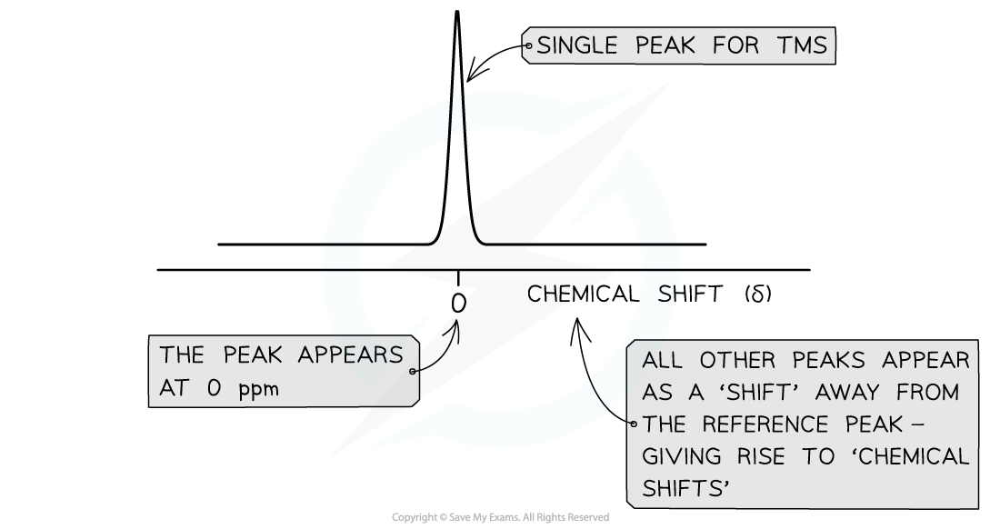

# Tetramethylsilane (TMS) & Deuterated Solvents

## Use of Tetramethylsilane (TMS)

> **Spec point** — `spcpt_hS2VJk6cNC2zpynw`

## Use of Tetramethylsilane (TMS)

- In NMR spectroscopy, tetramethylsilane (TMS) is used as a reference compound
- The organic compound is dissolved in TMS before being introduced to the magnetic field of the spectrometer
- It is an ideal chemical to use as a reference

  - TMS is inert and volatile
  - This reduces undesirable chemical reactions with the compound to be analysed
  - It also mixes well with most organic compounds
- TMS gives a single sharp peak on the NMR spectrum and is given a value of zero
- The molecular formula of TMS is Si(CH3)4

  - There are 12 hydrogens in this molecule
  - All of the protons are in the same molecular environment. Therefore gives rise to just one peak
  - This peak has a very high intensity as it accounts for the absorption of energy from 12 1H nuclei

#### The structure of tetramethylsilane

***Tetramethylsilane (TMS)***** – Si(CH****3****)****4**

- When peaks are recorded from the sample compound, they are measured and recorded by their shift away from the sharp TMS peak
- This gives rise to the **chemical shift** values for different 1H environments in a molecule

#### The 1H NMR spectrum for tetramethylsilane

*** 1******H NMR spectrum for TMS showing its signal at 0 ppm***

## Deuterated Solvents in Proton NMR

> **Spec point** — `spcpt_pYmRWxPrtMDKj5ym`

## Deuterated Solvents in Proton NMR

- When samples are analysed through NMR spectroscopy, they must be dissolved in a solvent
- Tetramethylsilane (TMS) is a commonly used solvent in NMR as it gives one sharp reference peak on NMR spectra
- However, the proton atoms can still interfere with peaks of a sample compound
- To avoid this interference, solvents containing deuterium can be used instead, e.g. CDCl3

  - Deuterium (2H) is an isotope of hydrogen (1H)
- Deuterium nuclei absorb radio waves in a different region to the protons analysed in organic compounds
- Therefore, the reference solvent peak will not interfere with those of the sample

### Identifying the -OH or -NH signal in an NMR spectrum

- In ¹H NMR, samples are dissolved in a solvent to help separate molecules and prevent them from interacting
- The solvent must:

  - Be a good solvent for organic molecules
  - Not contain any hydrogen (¹H) atoms, so it does not interfere with the NMR signals

### Deuterated and non-deuterated solvents

- **Carbon tetrachloride, CCl****4****:**

  - This solvent does not contain hydrogen, so it does not produce 1H NMR signals.
  - It is suitable for 1H NMR but does not dissolve all molecules well.
- Deuterated solvents are often used in 1H NMR spectroscopy because deuterium (²H) is an isotope of hydrogen with no nuclear spin, which does not affect NMR results
- **Deuterochloroform / Chloroform-d, CDCl****3****:**

  - This is often preferred because it contains **deuterium (****2****H)** instead of hydrogen, so it does not interfere with the proton NMR spectrum
- **Deuterium oxide / Heavy water, D****2****O:**

  - The deuterium atoms exchange reversibly with the protons in the -OH and -NH groups, allowing these signals to be identified in the NMR spectrum

### Identifying -OH and -NH signals

- Protons in **-OH** (hydroxyl) and **-NH** (amine) groups give **singlet** peaks in ¹H NMR, but these signals can be tricky:

  - They are **broad** or sometimes fall outside normal chemical shift ranges
  - The proton in these groups exchanges quickly with protons from water or acids, so only one peak appears
  - Their chemical shift ranges may overlap with other types of protons, making them difficult to interpret
- To identify these groups more clearly, proton exchange with **deuterium oxide (D****2****O)** is used:

  - The deuterium atoms in D2O exchange reversibly with the protons in the -OH or -NH groups

**-OH + D****2****O ⇌ -OD + HOD**

**-NH-CO- + D****2****O ⇌ -ND-CO- + HOD**

- Since deuterium does not absorb in the same region as protons in the NMR spectrum, the signal for -OH or -NH disappears after D2O is added
- This confirms the presence of -OH or -NH groups in the molecule

  - If a peak disappears after adding D2O, it must have been due to the exchange of a proton from an -OH or -NH group
- This technique is particularly useful because -OH and -NH peaks can be broad and difficult to assign confidently without D2O exchange
