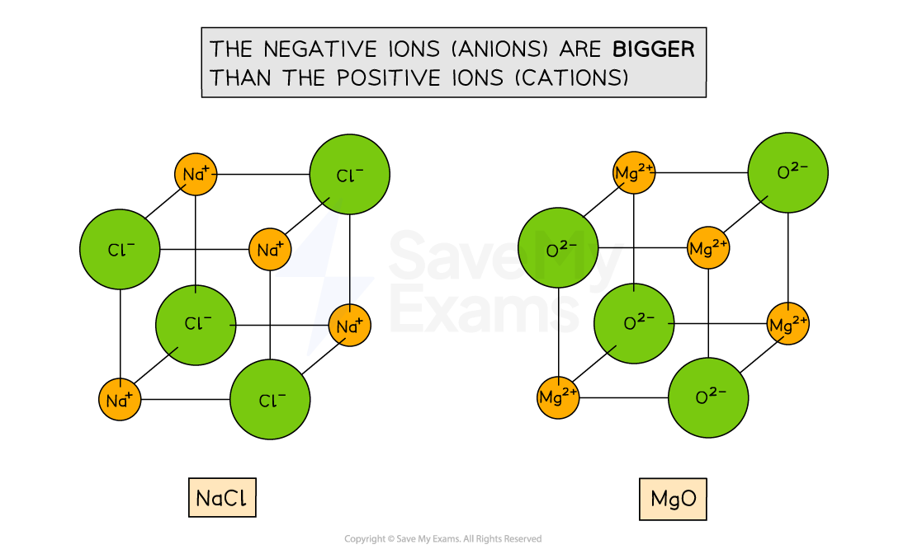
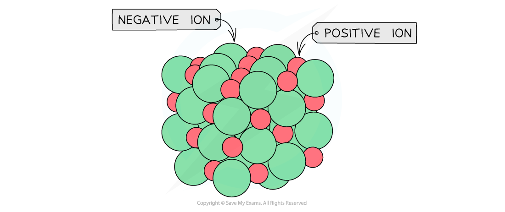
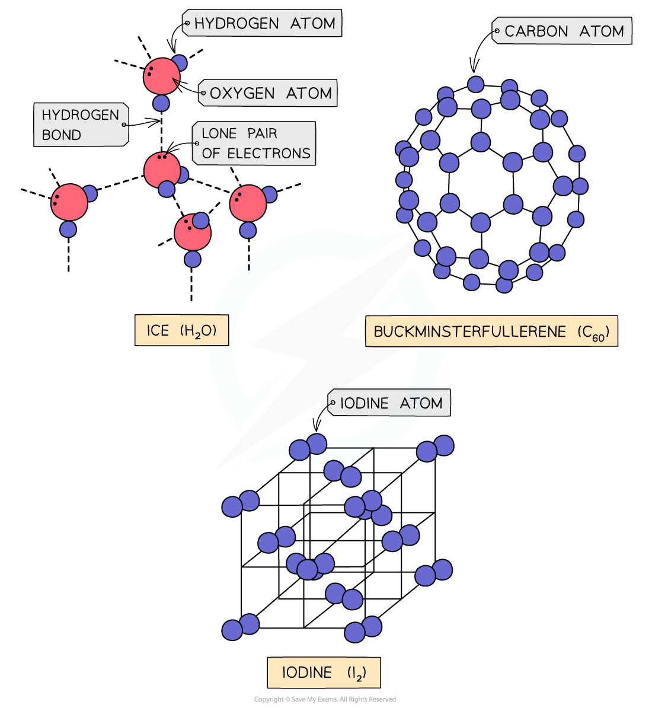
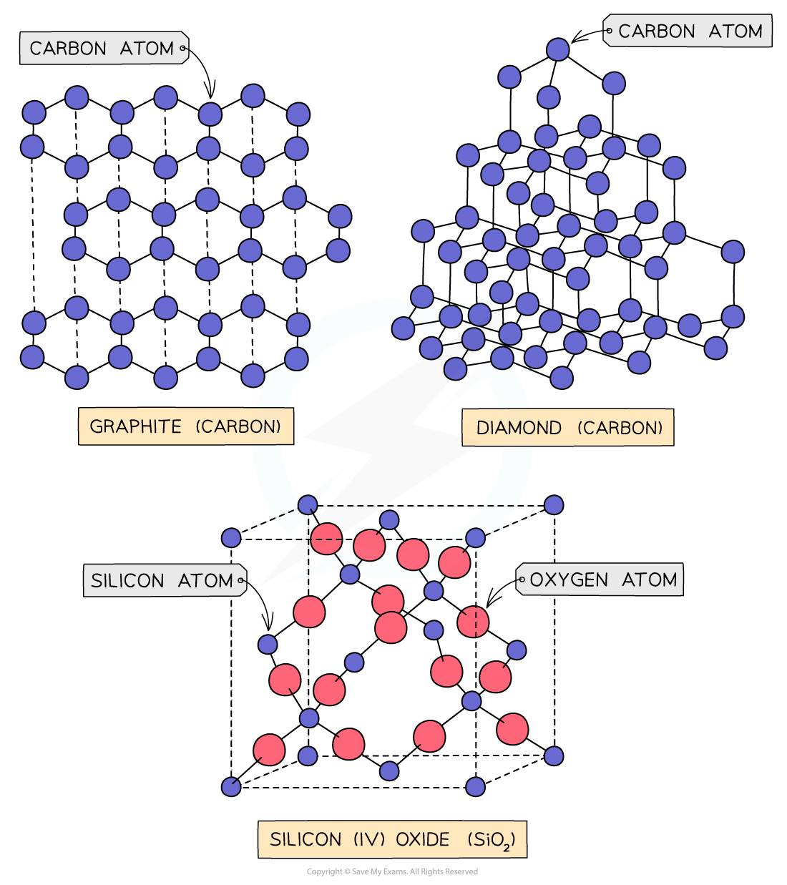
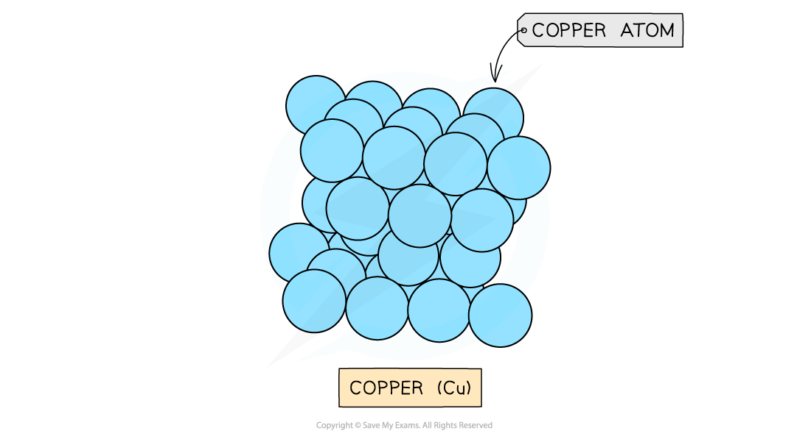

# Lattice Structures

## Lattice Structures

> **Spec point** — `spcpt_QRDSMMPCw4SvVdFc`

## Lattice Structures

- Most ionic, metallic and covalent compounds are **crystalline lattice**
- The ions, atoms or molecules are arranged in a **regular and repeating arrangement**

### Giant ionic lattices

- An **ionic bond** is an electrostatic force between a positively charged metal (**cation**) ion and a negatively charged non-metal (**anion**) ion

  - The metal becomes positively charged as it transfers electrons to the non-metal becomes negatively charged
- Ionic compounds are arranged in giant **ionic lattices **(also called **giant ionic structures**)
- The type of lattice formed depends on the sizes of the **positive **and **negative **ions which are arranged in an **alternating **fashion

  - The ionic lattice of MgO and NaCl are **cubic**

#### Ionic lattices of the ionic compounds NaCl and MgO

*The ionic lattices for NaCl and MgO are similar due to the ratio of 1 cation : 1 anion*

#### General ionic lattice

*A general ionic lattice shows the actual packing of the ions based on their relative size*

### Covalent lattices

- **Covalent bonds **are bonds between non-metals in which electrons are **shared **between the atoms
- Covalent compounds can be arranged in **simple molecular **or **giant molecular** **lattices**

  - Simple molecular lattices: Iodine, buckminsterfullerene (C60) and ice
  - Giant molecular: silicon(IV) oxide, graphite and diamond

#### Simple molecular lattices

*Ice, buckminsterfullerene and iodine all have different simple molecular lattices due to the different structures and intermolecular forces*

#### Giant molecular lattices

*Giant molecular lattices have higher melting and boiling points because they require more energy to overcome the intramolecular and / or intermolecular forces*

### Metallic lattices

- Metals form **giant metallic lattices **in which the metal ions are surrounded by a ‘sea’ of **delocalised **electrons
- The metal ions are often packed in **hexagonal layers **or in a **cubic arrangement**

#### The layered structure of copper atoms

*Copper cations are arranged in regular layers (the delocalised electrons are not shown in the diagram)*

> **Exam Hint**
> - Graphite, diamond and buckminsterfullerene are **allotropes **of carbon.
> - They are different **structural forms **of the same element (which is carbon).
