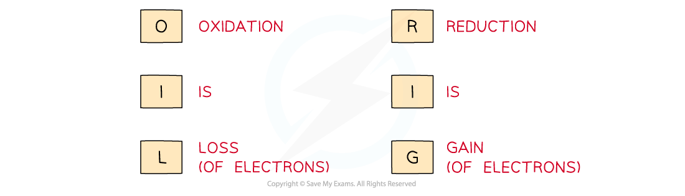

# Redox Reactions

## Balancing Redox Reactions

> **Spec point** — `spcpt_nx5frdwgZfGBzYhj`

## Balancing Redox Reactions

- Oxidation numbers can be used to balance chemical equations
- Go through these steps to balance a redox equation:

  1. **Write the unbalanced equation and identify the atoms which change in ox. no.**
  2. **Deduce the oxidation number changes**
  3. **Balance the oxidation number changes**
  4. **Balance the charges**
  5. **Balance the atoms**

> **Worked Example**
> **Writing overall redox reactions**
> 
> Manganate(VII) ions, MnO4–, react with Fe2+ ions in the presence of acid, H+, to form Mn2+ ions, Fe3+ ions and water.
> 
> Write the overall redox equation for this reaction.
> 
> **Answer**
> 
> - **Step 1:** Write the unbalanced equation and identify the atoms which change in oxidation number:
> 
> 
> 
> - **Step 2: **Deduce the oxidation number changes:
> 
> 
> 
> - **Step 3: **Balance the oxidation number changes:
> 
> 
> 
> - **Step 4: **Balance the charges:
> 
> 
> 
> - **Step 5: **Balance the atoms:
> 
> 

## Redox & Disproportionation Reactions

> **Spec point** — `spcpt_xNhdSSTW5sNGvVHn`

## Redox & Disproportionation Reactions

### Oxidation

- Oxidation is the **gain of** **oxygen**, e.g.:

  - **Cu + H****2****O → CuO + H****2**
  - Cu has gained an oxygen and is oxidised

- Oxidation is also the **loss of a hydrogen**, e.g.:

  - **2NH****3**** + 3Br****2**** → N****2**** + 6HBr**
  - N has lost a hydrogen and is oxidised
- Oxidation is also the **loss of electrons**, e.g.:

  - **Cu****2+**** + Mg → Mg****2+**** + Cu**
  - Mg has lost two electrons and is oxidised
- Oxidation causes an **increase in oxidation number**, e.g:

  - **Cu****2+**** + Mg → Mg****2+**** + Cu**
  - The oxidation number of Mg changes from 0 to +2, thus Mg is oxidised

### Reduction

- Reduction is the **loss of** **oxygen**, e.g.:

  - **Cu+ H****2****O → 2CuO + H****2**
  - H has been reduced
- Reduction is also the **gain of a hydrogen**, e.g.:

  - **2NH****3****+ 3Br****2**** → N****2**** + 6HBr**
  - Br has been reduced

- Reduction is also the **gain of electrons**, e.g.:

  - **Cu****2+**** + Mg → Mg****2+**** + Cu**
  - Cu has been reduced

- Reduction causes a **decrease in oxidation number**, e.g.:

  - **Cu****2+**** + Mg → Mg****2+**** + Cu**
  - The oxidation number of Cu changes from +2 to 0, thus Cu is reduced

#### OIL RIG acronym

*Use the acronym "Oil Rig" to help you remember the definitions of oxidation and reduction*

### Redox reactions

- Redox reactions are reactions in which oxidation and reduction take place together

  - While one species is oxidising, another is reducing in the same reaction
- For example:

**Cu****2+****+ Mg → Mg****2+**** + Cu**

- Cu has been reduced from +2 to 0
- Mg has been oxidised from 0 to +2

> **Worked Example**
> **Oxidation and reduction**
> 
> In each of the following equations, state which reactant has been oxidised and which has been reduced.
> 
> 1. 2Na + Cl2 → 2NaCl
> 2. Mg + Fe2+ → Mg2+ + Fe
> 3. CO + Ag2O → 2Ag + CO2
> 
> **Answer**
> 
> - **Answer 1:**
> 
>   - Oxidised: Na as the oxidation number has increased from 0 to +1
>   - Reduced: Cl2 as the oxidation number has decreased from 0 to –1
> - **Answer 2:**
> 
>   - Oxidised: Mg as the oxidation number has increased by 2
>   - Reduced: Fe2+ as the oxidation number has decreased by 2
> - **Answer 3:**
> 
>   - Oxidised: C as it has gained oxygen
>   - Reduced: Ag as it has lost oxygen

### Disproportionation reactions

- A **disproportionation** **reaction** is a reaction in which the same species is both oxidised and reduced at the same time

#### Example disproportion reaction

> **Worked Example**
> **Balancing disproportionation reactions**
> 
> Balance the disproportionation reaction which takes place when chlorine is added to hot concentrated aqueous sodium hydroxide.
> 
> The products are Cl– ions, ClO3– ions and water.
> 
> **Answer**
> 
> - **Step 1: **Write the unbalanced equation and identify the atoms that change in oxidation number:
> 
> 
> 
> - **Step 2: **Deduce the oxidation number changes:
> 
> 
> 
> - **Step 3: **Balance the oxidation number changes:
> 
> 
> 
> - **Step 4: **Balance the charges:
> 
> 
> 
> - **Step 5: **Balance the atoms:
> 
> 
