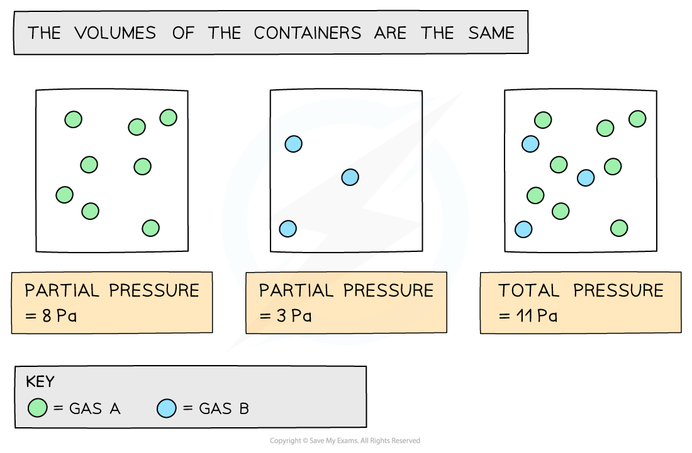
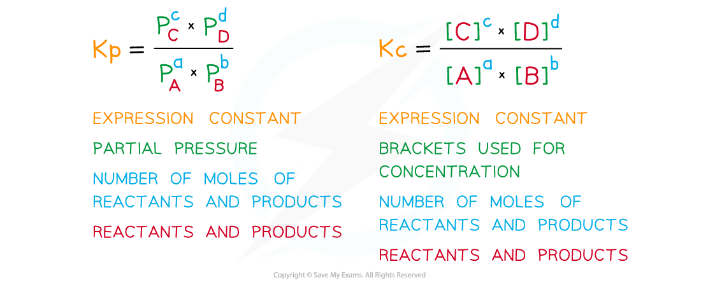

# Equilibrium Constants, Kc & Kp

## Equilibrium Constant: Concentrations

> **Spec point** — `spcpt_Y6Qj4KVdMvB2kpqv`

## Equilibrium Constant: Concentrations

### Equilibrium expression & constant

- The **equilibrium expression** is an expression that links the **equilibrium constant**, *K**c*, to the **concentrations of reactants and products** at equilibrium taking the **stoichiometry** of the equation into account
- So, for a given reaction:

**aA + bB ⇌ cC + dD**

- *K*c is defined as:

$K_{c} = \frac{[ \mathrm{C} ]^{c} [ \mathrm{D} ]^{d} }{[ \mathrm{A} ]^{a} [ \mathrm{B} ]^{b} }$

- Where:

  - [A] and [B] are the equilibrium concentrations of **A** and **B**, in mol dm-3
  - [C] and [D] are the equilibrium concentrations of **C** and **D**, in mol dm-3
  - a, b, c and d are the respective number of moles of each reactant and product

- **Solids** are ignored in equilibrium expressions
- The *K**c* of a reaction is specific and only changes if the **temperature** of the reaction changes

> **Worked Example**
> Deduce the equilibrium expression for the following reactions:
> 
> 1. Ag+ (aq) + Fe2+ (aq) $\rightleftharpoons$ Ag (s) + Fe3+ (aq)
> 2. N2 (g) + 3H2 (g) $\rightleftharpoons$ 2NH3 (g)
> 3. 2SO2 (g) + O2 (g) $\rightleftharpoons$ 2SO3 (g)
> 
> **Answer**
> 
> 1. Ag+ (aq) + Fe2+ (aq) $\rightleftharpoons$ Ag (s) + Fe3+ (aq)
> 
> *K*c = $\frac{[ Fe^{3 +} ( \text{aq} ) ]}{[ Fe^{2 +} ( \text{aq} ) ] [ Ag^{+} ( \text{aq} ) ]}$
> 
> 2. N2 (g) + 3H2 (g) $\rightleftharpoons$ 2NH3 (g)
> 
> *K*c = $\frac{[ NH_{3} ( \mathrm{g} ) ]^{2}}{[ \mathrm{N}_{2} ( \mathrm{g} ) ] [ \mathrm{H}_{2} ( \mathrm{g} ) ]^{3}}$
> 
> 3. 2SO2 (g) + O2 (g) $\rightleftharpoons$ 2SO3 (g)
> 
> *K*c = $\frac{[ SO_{3} ( \mathrm{g} ) ]^{2}}{[ SO_{2} ( \mathrm{g} ) ]^{2} [ \mathrm{O}_{2} ( \mathrm{g} ) ]}$

## Mole Fraction & Partial Pressure

> **Spec point** — `spcpt_ddWBfX2tFBNQ6ZTz`

## Mole Fraction & Partial Pressure

### Partial pressure

- For reactions involving mixtures of gases, the equilibrium constant ***K******p*** is used as it is easier to measure the **pressure** than the concentration for gases
- The **partial pressure **of a gas is the pressure that the gas would have if it was in the container all by itself
- The **total pressure** is the sum of the **partial pressure**:

**P****total**** = P****A**** + P****B**** + P****C**** + .......**

- Ptotal = total pressure

  - PA, PB, PC = partial pressures

#### How partial pressures contribute to total pressure

*Partial pressures can be added together to calculate the total pressure*

### Mole fraction

- The mole fraction of a gas is the ratio of moles of a particular gas to the total number of moles of gas present

$\mathrm{Mole} \mathrm{fraction}=\frac{\mathrm{number} \mathrm{of} \mathrm{moles} \mathrm{of}a\mathrm{particular} \mathrm{gas}}{\mathrm{total} \mathrm{number} \mathrm{of} \mathrm{moles} \mathrm{of} \mathrm{all} \mathrm{the} \mathrm{gases} \mathrm{in} \mathrm{the} \mathrm{mixture}}$

- To calculate the **partial pressures of each gas** the following relationship can be used:

$\mathrm{Partial} \mathrm{pressure}=\mathrm{mole} \mathrm{fraction}\times\mathrm{total} \mathrm{pressure}$

- The sum of the mole fractions should add up to 1.00, while the sum of the partial pressures should add up to the total pressure

## Equilibrium Constant: Partial Pressures

> **Spec point** — `spcpt_CmFTFqVFCZVCpGfG`

## Equilibrium Constant: Partial Pressures

### Equilibrium expressions involving partial pressures

- Equilibrium expressions in terms of partial pressures are written similarly to those involving concentrations, with a few differences:

#### Comparing Kp and Kc expressions

*The process of writing the expressions is similar, but there is a different presentation and different information required*

> **Worked Example**
> **Deducing equilibrium expressions of gaseous reactions**
> 
> Deduce the equilibrium expression for the following reactions:
> 
> 1. N2 (g) + 3H2 (g) $\rightleftharpoons$ 2NH3 (g)
> 2. N2O4 (g) $\rightleftharpoons$ 2NO2 (g)
> 3. 2SO2 (g) + O2 (g) $\rightleftharpoons$ 2SO3 (g)
> 
> **Answer**
> 
> 1. N2 (g) + 3H2 (g) $\rightleftharpoons$ 2NH3 (g)
> 
> *K*p = $\frac{p^{2}\mathrm{NH}_{3}}{p^{3}H_{2}\timespN_{2}}$
> 
> 2. N2O4 (g) $\rightleftharpoons$ 2NO2 (g)
> 
> *K*p = $\frac{p^{2}NO_{2}}{pN_{2}O_{4}}$
> 
> 3. 2SO2 (g) + O2 (g) $\rightleftharpoons$ 2SO3 (g)
> 
> *K*p = $\frac{p^{2}\mathrm{SO}_{3}}{p^{2}\mathrm{SO}_{2}\timespO_{2}}$
