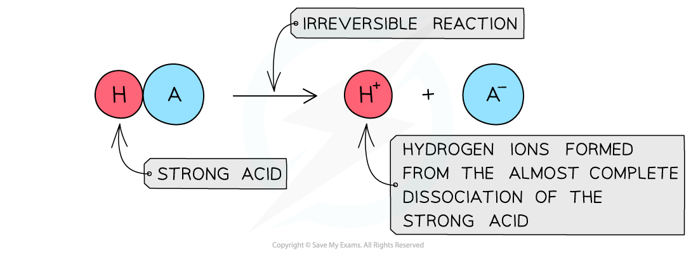
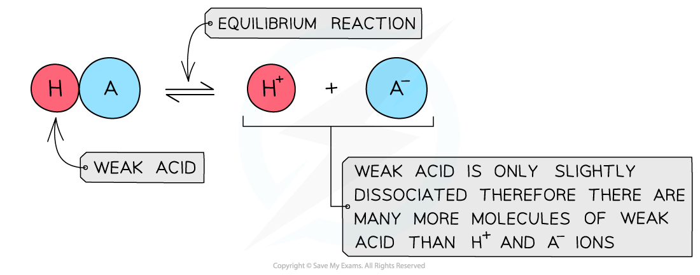
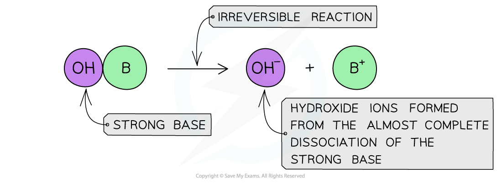
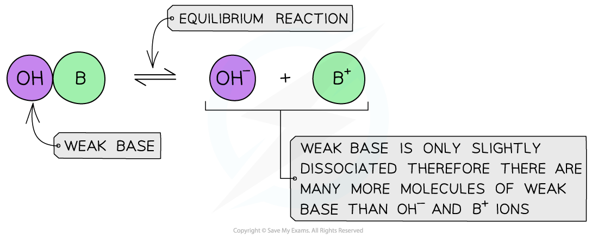

# Acid & Base Dissociation

## Acid & Base Dissociation

> **Spec point** — `spcpt_BYxDMWGVpx8M2cnb`

## Acid & Base Dissociation

### Strong acids

- A **strong acid **is an acid that **dissociates** almost **completely** in aqueous solutions

  - E.g. HCl (hydrochloric acid), HNO3 (nitric acid) and H2SO4 (sulfuric acid)
- The position of the equilibrium is so far over to the **right** that you can represent the reaction as an irreversible reaction

#### Diagram showing the dissociation of a strong acid in aqueous solution

*In an aqueous solution, a strong acid almost completely dissociates*

- The solution formed is **highly acidic** due to the high concentration of the H+ / H3O+ ions
- Since the **pH** depends on the concentration of H+ / H3O+ ions, the pH can be calculated if the concentration of the strong acid is known

  - The concentration of H+ / H3O+ ions can be written as [H+ (aq)]
- pH is the negative log of the concentration of H+ / H3O+ ions and can be calculated, if the concentration of the strong acid is known, using the stoichiometry of the reaction

**pH = –log****10**** [H****+**** (aq)]**

### Weak acids

- A **weak acid **is an acid that **partially** (or incompletely) **dissociates** in aqueous solutions

  - E.g. most organic acids (ethanoic acid), HCN (hydrocyanic acid), H2S (hydrogen sulfide) and H2CO3 (carbonic acid)
- The position of the equilibrium is more to the **left** and an equilibrium is established

#### Diagram showing the dissociation of a weak acid in aqueous solution

*In an aqueous solution, a weak acid does not fully dissociate*

- The solution is **less acidic** due to the lower concentration of H+ / H3O+ ions
- Finding the **pH** of a weak acid is a bit more complicated as now the concentration of H+ ions is not equal to the concentration of acid
- To find the concentration of H+ ions, the acid dissociation constant (*K**a*) should be used

#### Acid & equilibrium position summary

- Position of equilibrium

  - Strong acid; right
  - Weak acid; left
- Dissociation

  - Strong acid; fully dissociated (→)
  - Weak acid; partially dissociated ($\rightleftharpoons$)
- H+ concentration

  - Strong acid; high concentration
  - Weak acid; low concentration
- pH

  - Strong acid; use [strong acid] for [H+]
  - Weak acid; use *K*a to find [H+]
- Examples

  - Strong acid; HCl, HNO3, H2SO4 (first ionisation)
  - Weak acid; Organic acids, e.g. ethanoic acid, HCN, H2S, H2CO3

### Strong bases

- A **strong base **is a base that dissociates almost completely in aqueous solutions

  - E.g. Group 1 metal hydroxides such as NaOH (sodium hydroxide)
- The position of the equilibrium is so far over to the right that you can represent the reaction as an irreversible reaction

#### Diagram showing the dissociation of a strong base in aqueous solution

*In an aqueous solution, a strong base almost completely dissociates*

- The solution formed is highly basic due to the high concentration of the OH– ions

### Weak bases

- A **weak base **is a base that **partially** (or incompletely) **dissociates** in aqueous solutions

  - E.g. NH3 (ammonia), amines and some hydroxides of transition metals
- The position of the equilibrium is more to the **left** and an equilibrium is established

#### Diagram showing the dissociation of a weak base in aqueous solution

*In an aqueous solution, a weak base does not fully dissociate*

- The solution is **less basic** due to the lower concentration of OH- ions

#### Base & equilibrium position summary

- Position of equilibrium

  - Strong base; right
  - Weak base; left
- Dissociation

  - Strong base; fully dissociated (→)
  - Weak base; partially dissociated ($\rightleftharpoons$)
- OH- concentration

  - Strong base; high concentration
  - Weak base; low concentration
- Examples

  - Strong base; Group 1 metal hydroxides
  - Weak base; NH3 amines, some transition metal hydroxides

> **Exam Hint**
> - Hydrogen ions in aqueous solutions can be written as either as H3O+ or as H+ however, if H3O+ is used, H2O should be included in the chemical equation:
> 
> **HCl (g) → H****+ ****(aq) + Cl****- ****(aq) **
> or 
> **HCl (g) + H****2****O (l) → H****3****O****+ ****(aq) + Cl****- ****(aq)**
> 
> - Remember that some acids are both strong and weak acids – for example, H2SO4 (sulfuric acid) has two hydrogen ions that can ionise.
> 
>   - H2SO4 acts as a strong acid: **H****2****SO****4**** → H****+**** + HSO****4****-**
>   - HSO4- acts as a weak acid: **HSO****4****-**** ⇌ H****+ ****+ SO****4****2-**
> - Also, don't forget that the terms **strong **and **weak **acids and bases are related to the **degree of dissociation **and not the **concentration.**
> 
>   - The appropriate terms to use when describing **concentration** are **dilute **and **concentrated.**
