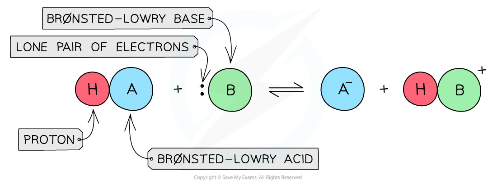
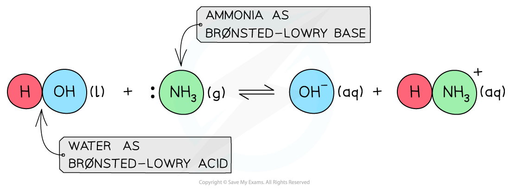
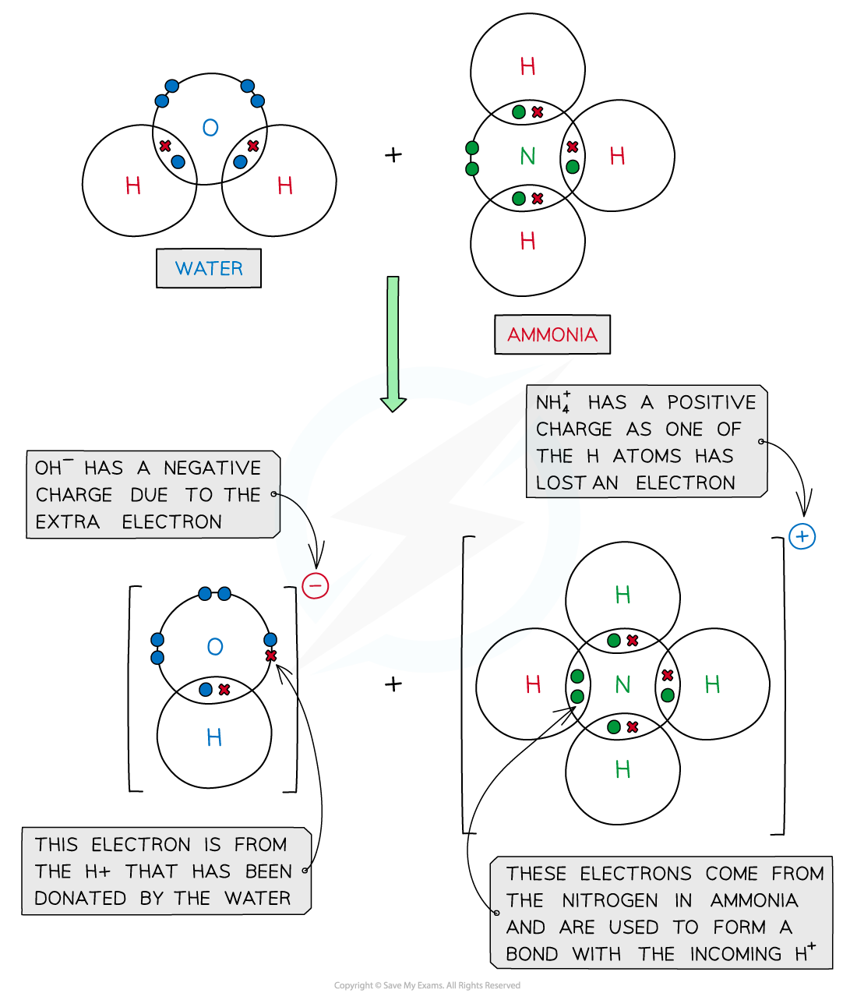
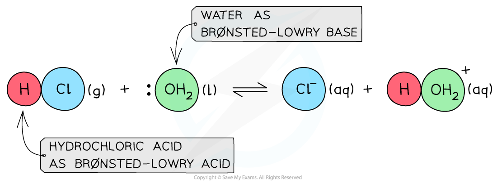
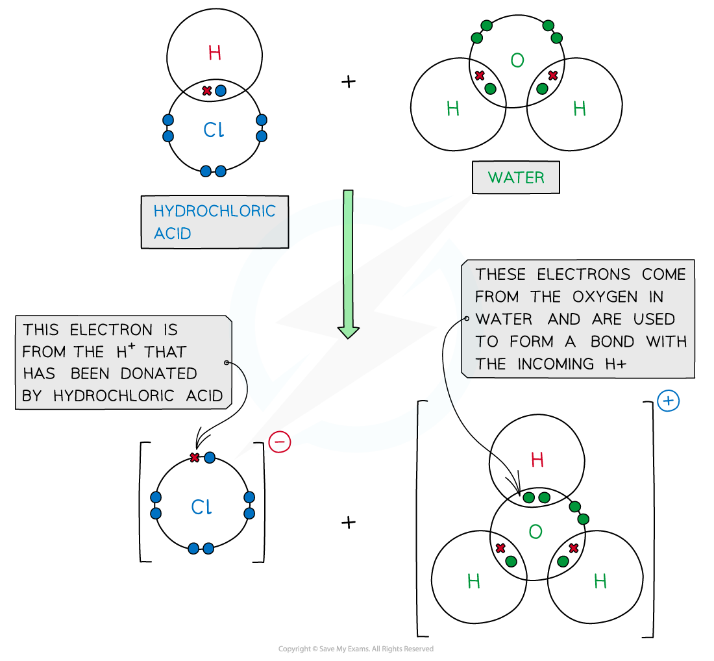
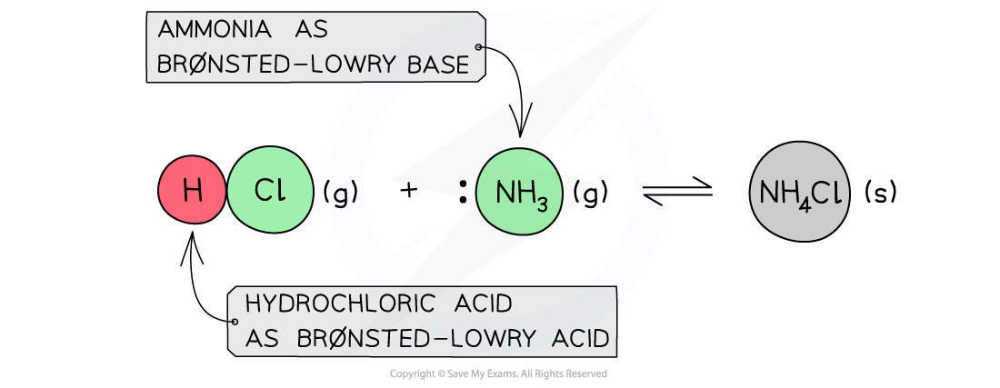

# Brønsted–Lowry Theory

## Brønsted–Lowry Theory

> **Spec point** — `spcpt_hPtRwxcytHJ65wbs`

## Brønsted–Lowry Theory

- **The Brønsted-Lowry Theory** defines acids and bases in terms of proton transfer between chemical compounds
- A **Brønsted-Lowry acid** is a species that **gives away** a **proton** (H+)
- A **Brønsted-Lowry base **is a species that **accepts** a proton (H+) using its **lone pair of electrons**

#### How an acid acts as a Brønsted-Lowry proton donor

*The diagram shows a Brønsted-Lowry acid which donates the proton to the Brønsted-Lowry base that accepts the proton using its lone pair of electrons*

- Species that can act both as acids and bases are called **amphoteric**

  - Eg. water as a Brønsted-Lowry acid

#### Water acting as a Brønsted-Lowry acid

*The diagram shows water acting as a Brønsted-Lowry acid by donating a proton to ammonia which accepts the proton using its lone pair of electrons*

#### Dot and cross diagram showing the Brønsted-Lowry behaviour of water with ammonia

*The diagram shows a dot & cross diagram for the reaction of water with ammonia to show how water acts as a Brønsted-Lowry acid and ammonia as a Brønsted-Lowry base*

- E.g. water as a Brønsted-Lowry base

#### Water acting as a Brønsted-Lowry base

*The diagram shows water acting as a Brønsted-Lowry base by accepting a proton from hydrochloric acid proton using its lone pair of electrons*

#### Dot and cross diagram showing the Brønsted-Lowry behaviour of water with hydrochloric acid

*The diagram shows a dot & cross diagram for the reaction of water with hydrochloric acid to show how water acts as a Brønsted-Lowry base and ammonia as a Brønsted-Lowry acid*

- The Brønsted-Lowry Theory is not limited to aqueous solutions only and can also be applied to reactions that occur in the gas phase

#### A Brønsted-Lowry acid and base reaction

*HCl acts as a Brønsted-Lowry acid by donating a proton while ammonia acts as a Brønsted-Lowry base by accepting a proton*

> **Exam Hint**
> - An atom of hydrogen contains 1 **proton**, 1 electron and 0 neutrons.
> - When hydrogen loses an electron to become **H****+** only a **proton** remains, which is why a H+ ion is also called a proton.
