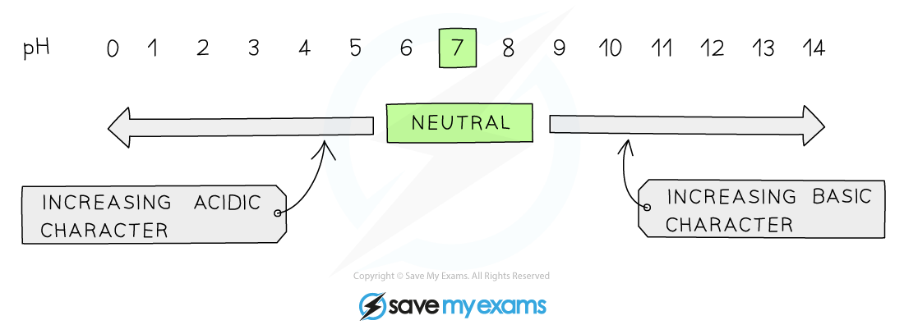

# pH Scale

## The pH Scale

> **Spec point** — `spcpt_Jb2WrHsjhdsHyqv6`

## The pH Scale

- The pH scale is a numerical scale that shows how **acidic **or **alkaline** a solution is
- The values on the pH scale go from 1-14 (extremely acidic substances have values of below 1)

  - All acids have pH values **below **7
  - All alkalis have pH values **above **7
- The **lower **the pH, the **more acidic **the solution is
- The **higher **the pH, the **more alkaline **the solution is

#### The pH scale

*The pH scale shows the acidity, neutrality and alkalinity of chemicals*

### pH of water

- An equilibrium exists in water where few water molecules dissociate into proton and hydroxide ions:

**H****2****O (l) ⇌ H****+ ****(aq) + OH****– ****(aq)**

- The equilibrium constant expression for this reaction is:

***K*****c**** = **$\frac{[ H^{+} ] [ OH^{-} ]}{[ H_{2} O ]}$

- The equilibrium constant expression can be rearranged to:

***K******c****** *****x [H****2****O] = [H****+****] [OH****–****]**

- Since the concentration of the H+ and OH- ions is very small, the concentration of water is considered to be a constant

  - So, the expression can be rewritten as:

***K******w***** = [H****+****] [OH****–****]**

- Where ***K******w****** *****(ionic product of water) = *****K******c****** *****x [H****2****O] = 10****-14 ****mol****2 ****dm****-3**** at 298K**

- Water at 298K has **equal amounts** of **OH****-** and **H****+**** ions** with concentrations of **10****-7**** mol dm****-3**
- To calculate the pH of water, the following formula should be used:

**pH = –log [H****+**** (aq)]**

- Where [H+ (aq)] is the concentration of H+ / H3O+ ions
- So, the calculation is:

  - **pH = -log (10****-7****) = 7**

- Thus, water has a pH of 7

### pH of acids

- **Acidic** solutions (strong or weak) **always **have more H+ than OH- ions
- Since the concentration of **H****+** is always **greater** than the concentration of **OH****-** ions, [H+] is always **greater** than 10-7 mol dm-3
- Using the pH formula, this means that the **pH of acidic solutions** is always **below** 7
- The higher the [H+] of the acid, the lower the pH

### pH of bases

- **Basic** solutions (strong or weak) **always **have more OH- than H+ ions
- Since the concentration of **OH****-** is always **greater** than the concentration of **H****+** ions, [H+] is always **smaller** than 10-7 mol dm-3
- Using the pH formula, this means that the **pH of basic solutions** is always **above** 7
- The higher the [OH-] of the base, the higher the pH
