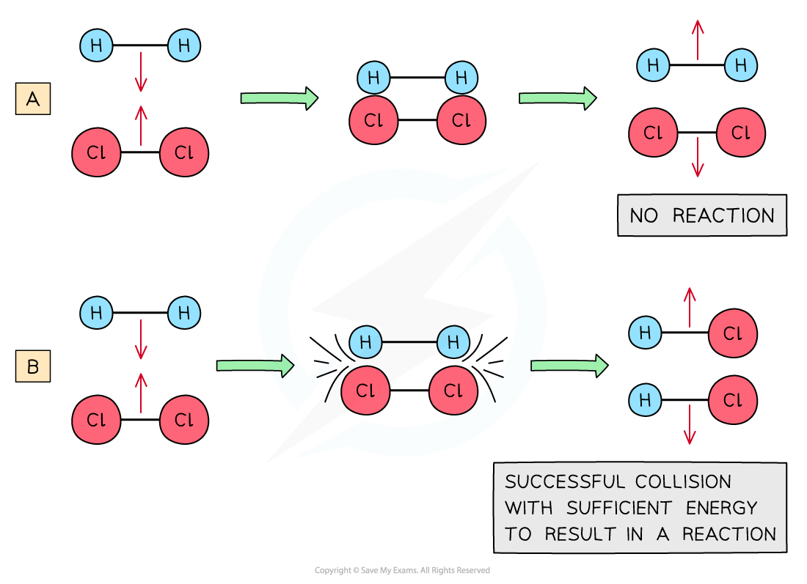
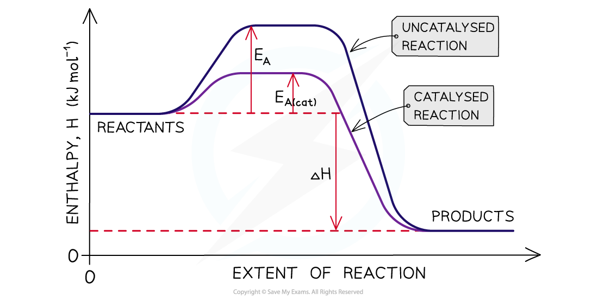
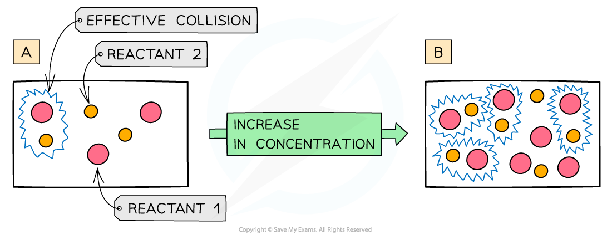
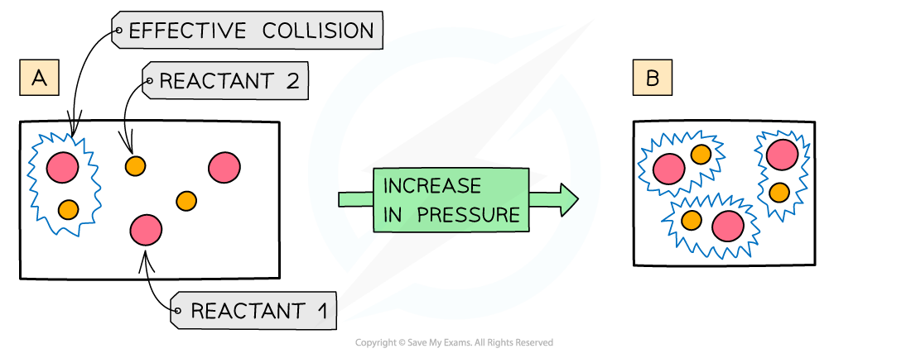

# Rate of Reaction & Collision Theory

## Rate of Reaction & Collision Theory

> **Spec point** — `spcpt_WvCr2JB5DYnqQ3vt`

## Rate of Reaction & Collision Theory

### Reaction rate

- The **rate of a reaction **is the speed at which a chemical reaction takes place and has units **mol dm****-3 ****s****-1**
- The rate of a reaction can be calculated by:

**Rate of reaction = **$\frac{\mathrm{change} \mathrm{in} \mathrm{the} \mathrm{amount} \mathrm{of} \mathrm{reactants} \mathrm{or} \mathrm{products}(\mathrm{mol} \mathrm{dm}^{-3})}{\mathrm{time}(s)}$

> **Worked Example**
> **Calculating the rate of reaction**
> 
> Calculate the rate of reaction when 0.0440 g of ethyl ethanoate, CH3COOC2H5, is formed in 1.0 minute from 400 cm3 of a reaction mixture
> 
> **Answer**
> 
> - **Step 1: **Calculate the amount of ethyl ethanoate formed in mol:
> 
>   - Moles = $\frac{mass ( \mathrm{g} )}{molar \text{mass} ( \mathrm{g} mol^{- 1} )}$
>   - Moles = $\frac{0.0440g}{88.0g\mathrm{mol}^{-1}}$
>   - Moles = 0.0005 mol
> 
> - **Step 2: **Calculate the volume of the reaction mixture in dm3:
> 
>   - **400 cm****3**** = 0.400 dm****3**
> 
> - **Step 3: **Calculate the concentration change of product formed:
> 
>   - Concentration = $\frac{amount ( \text{mol} )}{volume ( dm^{3} )}$
>   - Concentration = $\frac{0.0005\mathrm{mol}}{0.400\mathrm{dm}^{3}}$
>   - Concentration =** **0.00125 mol dm-3
> 
> - **Step 4: **Calculate the time in seconds:
> 
>   - **1.0 min = 60.0 s**
> 
> - **Step 5: **Use the equation to calculate the rate:
> 
>   - **Rate of reaction = **$\frac{\mathrm{change} \mathrm{in} \mathrm{the} \mathrm{amount} \mathrm{of} \mathrm{reactants} \mathrm{or} \mathrm{products}(\mathrm{mol} \mathrm{dm}^{-3})}{\mathrm{time}(s)}$
>   - Rate of reaction = $\frac{0.00125\mathrm{mol} \mathrm{dm}^{-3}}{60s}$
>   - Rate of reaction = 2.08 x 10-5 mol dm-3 s-1

### Collision theory

- The **collision theory **states that for a chemical reaction to take place, the particles need to **collide **with each other in the correct **orientation **and with enough **energy**
- The minimum energy that colliding particles must have for a collision to be **successful **and a reaction to take place is called the **activation energy** (***E******a***)

#### Collision theory table

|   | **Effective collision** | **Ineffective collision** |
|---|---|---|
| **Orientation** | Correct | Incorrect |
| **Energy** | Sufficient energy (*E*a) | Not enough energy |
| **Chemical reaction** | Yes | No |

- An **ineffective collision **is when particles collide in the wrong orientation or when they don’t have enough energy and **bounce off **each other without causing a chemical reaction

#### Effective and ineffective collisions

*(A) shows an ineffective collision due to the particles not having enough energy whereas (B) shows an effective collision where the particles have the correct orientation and enough energy for a chemical reaction to take place*

### Increase in reaction rate

- The **collision frequency **is the number of collisions per unit time
- When there are more collisions per unit time, the number of particles with energy greater than the *E**a** *increases
- This causes an **increase** in** **the **rate of reaction**
- A **catalyst **is a substance that **increases **the **rate of reaction **without taking part in the chemical reaction by providing the particles with an alternative mechanism with a lower activation energy

#### How catalysts affect reaction pathways

*A catalyst increases the rate of a reaction by providing an alternative pathway which has a lower activation energy*

### Concentration

- The more **concentrated **a solution is, the **greater **the number of **particles **in a given volume of solvent
- An increase in **concentration **causes an increased **collision frequency **and therefore an increased **rate of reaction**

#### How increasing concentration affects collisions

*The higher concentration of particles in (B) means that there are more particles present in the same volume than (A) so the chance and frequency of collisions between reacting particles increase causing an increased rate of reaction*

### Pressure

- An increase in pressure in reactions that involve gases has the same effect as an increased concentration of solutions
- When the **pressure **is increased, the molecules have less space in which they can move
- This means that the number of **effective collisions **increases due to an increased **collision frequency**
- An increase in pressure therefore increases the **rate of reaction**

#### How increasing pressure affects collisions

*The higher pressure in (B) means that the same number of particles occupy a smaller volume, resulting in an increased collision frequency and therefore increased rate of reaction*
