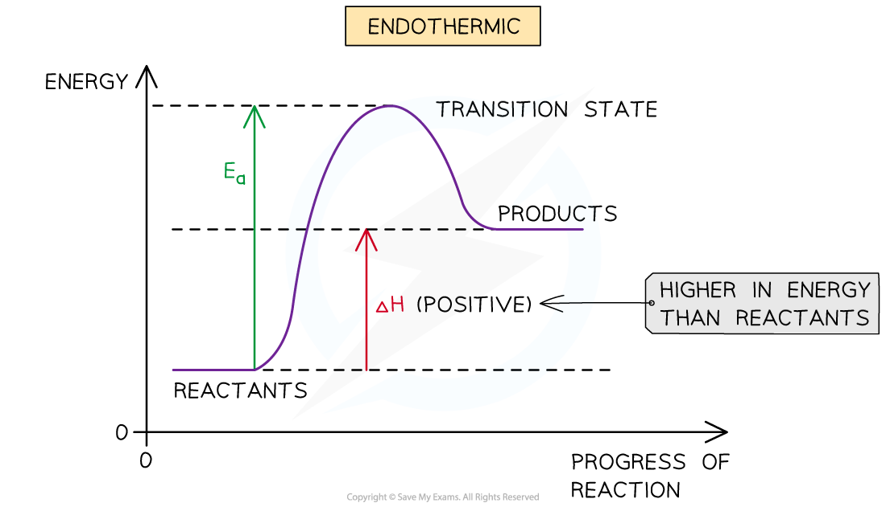
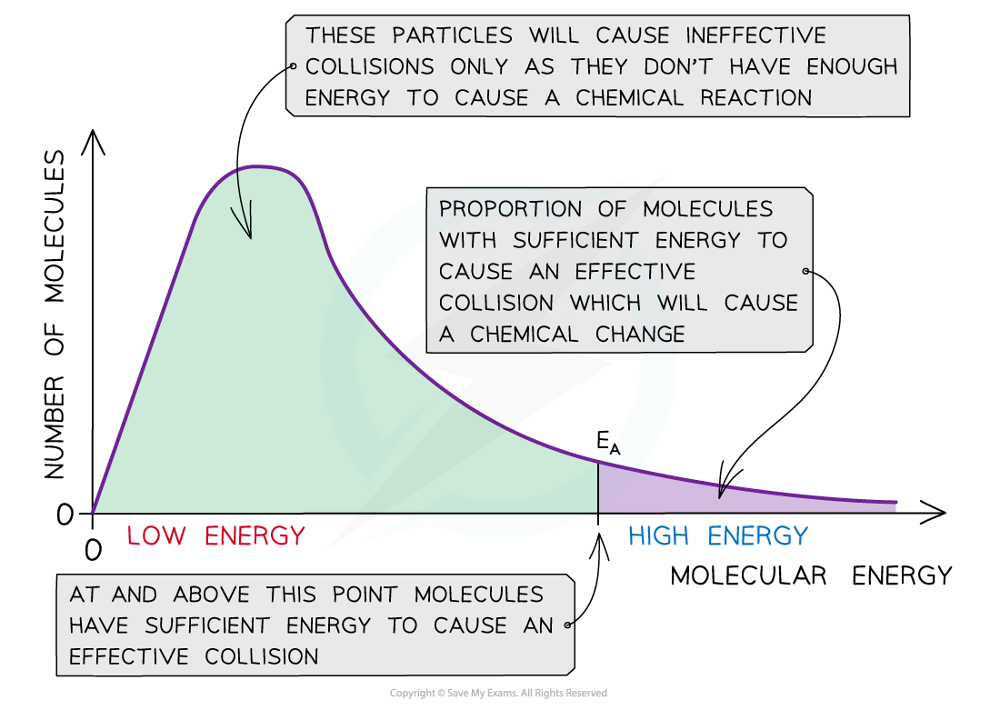
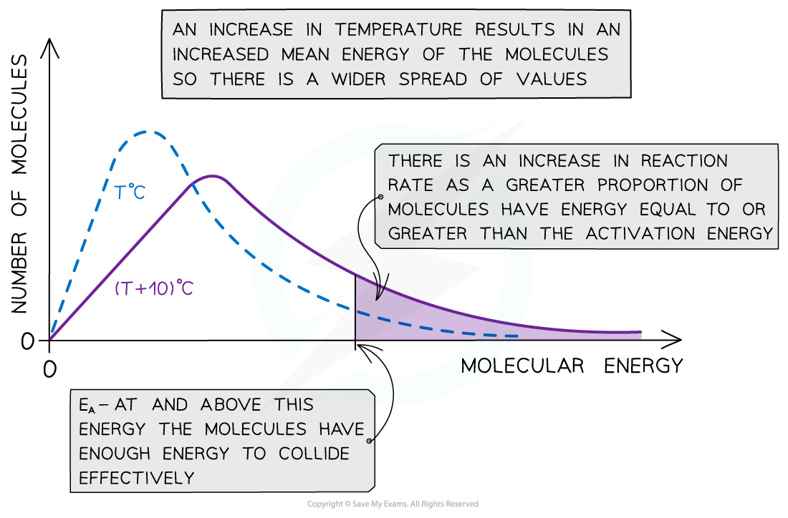

# Activation Energy & Boltzmann Distribution Curves

## Activation Energy

> **Spec point** — `spcpt_hZTPmmSRrdvvX3Qd`

## Activation Energy

- For a reaction to take place, the reactant particles need to overcome a minimum amount of energy
- This energy is called the **activation energy (*****E******a*****)**
- In **exothermic reactions, **the reactants are higher in energy than the products
- In **endothermic reactions, **the reactants are lower in energy than the products
- Therefore, the *E**a** *in **endothermic reactions** is relatively larger than in exothermic reaction

#### Exothermic reaction pathway diagram

*The reactants are higher in energy than the products in an exothermic reaction, so the energy needed for the reactants to go over the energy barrier is relatively small*

#### Endothermic reaction pathway diagram

*The reactants are lower in energy than the products in an endothermic reaction, so the energy needed for the reactants to go over the energy barrier is relatively large*

- Even though particles collide with each other in the same orientation, if they don’t possess a minimum energy that corresponds to the *E**a** *of that reaction, the reaction will **not** take place
- Therefore, for a collision to be **effective** the reactant particles must collide in the correct orientation **AND **possess a minimum energy equal to the *E**a* of that reaction

> **Exam Hint**
> The activation energy is the energy needed to ‘activate’ the reactant particles in order for them to collide effectively and cause a chemical reaction.

## Boltzmann Distribution Curves

> **Spec point** — `spcpt_w4fyM4CPRXhQHM4b`

## Boltzmann Distribution Curves

### Boltzmann distribution curve

- The **Boltzmann distribution curve** is a graph that shows the distribution of **energies** at a certain **temperature**
- In a sample of a substance, a few particles will have very low energy, a few particles will have very high energy, and many particles will have energy in between

#### A Boltzmann distribution curve

*The Boltzmann distribution curve shows the distribution of the energies and the activation energy*

- The graph shows that only a small proportion of molecules in the sample have enough energy for an **effective collision **and for a **chemical reaction **to take place

### Changes in temperature

- When the temperature of a reaction mixture is increased, the particles gain more kinetic energy
- This causes the particles to move around faster resulting in more **frequent collisions**
- Furthermore, the proportion of **successful collisions **increases, meaning a higher **proportion **of the particles possess the minimum amount of energy (activation energy) to cause a chemical reaction
- With higher temperatures, the Boltzmann distribution curve **flattens **and the peak **shifts **to the right

#### How temperature affects a Boltzmann distribution curve

*The Boltzmann distribution curve at T oC and when the temperature is increased by 10 oC*

- Therefore, an increase in temperature causes an increased rate of reaction due to:

  - There being **more effective collisions** as the particles have **more kinetic energy**, making them move around faster
  - A **greater proportion** of the molecules having **kinetic energy** greater than the **activation energy**

> **Exam Hint**
> The increase in proportion of molecules having kinetic energy greater than the activation has a greater effect on the rate of reaction than the increase in effective collisions
