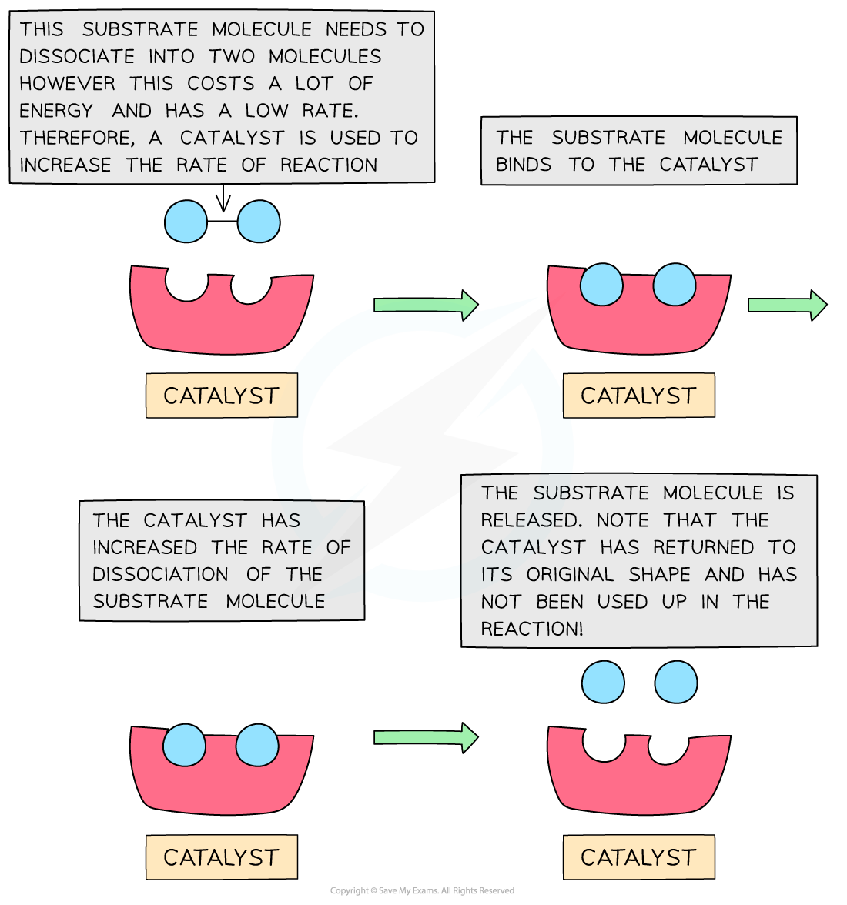
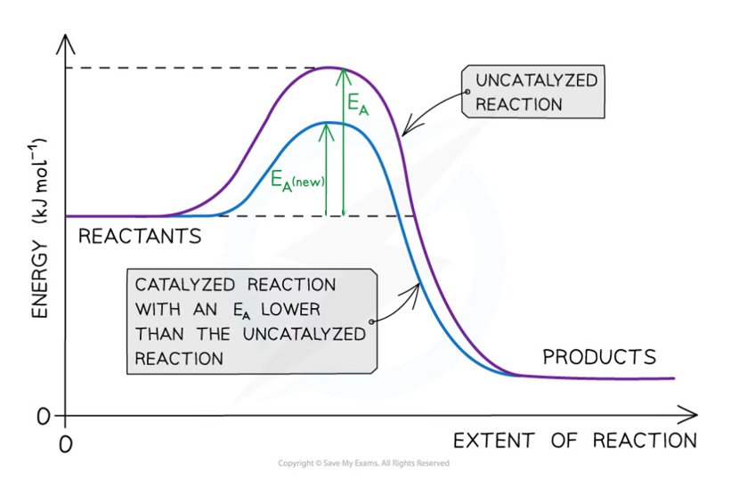
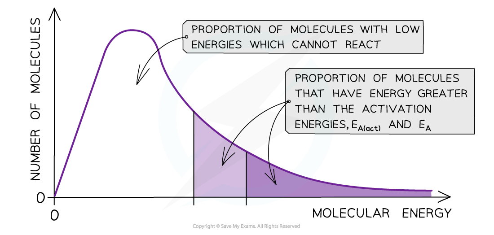

# Types of Catalyst

## Explaining How Catalysts Work

> **Spec point** — `spcpt_YSQfmtB7RFM428Q6`

## Explaining How Catalysts Work

- **Catalysis** is the process in which the rate of a chemical reaction is increased, by adding a substance called a **catalyst**
- A catalyst increases the rate of a reaction by providing the reactants with an **alternative reaction pathway** which is **lower in activation energy** than the uncatalysed reaction
- Catalysts can be divided into two types:

  - Homogeneous catalysts
  - Heterogeneous catalysts
- **Homogeneous** means that the catalyst is in the **same phase** as the reactants

  - For example, the reactants and the catalyst are all liquids
- **Heterogeneous** means that the catalyst is in a **different phase** to the reactants

  - For example, the reactants are gases, but the catalyst used is a solid

#### How a catalyst works

*The catalyst speeds up a reaction that would normally be slow due to the high activation energy. The catalyst is not used up in the reaction and does not appear in the overall chemical equation, but it does take part in the reaction mechanism*

#### How catalysts affect the reaction pathway

*The catalyst allows the reaction to take place through a different mechanism, which has a lower activation energy than the original reaction*

### Boltzmann distribution curve

- **Catalysts** enable the reaction to proceed via an alternative pathway with lower activation energy
- By lowering *E**a**, *a **greater proportion **of molecules in the reaction mixture have sufficient energy for an **effective collision**
- As a result of this, the rate of the catalysed reaction is increased compared to the uncatalysed reaction

#### How catalysts affect the number of particles with sufficient energy to react (Ea)

*The total shaded area (both dark and light shading) under the curve shows the number of particles with energy greater than the Ea with a catalyst. This area is much larger than the dark shaded area which shows the number of particles with energy greater than the Ea without a catalyst*
