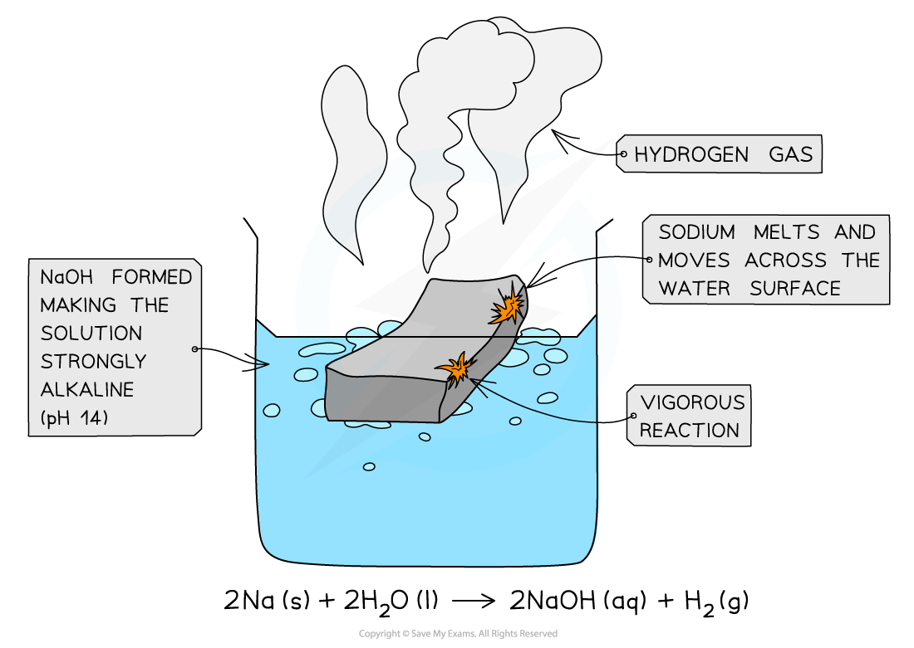
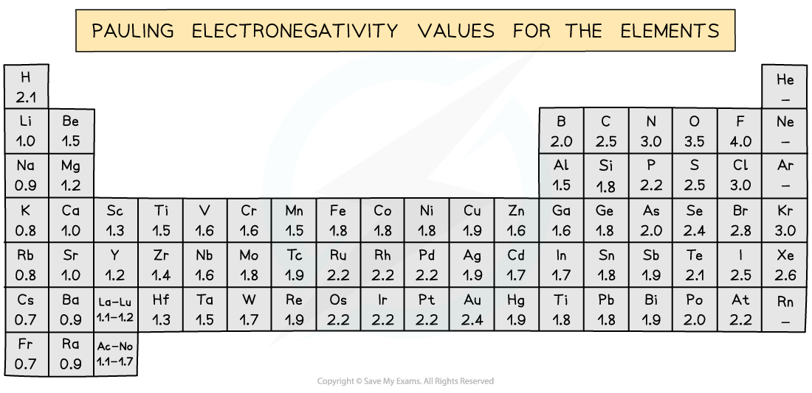

# Reactions of the Period 3 Elements

## Reactions of the Period 3 Elements

> **Spec point** — `spcpt_kCcDrFFyrnT3KYzX`

## Reactions of the Period 3 Elements

### Reactions with oxygen & chlorine

#### Reaction of Period 3 elements with oxygen table

|   | **Chemical equation** | **Reaction conditions** | **Reaction** | **Flame** | **Product** |
|---|---|---|---|---|---|
| **Na** | 4Na (s) + O2 (g) → 2Na2O (s) | Heat | Vigorous | Bright yellow | White solid |
| **Mg** | 2Mg (s) + O2 (g) → 2MgO (s) | Heat | Vigorous | Bright white | White solid |
| **Al** | 4Al (s) + 3O2 (g) → 2Al2O3 (s) | Powdered Al | Fast | Bright white | White powder |
| **Si** | Si (s) + O2 (g) → SiO2 (s) | Powdered Si, heat strongly | Slow | Bright white sparkles | White powder |
| **P** | P4 (s) + 5O2 (g) → P4O10 (s) | Heat, excess oxygen | Vigorous | Yellow or white | White clouds |
| **S** | S (s) + O2 (g) → SO2 (g) | Powdered S, heat | Gentle | Blue | Toxic fumes |

> **Exam Hint**
> - Textbooks sometimes show the combustion of phosphorus as
> 
>   - 4P + 5O2 → P4O10
>   - But this shorthand isn’t safe for exams
> - Phosphorus exists as P4 molecules, as stated in the syllabus and mark schemes
> - So, you should write reactions with P4
> - Also, be careful with phosphorus(V) oxide:
> 
>   - Examiners expect the molecular formula P4O10, not the empirical formula P2O5

#### Reaction of Period 3 elements with chlorine table

|   | **Chemical equation** | **Reaction conditions** | **Reaction** |
|---|---|---|---|
| **Na** | 2Na (s) + Cl2 (g) → 2NaCl (s) | Heat | Vigorous |
| **Mg** | Mg (s) + Cl2 (g) → MgCl2 (s) | Heat | Vigorous |
| **Al** | 2Al (s) + 3Cl2 (g) → Al2Cl6 (s) | Heat | Vigorous |
| **Si** | Si (s) + 2Cl2 (g) → SiCl4 (l) | Heat | Slow |
| **P** | P4 (s) + 10Cl2 (g) → 4PCl5 (l) | Heat, excess chlorine | Slow |

### Reaction of sodium with water

- Sodium reacts **vigorously **with **cold water**:

**2Na (s) + 2H****2****O (l) → 2NaOH (aq) + H****2 ****(g)**

- The sodium **melts** into a ball and moves across the water surface until it disappears
- **Hydrogen gas** is given off
- The solution formed is **strongly** **alkaline** (pH 14) due to the **sodium hydroxide** which is formed

#### The reaction of sodium with cold water

*Sodium fizzes while vigorously reacting with water to form sodium hydroxide*

### Reaction of magnesium with water

- Magnesium reacts **extremely slowly **with cold water:

**Mg (s) + 2H****2****O (l) → Mg(OH)****2 ****(aq) + H****2 ****(g)**

- The solution formed is **weakly** **alkaline** (pH 11) as the formed **magnesium hydroxide **is only **slightly soluble**
- When magnesium is **heated**, it reacts **vigorously **with steam (water) to make magnesium oxide and hydrogen gas:

**Mg (s) + H****2****O (g) → MgO (s) + H****2 ****(g)**

## Oxidation Number of Period 3 Oxides & Chlorides

> **Spec point** — `spcpt_qCCdRZPVCkRJRmqG`

## Oxidation Number of Period 3 Oxides & Chlorides

- Chlorine is more **electronegative **than the other Period 3 elements

  - Therefore, the other Period 3 elements will generally have **positive oxidation states **in their chlorides, while the chlorine has a **negative oxidation state **of -1
- Oxygen is more **electronegative** than any of the Period 3 elements

  - Therefore, the Period 3 elements will have **positive oxidation states **in their oxides, while the oxygen has a **negative oxidation state **of -2

#### The Pauling scale of electronegativity

*The Pauling scale shows that chlorine has a higher electronegativity than the other Period 3 elements and oxygen has a higher electronegativity than all of the Period 3 elements*

### Oxidation numbers of Period 3 elements in their oxides

- The normal [Oxidation Number Rules](https://www.savemyexams.com/a-level/chemistry/cie/25/revision-notes/6-electrochemistry/6-1-redox-processes-electron-transfer-and-changes-in-oxidation-number-oxidation-state/oxidation-number-rules/) apply to the Period 3 oxides

#### Table of formulae of the Period 3 oxides & the elements oxidation numbers

| **Period 3 element** | **Na** | **Mg** | **Al** | **Si** | **P** | **S** |
|---|---|---|---|---|---|---|
| **Formula of oxide** | Na2O | MgO | Al2O3 | SiO2 | P4O10 | SO2 SO3 |
| **Oxidation number of the Period 3 element** | +1 | +2 | +3 | +4 | +5 | +4 +6 |

> **Exam Hint**
> - SiO2 is not written in the specification as expected knowledge but you should be able to apply the oxidation number rules to this and other chemicals

> **Worked Example**
> **Deducing oxidation numbers of Period 3 elements in their oxides**
> 
> State the oxidation number of the bold atoms in these compounds or ions.
> 
> 1. **Na**2O
> 2. **Al**2O3
> 3. ** P**4O10
> 
> **Answer**
> 
> 1. **Na**2O
> 
>   - 1 O atom = –2
>   - The overall charge of the compound = 0
>   - 2 Na atoms = +2
>   - Oxidation number of 1 Na atom = (+2) / 2 = +1
> 2. **Al**2O3
> 
>   - 3 O atoms = 3 x (–2) = –6
>   - The overall charge of the compound = 0
>   - 2 Al atoms = +6
>   - Oxidation number of 1 Al atom = (+6) / 2 = +3
> 3. ** P**4O10
> 
>   - 10 O atoms = 10 x (–2) = –20
>   - The overall charge of the compound = 0
>   - 4 P atoms = +20
>   - Oxidation number of 1 P atom = (+20) / 4 = +5

### Oxidation numbers of Period 3 elements in their chlorides

- The normal [Oxidation Number Rules](https://www.savemyexams.com/a-level/chemistry/cie/25/revision-notes/6-electrochemistry/6-1-redox-processes-electron-transfer-and-changes-in-oxidation-number-oxidation-state/oxidation-number-rules/) apply to the Period 3 chlorides

#### Table of formulae of the Period 3 chlorides & the elements oxidation numbers

| **Period 3 element** | **Na** | **Mg** | **Al** | **Si** | **P** |
|---|---|---|---|---|---|
| **Formula of chloride** | NaCl | MgCl2 | AlCl3 | SiCl4 | PCl5 |
| **Oxidation number of the Period 3 element** | +1 | +2 | +3 | +4 | +5 |

> **Worked Example**
> **Deducing oxidation numbers of Period 3 elements in their chlorides**
> 
> State the oxidation number of the bold atoms in these compounds or ions.
> 
> 1. **Mg**Cl2
> 2. **Al**Cl3
> 3. **P**Cl5
> 
> **Answer**
> 
> 1. **Mg**Cl2
> 
>   - 2 Cl atoms = 2 x (–1) = –2
>   - The overall charge of the compound = 0
>   - Oxidation number of 1 Mg atom = +2
>   - Or, the oxidation number of a Group 2 metal is +2
> 2. **Al**Cl3
> 
>   - 3 Cl atoms = 3 x (–1) = –3
>   - The overall charge of the compound = 0
>   - Oxidation number of 1 Al atom = +3
> 3. **P**Cl5
> 
>   - 5 Cl atoms = 5 x (–1) = –5
>   - The overall charge of the compound = 0
>   - Oxidation number of 1 P atom = +5

## Reaction of Period 3 Oxides & Water

> **Spec point** — `spcpt_K3fJxvFZ56vnRxB5`

## Reaction of Period 3 Oxides & Water

- Not all Period 3 oxides **react** with or are **soluble** in water

#### Reaction of Period 3 oxides with water table

| **Oxide** | **Chemical equation** | **pH** | **Comments** |
|---|---|---|---|
| **Na****2****O** | Na2O (s) + H2O (l) → 2NaOH (aq) | 12 - 14 (Strongly alkaline) | - |
| **MgO** | MgO (s) + H2O (l) → Mg(OH)2 (aq) | 8 - 10 (Weakly alkaline) | - |
| **Al****2****O****3** | No reaction | - | Al2O3 is insoluble in water |
| **SiO****2** | No reaction | - | SiO2 is insoluble in water |
| **P****4****O****10** | P4O10 (s) + 6H2O (l) → 4H3PO4 (aq) | 3 - 4 (Weakly acidic) | Vigorous reaction |
| **SO****2** | SO2 (g) + H2O (l) ⇌ H2SO3 (aq) | 1 - 2 (Strongly acidic) | - |
| **SO****3** | SO3 (g) + H2O (l) → H2SO4 (aq) | 1 - 2 (Strongly acidic) | - |

> **Exam Hint**
> - Since aluminium oxide does not react or dissolve in water, the oxide layer protects the aluminium metal from corrosion
> - The reaction of silicon(IV) oxide is not required knowledge
