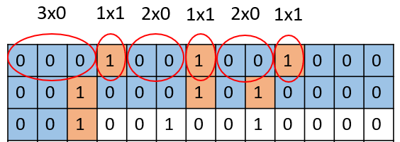

# Compression Techniques

## File compression

> **Spec point** — `spcpt_fmwRkQgR9K4kRNxC`

## File compression

### MP3 (MPEG-1 Audio Layer 3) - Audio compression

- MP3 uses **audio compression** to reduce file size
- A typical music file can be reduced by **up to 90%** (e.g. 80 MB to 8 MB)
- MP3 files are used on:

  - **MP3 players**
  - **Computers**
  - **Smart phones**
- Music can be:

  - **Downloaded or streamed** from the internet
  - **Converted from a CD** to MP3 format
- MP3 quality isn’t as high as the original CD, but it’s **good enough for most people**
- MP3 uses **perceptual music shaping** to remove sounds we don’t notice:

  - Frequencies **outside human hearing range**
  - **Quieter sounds** that are masked by louder ones
- This makes the file smaller **without a big drop in quality**
- MP3 is a **lossy** format:

  - Some original data is **permanently lost**
  - You **can’t get the original file back**

### MPEG-4 (MP4) - Multimedia file format

- MP4 is similar to MP3, but stores **more than just audio**
- It can store:

  - **Music**
  - **Videos**
  - **Photos**
  - **Animations**
- Commonly used for **streaming videos** over the internet
- MP4 uses **compression** to keep file size small
- Maintains **high quality** without noticeable loss to the viewer

### Images

- **Bitmap images can be compressed**, the file size and quality are reduced
- **JPEG** is the most common file format for bitmap images
- The JPEG **compression algorithm creates a new file**, so the original file can no longer be used
- **Vector** graphics can also be compressed but **with limited success**
- **Scalable vector graphics **(.svg) use an XML text file which means that allows them to be compressed.

## Run-length encoding (RLE)

> **Spec point** — `spcpt_kPFqHZBnn5Wk2ztV`

## Run-length encoding (RLE)

### What is run-length encoding?

- Run-length encoding (**RLE**) is a form of data compression that **condenses identical elements into a single value **with a count

#### Text data

- For text data containing the string "**AAAABBBCCDAA**", the plain RLE encoding would be "**4A3B2C1D2A**"
- The string has:

  - four 'A's (**4A**)
  - three 'B's (**3B**)
  - two 'C's (**2C**)
  - one 'D' (**1D**)
  - two 'A's (**2A**)
- To represent this in binary, the** count is stored in a fixed size binary format** (e.g. 7 or 8 bits)
- The character is stored using its **ASCII** value (7 bits)
- The binary RLE representation of **4A **would be ***0000100 1000001***

  - ***0000100**** *- binary for the count (4)
  - ***1000001**** *- binary for 'A' (65)

#### Images

- Run-length encoding (**RLE**) uses **frequency/data pairs** to compress **bitmap** **image **data
- For example, the following bitmap image with a** bit depth of 1 bit** would have the following binary bit pattern

| **Bitmap** | **Bit pattern** |
|---|---|
|  |  |

- Using RLE we** group pixel colours** and can create frequency/data pairs as follows

  - 3**0**, 1**1**, 2**0**, 1**1**, 2**0**, 1**1**, 5**0**, 1**1**, 3**0**, 1**1**, 1**0**, 1**1**, 6**0**, 1**1**......

- **3 x 0 =** 3 x white, **1 x 1 =** 1 x black
- Data pairs **can carry over on to the next line**, e.g. end of first line and start of second line is 5 x 0 (**5 x white**)
- The **original **file would need to use** 195 bits** of storage space
- The **RLE compressed** file would need use **38 bits** of storage space, **a saving of 157 bits (80%)**
- For images using more **than two colours**, the *RGB* value for each colour is stored along with the count
- For example, an image using the following four colours:

| Colour | Red | Green | Blue |
|---|---|---|---|
| **Black** | 0 | 0 | 0 |
| **White** | 255 | 255 | 255 |
| **Red** | 255 | 0 | 0 |
| **Green** | 0 | 255 | 0 |

- The data stored could look like:

  - *10 0 0 0 5 255 0 0 3 0 255 0*
- **Ten black pixels** ((10) 0 0 0) - count + RGB
- **Five red pixels** ((5) 255 0 0) - count + RGB
- **Three green pixels** ((3) 0 255 0) - count + RGB
