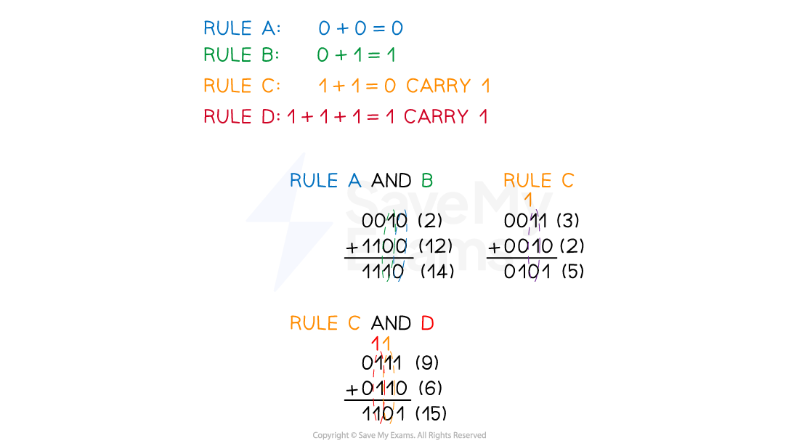

# Binary Arithmetic

## Binary addition

> **Spec point** — `spcpt_mCYbQ4tNrZf2sRYp`

## Binary addition

### What is binary addition?

- Binary addition involves** summing numbers in base-2**, which uses only the digits 0 and 1
- Like denary addition, start from the** rightmost digit** and move towards the left
- **Carrying over** occurs when the sum of a column is greater than 1, passing the excess to the next left column

### Example addition

> **Worked Example**
> Add the following two binary integers using binary addition. Show your working. **[2]**
> 
> 1 0 0 1 1 0 1 0  + 0 0 1 0 1 1 1 1
> 
> **Final answer:** **Answer**
> 
> | carry |   | 1 | 1 | 1 | 1 | 1 |   |   |
> |---|---|---|---|---|---|---|---|---|
> |   | 1 | 0 | 0 | 1 | 1 | 0 | 1 | 0 |
> | **+** | 0 | 0 | 1 | 0 | 1 | 1 | 1 | 1 |
> |   | **Final answer:** **1** | **Final answer:** **1** | **Final answer:** **0** | **Final answer:** **0** | **Final answer:** **1** | **Final answer:** **0** | **Final answer:** **0** | **Final answer:** **1** |
> 
> - 1 mark for working ** [1 mark]**
> - 1 mark for answer ** [1 mark]**

## Overflow

> **Spec point** — `spcpt_Xx75Cy99C8czCVfW`

## Overflow

### What is an overflow?

- Overflow occurs when the sum of two binary numbers** exceeds the given number of bits**
- In** signed number** representations, the leftmost bit often serves as the sign bit; overflow can flip this, incorrectly changing the sign of the result
- Overflow generally leads to **incorrect or unpredictable results** as the extra bits are truncated or wrapped around

## Binary subtraction

> **Spec point** — `spcpt_9R8nsRMhTH6vBgbw`

## Binary subtraction

- To carry out subtraction, the number being subtracted is **converted into its negative equivalent** using two's complement
- The two numbers are then** added together**

#### Example

- 48 - 12

|   | **-128** | **64** | **32** | **16** | **8** | **4** | **2** | **1** |   |
|---|---|---|---|---|---|---|---|---|---|
|   | *0* | *0* | *1* | *1* | *0* | *0* | *0* | *0* | **= 48** |
|   | *0* | *0* | *0* | *0* | *1* | *1* | *0* | *0* | **= 12** |
|   | **find two's complement of -12** |   |   |   |   |   |   |   |   |
|   | *0* | *0* | *0* | *0* | *1* | *1* | *0* | *0* | **= 12** |
|   | **invert** |   |   |   |   |   |   |   |   |
|   | *1* | *1* | *1* | *1* | *0* | *0* | *1* | *1* |   |
|   | **add 1** |   |   |   |   |   |   |   |   |
|   |   |   |   |   |   |   |   | *1* |   |
|   | **result** |   |   |   |   |   |   |   |   |
|   | *1* | *1* | *1* | *1* | *0* | *1* | *0* | *0* | **= -12** |
|   | **Add 48 and -12** |   |   |   |   |   |   |   |   |
|   | **-128** | **64** | **32** | **16** | **8** | **4** | **2** | **1** |   |
|   | *0* | *0* | *1* | *1* | *0* | *0* | *0* | *0* | **= 48** |
|   | *1* | *1* | *1* | *1* | *0* | *1* | *0* | *0* | **= -12** |
|   | **carries** |   |   |   |   |   |   |   |   |
| *1* | *1* | *1* | *1* |   |   |   |   |   |   |
|   | **result** |   |   |   |   |   |   |   |   |
|   | *0* | *0* | *1* | *0* | *0* | *1* | *0* | *0* | **= 36** |

- 48 - 12 = **36**
- The **additional overflow bit is ignored** leaving a result of *0010 0100*, denary equivalent of **36**, which is the **correct answer**
- In **two's complement** arithmetic, the **overflow bit** does not contribute to the actual value of the operation but is more of a **by-product** of the method
